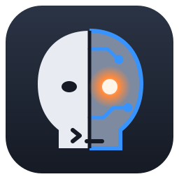
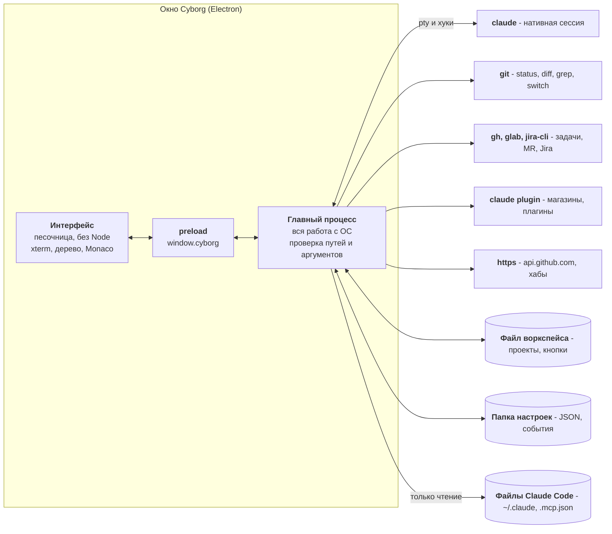

<p align="center">
  
</p>

<h1 align="center">AICyborg</h1>

<p align="center">
  <b>Рабочее место для параллельных сессий Claude Code</b>
  <br />
  Терминал, дерево файлов с git-статусом, задачи и MR рядом с каждой сессией.
  <br />
  Сам <code>claude</code> остаётся настоящим.
  <br />
  <br />
  <a href="https://github.com/dex-it/ai-cyborg/actions/workflows/ci.yml"></a>
  
  
  
  <br />
  <br />
  <a href="#зачем">Зачем</a>
  ·
  <a href="#возможности">Возможности</a>
  ·
  <a href="#быстрый-старт">Быстрый старт</a>
  ·
  <a href="#клавиши">Клавиши</a>
  ·
  <a href="https://dex-it.github.io/ai-cyborg/">Документация</a>
  ·
  <a href="#разработка">Разработка</a>
</p>

## Зачем

Три-четыре параллельные сессии `claude` расползаются по терминалам, а что каждая из них меняет в репозитории, приходится выяснять отдельно. Cyborg собирает их в одно окно и держит рядом с каждой сессией то, за чем обычно идут в другие окна:

- **её файлы и git**: дерево с веткой, числом изменений и статусом файлов, просмотр и сравнение с HEAD;
- **задачи и MR** из GitHub и GitLab, с которых можно начать сессию в один клик;
- **статус проекта**: упавшие пайплайны, замечания, задачи Jira и MR на вашем ревью в одной карточке;
- **кнопки-команды**: «Сливай», «Сделай PR», «Мердж» и свои фразы одним нажатием или клавишей;
- **расширения Claude Code**: магазины плагинов, скиллы, серверы MCP, установка и удаление.

> [!NOTE]
> Cyborg запускает обычный CLI `claude` в терминале и ничего в нём не подменяет. История сессий та же, что при запуске из консоли, и любую сессию можно продолжить в любом месте.

## Возможности

Подробности по каждой возможности - на [сайте документации](https://dex-it.github.io/ai-cyborg/features/).

| | |
|---|---|
| [**Сессии**](https://dex-it.github.io/ai-cyborg/features/sessions/) | Сколько угодно сессий во вкладках; уведомление, когда сессия ждёт вас; прошлые сессии проекта можно продолжить или удалить. |
| [**Изоляция**](https://dex-it.github.io/ai-cyborg/features/isolation/) | Параллельные сессии в одних репозиториях знают друг о друге и уходят каждая в свой worktree до первой правки. |
| [**Дерево и просмотр**](https://dex-it.github.io/ai-cyborg/features/tree/) | У каждой сессии своё дерево: ветка, число изменений, git-статус обновляются сами, а ушла сессия в worktree - дерево идёт за ней. Просмотр с подсветкой Monaco только на чтение. Ветку можно сменить кликом, пока в репозитории нет работающей сессии. |
| [**Поиск**](https://dex-it.github.io/ai-cyborg/features/search/) | Файл по имени, строка в содержимом файлов и среди изменений; подстрока, слово или регулярное выражение, переход к строке. |
| [**Задачи и MR**](https://dex-it.github.io/ai-cyborg/features/tasks-mrs/) | GitHub и GitLab по remote репозиториев проекта: метки, фильтры «Author / Assignee / Reviewer: я», пайплайны, апрувы. Чужой MR - сессии на ревью (нужен плагин `dex-auto`, см. «Быстрый старт»), свой - на доработку по замечаниям. |
| [**Статус**](https://dex-it.github.io/ai-cyborg/features/status/) | Кнопка в полосе сессий: индикатор худшего состояния и карточка с задачами Jira на вас, вашими MR с упавшим пайплайном или замечаниями и MR на ревью. Jira читается через `jira-cli`. |
| [**Кнопки-команды**](https://dex-it.github.io/ai-cyborg/features/commands/) | Полоса под терминалом: встроенные кнопки (`F1`-`F4`) и свои фразы и слеш-команды, подстановки `{branch}`, `{pr}`, `{task}`. Общий набор и набор воркспейса правятся в Monaco, следующие шаги предлагает и сама модель. |
| [**Расширения**](https://dex-it.github.io/ai-cyborg/features/extensions/) | Магазины плагинов, установленные плагины и скиллы, серверы MCP по областям «Сессия», «Проект», «Везде»; установка, удаление, хабы магазинов, статистика вызовов. |
| [**Проекты и воркспейсы**](https://dex-it.github.io/ai-cyborg/start/first-run/) | Проект - набор локальных репозиториев под одним именем. Проекты лежат в файле воркспейса по любому пути (`team.cyborg.json`); другой воркспейс открывается отдельным окном, один файл - в одном окне. |
| [**Путь в промпт**](https://dex-it.github.io/ai-cyborg/features/path-drop/) | Строку дерева или файл из файлового менеджера можно перетащить на терминал: вставится абсолютный путь. |

## Быстрый старт

Нужны:

- macOS или Linux (на Windows не проверялось);
- Node.js 24, npm и git;
- [Claude Code](https://docs.claude.com/en/docs/claude-code): команда `claude` в `PATH`, вход выполнен;
- для задач и MR - залогиненные [`gh`](https://cli.github.com/) и/или [`glab`](https://gitlab.com/gitlab-org/cli); токены Cyborg не хранит, работает под их входом;
- для Jira - настроенный [`jira-cli`](https://github.com/ankitpokhrel/jira-cli) (`jira me` называет вас), токен Cyborg не читает;
- для действия «Ревью» у MR - плагин `dex-auto` из каталога [ai-kit](https://dex-it.github.io/ai-kit/): сессия получает команду `/dex-auto:auto review <ссылка>`. «Доработать» и старт по задаче плагина не требуют.

```bash
git clone https://github.com/dex-it/ai-cyborg.git
cd ai-cyborg
./cyborg
```

При первом запуске `./cyborg` поставит зависимости (`npm install` пересобирает нативный модуль терминала под Electron, Electron докачивает свой бинарь), соберёт приложение и откроет окно. Запускайте из терминала: приложение берёт `PATH` процесса, из которого запущено, и при запуске из Dock или Finder `gh` и `glab` могут не найтись.

**Первые шаги.** Окно предложит создать воркспейс: имя, файл и первый проект с репозиториями. Новые проекты добавляет «Воркспейс → Новый проект»; в свойствах проекта включаются источники задач и Jira. Затем «Новая сессия». Другой воркспейс открывается отдельным окном: «Воркспейс → Открыть в новом окне…» или `./cyborg --workspace файл.cyborg.json`.

<details>
<summary>Песочница Chromium на Linux</summary>

Песочнице Chromium нужен либо setuid `chrome-sandbox`, либо непривилегированные user namespaces. Нет ни того, ни другого - скрипт сам добавит `--no-sandbox` и скажет об этом. Чтобы песочница работала, один раз выполните:

```bash
sudo chown root node_modules/electron/dist/chrome-sandbox
sudo chmod 4755 node_modules/electron/dist/chrome-sandbox
```

</details>

## Клавиши

| Действие | Linux | macOS |
|---|---|---|
| Новая сессия | `Ctrl+Shift+N` | `Cmd+Shift+N` |
| Размер шрифта терминала и файлов | `Ctrl+колесо`, сброс `Ctrl+0` | `Cmd+колесо`, сброс `Cmd+0` |
| Копировать и вставить в терминале | `Ctrl+Shift+C`, `Ctrl+Shift+V` | `Cmd+C`, `Cmd+V` |
| Найти файл | `Ctrl+Shift+P` | `Cmd+P` |
| Найти в файлах, найти в изменениях | `Ctrl+Shift+F`, `Ctrl+Shift+D` | `Cmd+Shift+F`, `Cmd+Shift+D` |
| Расширения: магазины | `Ctrl+Shift+X` | `Cmd+Shift+X` |
| Встроенные кнопки-команды | `F1`-`F4` | `F1`-`F4` (на macOS с `Fn`, если F-клавиши не стандартные) |

Полный список - в [справке по клавишам](https://dex-it.github.io/ai-cyborg/reference/hotkeys/).

## Как это устроено

Electron-приложение на TypeScript. Сессии запускаются в pty ([node-pty](https://github.com/microsoft/node-pty)), терминал - xterm.js, просмотр файлов - Monaco. О том, что делает сессия, Cyborg узнаёт из хуков Claude Code: при запуске он добавляет их через `--settings`, не трогая ваших настроек. Всё остальное - вызовы `git`, `gh`, `glab`, `jira-cli` и `claude plugin`.



Подробно - жизнь сессии, границы доверия, источники данных и решения - на странице [«Архитектура»](https://dex-it.github.io/ai-cyborg/concepts/architecture/).

## Границы

- **Файлы репозиториев не правит**: их меняет сессия или ваш редактор. Исключение - окно «Расширения» по вашей команде: `claude plugin` с областью «Проект» пишет в `.claude/settings.json` репозитория.
- **Пишет только своё**: файл воркспейса (проекты и кнопки); в папке настроек `commands.json`, `prompts.json`, `hubs.json`, `extensions-usage.json`, `recent-workspaces.json`, хуки и события сессий; рядом с воркспейсом замок `<файл>.lock`. Из git меняет только ветку: `git switch` по вашему клику. Команды git над чужими репозиториями идут с отключёнными хуками и fsmonitor; ветку Cyborg не сменит, если конфиг репозитория мог бы запустить при этом команду (`filter.*`, докачка partial clone) - такую переключите в терминале.
- **Не коммитит и не пушит**, в трекер, MR и Jira не пишет: это делает агент сессии.
- **Не запускает сессии сам**: по пайплайну, задаче или MR сессию открывает только ваше нажатие.
- **Без своего клиента модели**, работает с локальными репозиториями и локальным `claude`. Сеть: задачи и MR - через `gh` и `glab`, Jira - через `jira-cli`; хабы магазинов читают `api.github.com`, `raw.githubusercontent.com` и https-адреса ваших хабов; `claude plugin` и `claude mcp list` ходят в сеть по правилам Claude Code.

## Статус

Ранняя версия: приложение запускается из исходников, установщиков и подписанных сборок нет. Проверено на macOS (Apple Silicon) и Linux; каждый PR проходит CI на обеих системах. Упаковка в `.app` и `.dmg`, запуск из Dock и Finder и Windows пока не поддерживаются. Jira проверена по тестам и на живом сервере Jira Server 9.2; Jira Cloud и Data Center вживую не проверялись.

## Документация

Сайт: <https://dex-it.github.io/ai-cyborg/> - установка, возможности, устройство, FAQ. Требования и решения проекта лежат в [`docs/`](docs/README.md): BRD продукта, требования по фичам, ADR.

## Разработка

```bash
npm run build         # сборка в dist/
npm run typecheck     # проверка типов
npm test              # тесты (node --test)
npm run check:corpus  # согласованность корпуса docs/ (после правки SRS: npm run corpus:matrix)
npm run smoke         # дымовой тест окна: сессия, клавиши, дерево (нужен дисплей)
npm start             # сборка и запуск
```

Код: `src/main/` - главный процесс (сессии, git, трекеры), `src/renderer/` - интерфейс, `site/` - сайт документации (Astro и Starlight; страницы лежат в `docs/guide/`).

Каждый PR и пуш в `master` проверяет GitHub Actions на macOS и Linux ([`ci.yml`](.github/workflows/ci.yml)): установка, сборка, типы, `npm test` и `npm run smoke`; отдельно - `npm run check:corpus`. Сайт собирается и публикуется отдельным workflow ([`docs-site.yml`](.github/workflows/docs-site.yml)).

Работа идёт циклом «требования → разработка → фиксация истины»: изменение поведения сопровождается правкой корпуса в `docs/`, правила описаны в [`CLAUDE.md`](CLAUDE.md).
