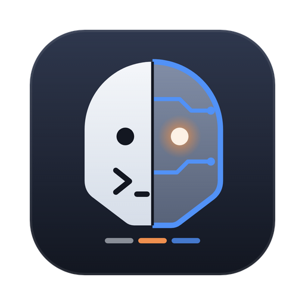
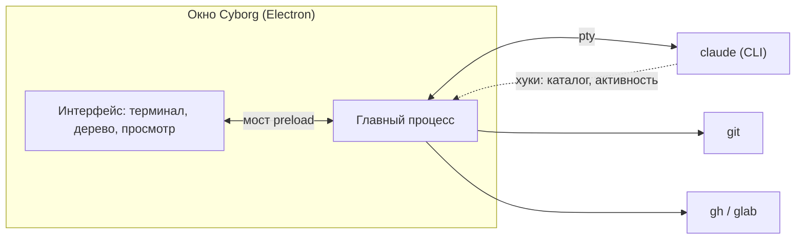

<p align="center">
  
</p>

<h1 align="center">Cyborg</h1>

<p align="center">
  Одно окно для нескольких сессий Claude Code.
  <br />
  Терминал, дерево файлов с git-статусом, задачи и MR рядом с каждой сессией.
  <br />
  <br />
  <a href="https://github.com/dex-it/ai-cyborg/actions/workflows/ci.yml"></a>
  
  
  
  <br />
  <br />
  <a href="#возможности">Возможности</a>
  ·
  <a href="#быстрый-старт">Быстрый старт</a>
  ·
  <a href="#клавиши">Клавиши</a>
  ·
  <a href="https://dex-it.github.io/ai-cyborg/">Документация</a>
  ·
  <a href="#разработка">Разработка</a>
</p>

## О проекте

Когда параллельно идут три-четыре сессии `claude`, они расползаются по терминалам, а что каждая из них меняет в
репозитории, приходится выяснять отдельно. Cyborg собирает их в одно окно: у каждой сессии рядом с терминалом видно её
дерево файлов, ветку и git-изменения, файл открывается тут же. Задачи и MR из GitHub и GitLab лежат на соседней
панели, и сессию можно начать прямо с них.

Claude Code при этом остаётся настоящим: Cyborg запускает обычный CLI `claude` в терминале и ничего в нём не
подменяет. История сессий та же, что при запуске из консоли, и любую из них можно продолжить в любом месте.

## Возможности

| | |
|---|---|
| **Проекты** | Набор локальных репозиториев под одним именем. Сессия стартует в одном из них, остальные подключаются к ней как дополнительные каталоги. |
| **Сессии** | Сколько угодно сессий Claude Code во вкладках. Прошлые сессии проекта на вкладке «Сессии»: их можно продолжить или удалить. |
| **Дерево файлов** | У каждой сессии своё: ветка, число изменений и git-статус файлов обновляются сами, пока сессия работает. Если сессия ушла в отдельный worktree, дерево переходит за ней. |
| **Просмотр файлов** | Подсветка синтаксиса (Monaco), только на чтение. Изменённый файл можно сравнить с версией в HEAD. |
| **Смена ветки** | Кликом по ветке в дереве, когда в репозитории не работает сессия. Пока работает, веткой управляет она. |
| **Задачи** | Из GitHub и GitLab по remote репозиториев проекта: метки, фильтр по меткам, детали задачи, открытие в браузере и старт сессии по задаче. |
| **MR и PR** | Тех же репозиториев: фильтры «Author / Assignee / Reviewer: я», пайплайны и апрувы. Чужой MR можно отдать сессии на ревью (нужен плагин `dex-auto`, см. «Быстрый старт»), свой - на доработку по замечаниям. |
| **Путь в промпт** | Строку дерева или файл из файлового менеджера можно перетащить на терминал сессии, и в промпт вставится абсолютный путь. |
| **Изоляция сессий** | Параллельные сессии в одних и тех же репозиториях Cyborg изолирует: каждой он сообщает, что рядом работают другие, и сессия уходит в свой worktree до первой правки. |

## Быстрый старт

Нужны:

- macOS или Linux (на Windows не проверялось);
- Node.js 24 и npm, git;
- [Claude Code](https://docs.claude.com/en/docs/claude-code): команда `claude` в `PATH`, вход уже выполнен;
- для задач и MR - залогиненные [`gh`](https://cli.github.com/) и/или [`glab`](https://gitlab.com/gitlab-org/cli).
  Свои токены Cyborg не хранит, работает под их входом.
- для действия «Ревью» у MR - плагин `dex-auto` в Claude Code из каталога [ai-kit](https://dex-it.github.io/ai-kit/):
  сессия получает команду `/dex-auto:auto review <ссылка>`. «Доработать» и старт по задаче плагина не требуют.

```bash
git clone https://github.com/dex-it/ai-cyborg.git
cd ai-cyborg
./cyborg
```

При первом запуске `./cyborg` поставит зависимости (`npm install` пересобирает нативный модуль терминала под Electron;
Electron при этом докачивает свой бинарь), соберёт приложение и откроет окно. Дальше можно запускать его же или положить
ссылку на него в `PATH`. Запускайте из терминала: приложение берёт `PATH` процесса, из которого запущено, и при запуске
из Dock или Finder `gh` и `glab` могут не найтись.

Первые шаги: ⚙ → «Новый проект», добавить репозитории, при желании включить источники задач, сохранить. Затем
`+ CC` - новая сессия.

<details>
<summary>Песочница Chromium на Linux</summary>

Песочнице Chromium нужен либо setuid `chrome-sandbox`, либо непривилегированные user namespaces. Нет ни того, ни
другого - скрипт сам добавит `--no-sandbox` и скажет об этом. Чтобы песочница работала, один раз выполните:

```bash
sudo chown root node_modules/electron/dist/chrome-sandbox
sudo chmod 4755 node_modules/electron/dist/chrome-sandbox
```

</details>

## Клавиши

| Действие | Linux | macOS |
|---|---|---|
| Новая сессия | `Ctrl+Shift+N` | `Cmd+Shift+N` |
| Размер шрифта терминала и файлов | `Ctrl+колесо`, сброс `Ctrl+0` | `Cmd+колесо`, сброс `Cmd+0` |
| Копировать и вставить в терминале | `Ctrl+Shift+C`, `Ctrl+Shift+V` | `Cmd+C`, `Cmd+V` |

## Чего не делает

- Не редактирует файлы: правит сессия или ваш редактор.
- Не коммитит и не пушит, в трекер и MR не пишет. Это делает агент сессии.
- Работает только с локальными репозиториями и локальным `claude`, без своего клиента модели.
- Jira пока не поддерживается.

## Статус

Ранняя версия: приложение запускается из исходников, установщиков и подписанных сборок нет. Проверено на macOS (Apple
Silicon) и Linux; каждый PR проходит CI на обеих системах. Упаковка в `.app` и `.dmg`, запуск из Dock и Finder, Windows
и Jira пока не поддерживаются.

## Как это устроено

Electron-приложение на TypeScript. Сессии запускаются в pty (`node-pty`), терминал - xterm.js, просмотр файлов - Monaco.
О том, что делает сессия, Cyborg узнаёт из хуков Claude Code: при запуске он добавляет их через `--settings`, не трогая
ваших настроек. Задачи и MR берутся через `gh` и `glab`.



Git-команды над чужими репозиториями выполняются с отключёнными хуками и fsmonitor. Смену ветки Cyborg не выполнит, если
конфиг репозитория мог бы запустить при ней команду: фильтры `filter.*` или докачка в partial clone. Такую ветку
переключите в терминале.

## Документация

Сайт: <https://dex-it.github.io/ai-cyborg/> - установка, возможности, устройство, FAQ. Требования и решения проекта
лежат в [`docs/`](docs/README.md): BRD продукта, требования по фичам, ADR.

## Разработка

```bash
npm run build       # сборка в dist/
npm run typecheck   # проверка типов
npm test            # тесты (node --test)
npm run smoke       # дымовой тест окна: сессия, клавиши, дерево (нужен дисплей)
npm start           # сборка и запуск
```

Код: `src/main/` - главный процесс (сессии, git, трекеры), `src/renderer/` - интерфейс, `site/` - сайт документации
(Astro и Starlight; страницы лежат в `docs/guide/`).

Каждый PR и пуш в `master` проверяет GitHub Actions на macOS и Linux
([`ci.yml`](.github/workflows/ci.yml)): установка, сборка, типы, `npm test` и `npm run smoke`. Сайт собирается и
публикуется отдельным workflow ([`docs-site.yml`](.github/workflows/docs-site.yml)).

Работа идёт циклом «требования → разработка → фиксация истины»: изменение поведения сопровождается правкой корпуса в
`docs/`, правила описаны в [`CLAUDE.md`](CLAUDE.md).
