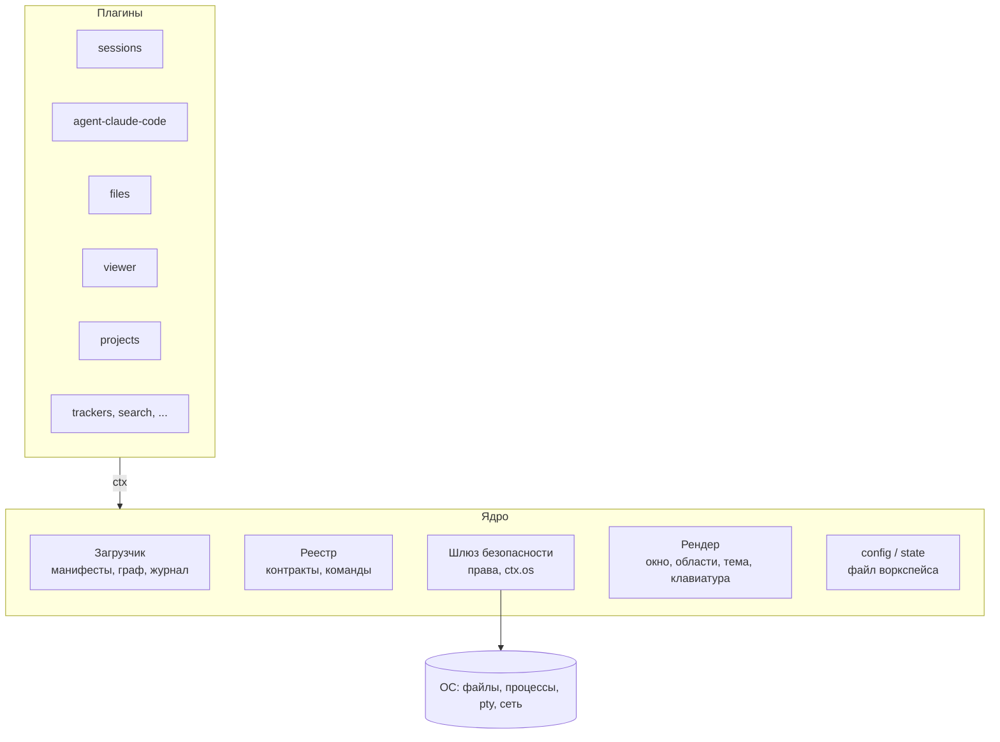
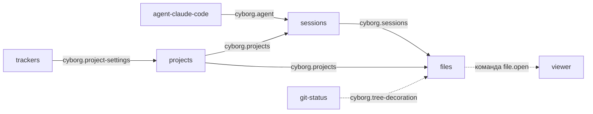
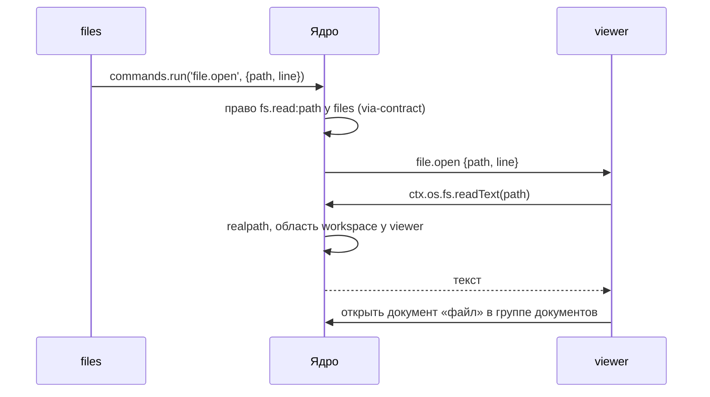

# Ядро и плагины: общая архитектура

> Договорённости владельца и составителя от 2026-11-02 и 2026-11-03, сведённые при разборе пакета. Документ пересматривает границу ядра из [SAD](sad.md): там, где они расходятся, действует этот документ ([раздел 7](#7-расхождения-с-sad-и-adr-пакета)). Интерфейсы - эскизы, сигнатуры фиксируются в P1 [дорожной карты](../../05-plans/roadmap.md).

## 1. Общая архитектура

Cyborg - это **ядро** и набор **равных плагинов**. Ядро не знает предметной области: в нём нет агентов, сессий, терминалов, файлов, проектов и трекеров. Всё это плагины. Ядро загружает плагины, связывает их между собой, следит за правами и даёт им место на экране.



**Процессы.**

| Процесс | Что в нём |
|---|---|
| Главный (Electron main) | ядро: загрузчик, реестр, шлюз, `config`, pty и доступ к ОС |
| Хосты плагинов (`utilityProcess`, один или несколько) | главные части плагинов по группам ([3.7](#37-хосты-плагинов-и-сторож)), каждый в своём `Compartment` (Hardened JS); глобальных объектов Node нет, есть только `ctx` |
| Рендерер | каркас окна от ядра и UI плагинов; сторонний UI - во `<iframe>` со своим origin |

Код плагина не имеет пути к ОС мимо ядра. Поэтому права из манифеста действительно ограничивают плагин, а не служат подсказкой.

## 2. Что есть ядро

Ядро - это хост плагинов плюс модуль `config`, работающий с файлом воркспейса.

**В ядре есть:** загрузчик плагинов, реестр контрактов и команд, шлюз безопасности с `ctx.os`, хранилище секретов и разрешение ссылок на секреты, рендер (окна, области, тема, фокус, клавиатура, меню, слой диалогов), `config` и `state`, журнал плагинов, безопасный режим.

**В ядре нет:** агента и его запуска, сессий и pty-логики сессий, дерева файлов, просмотрщика, проектов, трекеров, уведомлений о сессиях, общей шины событий, реестра сервисов по произвольным ключам на ходу, `inject`, waterfall и guard.

**Центральных плагинов нет.** Хост не выделяет ни один плагин, в коде ядра нет имён плагинов. Окно без плагинов - нормальное состояние: в нём доступно управление плагинами. Поставка Cyborg - это список встроенных плагинов и больше ничего.

## 3. Задачи ядра

### 3.1. Загрузка плагинов

1. Определить воркспейс: `--workspace` или «Недавние»; взять замок `<файл>.lock`.
2. Прочитать `plugins.enabled` (файл пользователя, перекрытый файлом воркспейса). Больше ядру для старта ничего не нужно.
3. Прочитать манифесты, проверить версию API плагина.
4. Разрешить граф контрактов **до запуска кода**: недостающий `requires`, два поставщика при кратности `one`, цикл - плагин не загружается, причина пишется в журнал.
5. Нарисовать каркас окна по манифестам (раздел 3.4).
6. Активировать плагины в порядке графа; активация может быть ленивой - по первому показу вида или первой команде.

Безопасный режим выключает все плагины без исключений. Смена набора плагинов в v1 означает перезапуск хостов и окна: горячей выгрузки и каскада перезапуска нет, но `Disposable` ведутся с первого дня. Процессы агентов и лаяут перезапуск переживают ([3.8](#38-восстановление-сессий-и-окна)).

### 3.2. Связь между плагинами

Ядро ведёт реестр контрактов (`provides` / `requires` / `optional` / `consumes`), реестр команд и каналы между частями одного плагина (хост плагинов и окно). Как плагины этим пользуются - [раздел 4](#4-взаимодействие-плагинов).

### 3.3. Безопасность

Доступ к ОС разбит на пространства имён. Нет права в манифесте - нет объекта в `ctx.os`: ни чтения, ни записи.

| Пространство | Что даёт | Право в манифесте |
|---|---|---|
| `fs.read` / `fs.write` / `fs.watch` | файлы | области путей |
| `process` | запуск программ | список программ, опционально первые аргументы |
| `pty` | терминал | список программ |
| `net` | HTTP | список хостов |
| `shell` | открыть путь или URL в системе | области путей, схемы URL |
| `clipboard` | буфер обмена | `read` / `write` |
| `notify` | системные уведомления | да / нет |
| `env` | переменные окружения | список имён |
| `secrets` | своё хранилище секретов | не нужно, только свои ключи |
| `secrets.ref` | секреты из внешнего источника по ссылке ([3.6](#36-секреты)) | маски ссылок: `vault://kv/data/jira*` |
| `dialog` | выбор файла | не нужно, выбор пользователя сам становится правом |

**Области путей:** `workspace` (репозитории проектов и cwd живых сессий; задают плагины с правом `security.roots`), `plugin-data`, `plugin-temp` (всегда свои), явные пути и маски, `granted` (выбор в `dialog`).

**Правила шлюза:**

- вызывающего ядро определяет по каналу, а не со слов плагина;
- путь проверяется после `realpath`, на открытом дескрипторе; вне области - всегда `PermissionDenied`, никогда `NotFound`;
- защищённые пути закрыты всегда: данные приложения, файл воркспейса и замок, запись в `.git/` (кроме явной области `workspace.git`);
- права через чужой контракт не передаются: член контракта объявляет нужное право, и шлюз проверяет его у **вызывающего** (`reason: 'via-contract'`);
- каждый отказ пишется в журнал плагинов.

**Честная граница:** `process` и `pty` дают программе все права пользователя ОС. Списки аргументов и запрет опасных флагов - смягчение, а не защита; окно подтверждения показывает такое право как «полный доступ через программу».

### 3.4. Рендер

Ядро знает только **роды областей**: боковая колонка с заголовком, основная область с группой документов, панель инструментов основной области, всплывающий слой. Плагин объявляет в манифесте виды и типы документов: род области и `order`.

Расстановка = манифесты + изменения пользователя. Изменения пользователя - это `state`; закрепить расстановку для команды можно явным сохранением в `config` воркспейса. **Предустановленного лаяута нет**: всё известно из данных до запуска кода плагинов, поэтому каркас рисуется сразу.

Ещё в рендере: токены темы и шрифта, слой диалогов, фокус, сочетания клавиш с единой проверкой конфликтов при загрузке, системное меню.

**Средства UI для плагинов.** Общего фреймворка нет: плагин пишет свой UI на чём угодно внутри своего `<iframe>`. Ядро даёт два средства, и оба работают без фреймворка и из любого:

- **токены темы** - CSS-переменные цветов, шрифтов, отступов и радиусов; ядро передаёт их в каждый `<iframe>` и обновляет при смене темы;
- **элементы ядра** - веб-компоненты (Custom Elements) кнопки, поля, списка, дерева, вкладок, пустого состояния и индикатора загрузки, на токенах темы. Плагин подключает их скриптом ядра по адресу, который отдаёт CSP своего origin.

Почему не фреймворк: его версия стала бы частью API плагинов, и мажорное обновление сломало бы все сторонние плагины разом; каждый `<iframe>` всё равно грузит свою копию, так что общий фреймворк не экономит бандл. Набор элементов ядра версионируется вместе с API плагинов ([4.1](#41-версии-контрактов)): элемент не удаляется и не меняет атрибуты в пределах мажорной версии.

**Чужой UI в свой не встраивается - в v1 «задача, а не виджет».** Плагин не монтирует вид другого плагина. Нужен чужой UI - плагин вызывает команду или член контракта владельца; владелец сам показывает свой документ или диалог и возвращает данные:

```ts
// редактор кнопок просит JSON у просмотрщика вместо встраивания Monaco
const text = await viewer.editJson({ title: 'Кнопки', value, schema });  // undefined - пользователь отменил
```

Сегодня редактор кнопок встраивает Monaco (`src/renderer/config-editor.ts:85`); при переносе он переходит на такой вызов. Встраиваемые виды ядро не поддерживает, пока не появится случай, который так не решается (например, составной экран из карточек разных плагинов).

### 3.5. Config и state

| | Config | State |
|---|---|---|
| Что | намеренные настройки | память машины: активный проект, ширины, раскрытые узлы, расстановка |
| Где | файл воркспейса + файл пользователя | каталог приложения, ключ по воркспейсу |
| API | `ctx.config` - только свой раздел | `ctx.state` - только свой раздел |

Значения секретов не лежат ни там, ни там; в `config` допустима только ссылка на секрет ([3.6](#36-секреты)).

```jsonc
{
  "cyborg": 2,
  "plugins": { "enabled": ["sessions", "agent-claude-code", "files", "viewer", "projects", "trackers"] },
  "settings": {
    "projects": { "items": [{ "id": "p1", "name": "Cyborg", "description": "", "repos": ["/home/me/Work/Cyborg"] }] },
    "trackers": { "byProject": { "p1": { "github": true, "gitlab": false, "jira": { "enabled": false, "projects": [] } } } }
  }
}
```

Старый формат `{projects, lastProjectId}` (`src/main/workspaces.ts`, `src/main/projects.ts`) `config` переводит один раз: `id`, `name`, `description`, `repos` - в `settings.projects`; `trackers` и `jira` - в `settings.trackers.byProject`; `lastProjectId` - в state. Это единственное место, где ядро знает чужие поля, и оно удаляется через пару версий.

**Схема и миграции раздела.** Плагин обновился и сменил формат, пользователь поправил файл руками и ошибся - ни то, ни другое не должно ронять плагин или окно.

```jsonc
// манифест плагина
"config": { "schema": "./config.schema.json", "version": 3 },
"state":  { "schema": "./state.schema.json",  "version": 1 }
```

- Ядро проверяет раздел по схеме до активации и при изменении файла воркспейса извне (файл отслеживается).
- Версия раздела ниже версии плагина - ядро до активации вызывает `migrate(fromVersion, data)` плагина и сохраняет результат.
- Версия раздела выше (плагин откатили) - плагин не активируется, раздел не трогается, причина в журнале.
- Раздел не прошёл схему - отказ только этому плагину с записью в журнале; остальные работают.

### 3.6. Секреты

Секреты держатся на двух ролях, и смешивать их нельзя.

1. **Хранилище ядра** (`ctx.os.secrets`, `safeStorage`) - корень доверия. Работает без плагинов; ключи хранятся как `<pluginId>/<key>`, и каждый плагин видит только свои. Без шифрования ОС (Linux без keyring) вызов получает `Unavailable`, а не запись открытым текстом. При удалении плагина его секреты стираются.
2. **Источник секретов** (Vault, 1Password, `pass`) - предметная область, то есть плагин, поставщик контракта `cyborg.secret-source`. Свой собственный токен источник хранит в хранилище ядра.

**Почему источник не подменяет хранилище ядра.** Если ядро отправит все `secrets.get` в плагин, тот увидит секреты всех плагинов, разделение по владельцам перестанет быть заботой ядра, а выключение плагина лишит секретов всех остальных, включая токен самого источника.

**Ссылки.** В `config` лежит не значение, а ссылка:

```jsonc
"trackers": { "byProject": { "p1": {
  "jira": { "enabled": true, "token": { "$secret": "vault://kv/data/jira#token" } }
} } }
```

Ссылка без схемы (`{ "$secret": "jira-token" }`) указывает на хранилище ядра вызывающего плагина, поэтому без источника всё работает как сегодня.

**Контракт.** `cyborg.secret-source`, кратность `many`, но поставщик выбирается по схеме ссылки: два поставщика одной схемы - отказ при загрузке, как при `one`.

```jsonc
// поставщик: vault
"provides": { "cyborg.secret-source": { "version": "1.0", "schemes": ["vault"] } },
"permissions": { "net": ["vault.company.local"] }

// потребитель: trackers
"consumes": { "cyborg.secret-source": { "version": "^1", "many": true } },
"permissions": { "secrets.ref": ["vault://kv/data/jira*", "vault://kv/data/gitlab*"] }
```

```ts
export interface SecretValue { value: string; expiresAt?: number }   // аренда источника

export interface SecretSource {
  /** @requires secrets.ref:ref */
  resolve(ref: string): Promise<SecretValue>;
  /** Пути без значений - для выбора ссылки в форме. */
  /** @requires secrets.ref:prefix */
  list?(prefix: string): Promise<string[]>;
}

// в ctx потребителя
ctx.secrets.resolve(ref: string | { $secret: string }): Promise<SecretValue>;
```

**Как ядро разрешает ссылку.**

1. Проверяет ссылку по праву `secrets.ref` **вызывающего** - тот же механизм `via-contract`, что для `fs.read`. Источник не знает, кто спросил, и не решает, кому что можно.
2. Ссылку без схемы разрешает из своего хранилища, по ключам вызывающего; иначе выбирает поставщика по схеме.
3. Передаёт вызов и возвращает значение. Нет поставщика схемы или он выключен - `Unavailable`; ссылка вне права - `PermissionDenied`.

**Правила.**

- Значение секрета никогда не пишется в `config`, `state` и журнал; ядро не логирует ни результат `resolve`, ни аргументы с ним.
- Ядро значения не кэширует, чтобы аренды и отзыв в источнике работали. Кэш до `expiresAt` - решение потребителя, в его памяти.
- Значение не проходит через третьи плагины: ни через `projects`, ни через форму настроек. Форма хранит только выбор «локально» или «ссылка» и саму ссылку; путь для ссылки помогает выбрать `list()`.
- Окно подтверждения прав показывает у потребителя «читает секреты `vault://kv/data/jira*`», у источника - «отдаёт секреты другим плагинам по их правам».

### 3.7. Хосты плагинов и сторож

`Compartment` изолирует доступ, но не время: плагины одного хоста делят цикл событий. Зависание одного останавливает соседей, падение хоста роняет все его плагины. Поэтому группировкой по хостам управляет пользователь.

```jsonc
"plugins": {
  "enabled": ["sessions", "agent-claude-code", "files", "viewer", "projects", "trackers", "search"],
  "hosts": {
    "builtin":  ["sessions", "agent-claude-code", "files", "viewer", "projects"],
    "trackers": ["trackers", "search"]
  }
}
```

- `plugins.hosts` - часть `config` с теми же уровнями: пользователь и воркспейс.
- По умолчанию встроенные плагины - в хосте `builtin`, каждый сторонний - в своём хосте. Плагин, не названный ни в одной группе, идёт по умолчанию.
- Манифест может попросить отдельный хост (`"host": "own"`). Пользователь вправе переопределить, но «Плагины Cyborg» показывают предупреждение.
- Хосты прозрачны для связей: вызов между плагинами всегда идёт через шлюз ядра, в одном они хосте или в разных.
- **Сторож.** Ядро регулярно проверяет, отвечает ли хост; нет ответа дольше порога - хост перезапускается. Виновник - плагин с незавершённым вызовом или активацией; после нескольких зависаний подряд плагин выключается с записью в журнале. Падение хоста идёт тем же путём. Интервал, порог и число повторов - по замеру в спайке.
- Перезапуск хоста не трогает другие хосты и процессы агентов ([3.8](#38-восстановление-сессий-и-окна)). Плагины хоста активируются заново; потребители из других хостов узнают о пропаже и возврате поставщика из `ctx.contracts.onChange`.
- Цена - память на каждый процесс хоста; сколько именно, замерить в спайке.

### 3.8. Восстановление сессий и окна

| | Перезапуск хоста или окна | Перезапуск приложения |
|---|---|---|
| Процессы агентов | живы: pty принадлежит ядру | завершены |
| Сессии | `sessions` подключается к живым pty | `sessions` поднимает их заново через `resume` агента |
| Лаяут и документы | из state | из state |

**pty переживает плагин.** Ядро держит pty-процессы, пока жив главный процесс. `ctx.os.pty.list()` отдаёт pty своего плагина, `ctx.os.pty.attach(id)` - тот же `PtyHandle` плюс хвост вывода, который ядро хранит в кольцевом буфере. Выключение плагина, владеющего pty, - единственный случай, когда ядро спрашивает, завершать ли процессы.

**Сессии после перезапуска приложения.** `sessions` ведёт в своём state список открытых сессий: `{agent, resumeId, cwd, projectId, title, order}`. При старте вкладки восстанавливаются сразу, а процесс агента запускается через `resume` поставщика `cyborg.agent` при первом показе вкладки - старт с десятью сессиями не поднимает десять `claude`. Настройка `sessions.restore`: `lazy` (по умолчанию), `eager`, `off`.

**Лаяут окна.** Расстановка видов, ширины, открытые документы и их порядок - state ядра. Документ восстанавливается, если его тип объявлен в манифесте как `restorable`: поставщик типа отдаёт `serialize()` (данные) и принимает `restore(data)`. Поставщика нет - вкладка показывается как недоступная, а не пропадает.

**Файл событий хуков.** Сейчас его имя включает pid процесса Cyborg (`src/main/sessions.ts:121`); для подключения после перезапуска оно строится от устойчивого id сессии, а файл лежит в `plugin-data` плагина агента.

## 4. Взаимодействие плагинов

1. **Через контракты, а не друг через друга.** Поставщик не знает потребителей, потребитель не знает поставщика; обе стороны знают только контракт. Контракт - имя, версия и типы; типы лежат в пакете объявлений `@cyborg/contracts` без логики.
2. **Кратность объявляет потребитель.** `one` - ровно один поставщик, при двух ядро отказывает при загрузке и выбор за пользователем. `many` - все поставщики собираются списком.
3. **Ещё два вида связи без зависимости:** команда по имени («пусть сделает кто-нибудь») и тип данных при перетаскивании и в буфере (`application/x-cyborg-path`).
4. **Общей шины событий нет.** Событие - часть контракта того, кто владеет предметом: `sessions.onChange`, `projects.onChange`.
5. **API контракта асинхронный и только с данными.** Обратный вызов - только подписка с `Disposable`. Поэтому тот же API работает через RPC между хостом плагинов и окном.
6. **Подписки привязаны к вызывающему:** ядро снимает их при выгрузке плагина.
7. **Раздел `config` - не канал связи:** плагин видит только свой раздел.

```jsonc
// манифест потребителя
"requires": { "cyborg.sessions": "^1" },
"optional": { "cyborg.projects": "^1" },
"consumes": { "cyborg.tree-decoration": { "version": "^1", "many": true } }
// манифест поставщика
"provides": { "cyborg.tree-decoration": "1.0" }
```

```ts
const decorations = ctx.contracts.all<TreeDecoration>('cyborg.tree-decoration');
ctx.subscriptions.add(ctx.contracts.onChange('cyborg.tree-decoration', refresh));
const sessions = ctx.contracts.get<SessionsApi>('cyborg.sessions');
ctx.subscriptions.add(sessions.onChange(e => { /* ... */ }));
```

### 4.1. Версии контрактов

- **Семантические версии.** Минорное изменение: новый необязательный член, новое необязательное поле, новое значение в объединении событий - потребитель обязан пропускать незнакомое. Мажорное: удаление или переименование, новое обязательное поле аргумента, смена смысла.
- **Владение.** Пространство имён `cyborg.*` закреплено за репозиторием Cyborg и пакетом `@cyborg/contracts`. Сторонние контракты называются по автору (`acme.*`) и публикуются своими пакетами объявлений.
- **Переход между мажорными версиями.** Поставщик может давать две версии сразу (`"provides": { "cyborg.sessions": ["1.4", "2.0"] }`); каждый потребитель получает ту, что просил.
- **Устаревание.** Член с пометкой `@deprecated` живёт минимум до следующей мажорной версии; ядро пишет в журнал, кто его вызывает.

## 5. Пример: базовая часть

Базовая часть - агент, сессии, дерево файлов, просмотрщик и проекты. Это пять обычных плагинов; ни один не знает о другом по имени.



| Плагин | Даёт | Потребляет | Права |
|---|---|---|---|
| `sessions` | `cyborg.sessions`: реестр сессий, документ-терминал, события, `create` / `send` / `paste` / `reveal`, приём броска пути; команда `sessions.new` | `cyborg.agent` (many), `cyborg.projects` (optional) | `pty` по списку агентов, `security.roots` (cwd живых сессий) |
| `agent-claude-code` | `cyborg.agent`: запуск `claude` с хуками, адаптер событий `Stop` / `Notification`, `resume`; вид «Сессии» (история) | - | `pty: ["claude"]`, `fs.read: ["~/.claude/projects"]` |
| `files` | вид «Файлы»; бросок пути как MIME | `cyborg.sessions`, `cyborg.projects` (optional), `cyborg.tree-decoration` (many); команда `file.open` | `fs.read`, `fs.watch`: `workspace` |
| `viewer` | документ «файл» (Monaco), исполнитель `file.open`, `cyborg.editor` | - | `fs.read: workspace`, `shell.openPath: workspace` |
| `projects` | `cyborg.projects`, диалог проекта, команды `projects.new` / `projects.edit` | `cyborg.project-settings` (many) | `security.roots` |

Корни дерева - репозитории активного проекта и cwd активной сессии. Без `projects` дерево показывает только cwd сессий. Терминал сессии и файл - документы разных типов в одной группе: вкладки группы заменяют нынешнюю полосу сессий, а её кнопки («Статус», «Задачи», «MR/PR», «Новая сессия») переходят на панель инструментов основной области.

### 5.1. Как это работает: файл из дерева в просмотрщик



### 5.2. Описание контракта на примере `cyborg.projects`

Так описывается любой контракт базы: кто поставщик и кратность, типы, что в контракт сознательно не входит, жизненный цикл.

**Поставщик** `projects`, кратность `one`. **Потребители** - `files`, `sessions` (optional), `trackers`.

```ts
export interface Project {
  id: string;
  name: string;
  description: string;
  /** Абсолютные пути, порядок задаёт пользователь. */
  repos: string[];
}

export type ProjectsEvent =
  | { type: 'added'; project: Project }
  | { type: 'updated'; project: Project; changed: Array<'name' | 'description' | 'repos'> }
  | { type: 'removed'; id: string }
  | { type: 'activated'; id: string | null };

export interface ProjectsApi {
  list(): Promise<Project[]>;
  get(id: string): Promise<Project | null>;
  /** Активный проект окна; хранится в ctx.state. */
  active(): Promise<string | null>;
  activate(id: string): Promise<void>;
  /** Проект, которому принадлежит путь: самый длинный совпавший корень. */
  ownerOf(path: string): Promise<string | null>;
  onChange(listener: (e: ProjectsEvent) => void): Disposable;
}
```

- **Изменения - не в контракте.** Записи меняет только владелец через свой диалог; остальные вызывают команды `projects.new` и `projects.edit {id}` и узнают результат из событий.
- **Корни для ядра - не в контракте.** `projects` передаёт их ядру `ctx.security.setRoots(paths)` по праву `security.roots`; ядро объединяет их с cwd сессий в область `workspace`.
- **Удаление.** Запись вычёркивается, затем идёт `removed`; каждый потребитель сам чистит свои ключи. Ключ-сирота выключенного плагина безвреден и вычищается сверкой с `list()` при активации.

**Настройки проекта у других плагинов** - контракт `cyborg.project-settings` (many). Поставщик (например, `trackers`) отдаёт секцию формы данными: `fields()`, `load(draft)`, `validate(draft, values)`, `save(projectId, values)`. Диалог рисует `projects`, значения хранит поставщик в своём разделе (`settings.trackers.byProject[id]`). Чужой UI в чужой диалог не монтируется; значений секретов в форме нет - токен вводится в окне поставщика по его команде, а форма хранит только ссылку `$secret` ([3.6](#36-секреты)).

## 6. Что из этого следует для плана

- Пилот P1 - `session-notifications`, а не `path-drop`: `path-drop` в этой модели - часть `sessions` (приём MIME) и не проверяет ни контракт, ни права.
- Каркас P1 строится вокруг реестра контрактов, шлюза `ctx.os` и рендера областей; реестр сервисов по ключам, шина и `inject` не нужны.
- Хосты плагинов в `utilityProcess` со сторожем нужны с первого плагина, а не только для сторонних в P4.
- pty переходит во владение ядра с `list` и `attach` до переноса `sessions`; восстановление сессий и лаяута - часть паритета.

## 7. Расхождения с SAD и ADR пакета

| Тема | Пакет | Здесь |
|---|---|---|
| Граница ядра | рантайм сессий, воркспейс, уведомления, шина ([SAD §5](sad.md)) | загрузка, связь, безопасность, рендер, `config` |
| Связи | реестр сервисов, `inject`, waterfall, guard ([SAD §6.3, §7](sad.md), ADR-CH-0005) | контракты в манифесте, проверка до запуска, кратность, без каскада |
| Агент | точка расширения «провайдер агента», `registerAgent` (ADR-CH-0004) | обычный плагин, поставщик `cyborg.agent` |
| Лаяут | слоты в оболочке, разрез `app.ts` последним (ADR-CH-0007) | роды областей в ядре, `kind` и `order` в манифестах |
| Изоляция | L0-L1 в одном процессе, L2 для сторонних (ADR-CH-0003) | у любого плагина нет пути к ОС мимо `ctx.os` |
| Проекты и трекеры | воркспейс в ядре, трекеры на шесть плагинов ([SAD §9.2](sad.md)) | плагин `projects`; настройки трекеров через `cyborg.project-settings` |

## 8. Открытые вопросы

1. Просмотр файла в v1: одно превью на месте терминала, как сейчас, или вкладка в группе документов. Предложение - превью, ради паритета.
2. Диапазоны `order` для встроенных плагинов.
3. Поля секций `project-settings`: в контракте (`fields()`) или в манифесте, чтобы диалог открывался без активации поставщика.
4. Связь сессии с проектом: `sessions.create({cwd, projectId?})` с `ownerOf` как запасным путём.
5. Списки опасных флагов для `git`, `gh`, `glab`, `claude`: кто ведёт и как сверяет с новыми версиями.
6. Аннотация права на членах контракта: генерировать из типов `@cyborg/contracts` или описывать в манифесте поставщика.
7. Спайк среды выполнения: `ses` с `lockdown()` в `utilityProcess` и цена RPC; память на хост; пороги сторожа; модель прав Node (`--permission`) как второй слой - принимает ли `utilityProcess` эти флаги, не проверено; `<iframe>` со своим origin и CSP.
8. Установка сторонних плагинов: источник (каталог, файл, git), подпись или хотя бы хеш, повторное согласие, когда новая версия расширяет права.
9. Один воркспейс в двух окнах: запрещать второе окно или делить файл воркспейса и state с замком и слиянием.
10. Бюджеты горячих путей: вывод терминала, события хуков, обход дерева, ввод в поиске - допустимая задержка шлюза и RPC в миллисекундах, чем замеряется.
11. Набор тестов контракта: общий для всех поставщиков (`cyborg.agent`, `cyborg.secret-source`, `cyborg.project-settings`), чтобы сторонний поставщик проверял себя тем же, что и встроенный.

## 9. Риски

| Риск | Чем грозит | Что делаем |
|---|---|---|
| `ses` с `lockdown()` не работает в `utilityProcess` или ломает зависимости плагинов | изоляции внутри хоста нет, сторонние плагины опасны | спайк до P1; запасной путь - процесс на плагин без `Compartment` |
| Цена RPC через шлюз на горячих путях | терминал и дерево заметно медленнее, чем сегодня | бюджеты из открытого вопроса 10 и замер в спайке; поток вывода pty идёт из ядра в рендерер напрямую, не через хост |
| Память на процесс хоста | группировка «каждый сторонний в свой хост» дорога при десятке плагинов | замер в спайке; группировку меняет пользователь ([3.7](#37-хосты-плагинов-и-сторож)) |
| Право `process` или `pty` даёт все права пользователя | плагин с этим правом обходит песочницу целиком | честная граница в окне согласия, списки опасных флагов, право выдаётся на конкретную программу ([3.3](#33-безопасность)) |
| Плагин-источник секретов скомпрометирован | утечка всех секретов его схемы | источник видит только запросы по своей схеме; две одинаковые схемы - отказ; значения не кэшируются и не пишутся ([3.6](#36-секреты)) |
| Восстановление сессий зависит от `resume` агента | после смены формата у Claude Code сессии не поднимаются | `resume` - член контракта `cyborg.agent`, сбой показывает вкладку с причиной, а не теряет её |
| Потеря поведения при переносе встроенных функций в плагины | регрессии, которых никто не заметил | паритет по записанным сессиям ([parity-plan](../../04-verification/parity-plan.md)); перенос по одному плагину |
| Ломающие изменения контрактов и элементов ядра | сторонние плагины перестают работать после обновления Cyborg | семантические версии, две мажорные версии одновременно, `@deprecated` с журналом ([4.1](#41-версии-контрактов)) |
| «Задача, а не виджет» не покрывает составные экраны | экран «Статус» из карточек разных плагинов не собрать | встраиваемые виды - отдельное решение, когда появится такой случай ([3.4](#34-рендер)) |
| Набор элементов ядра становится API | цена сопровождения и медленные изменения вида | набор минимальный, расширяется по запросу авторов плагинов |
| Файл воркспейса правят извне и из двух окон | потеря правок, противоречивый config | проверка по схеме при изменении файла ([3.5](#35-config-и-state)); решение по второму окну - открытый вопрос 9 |
