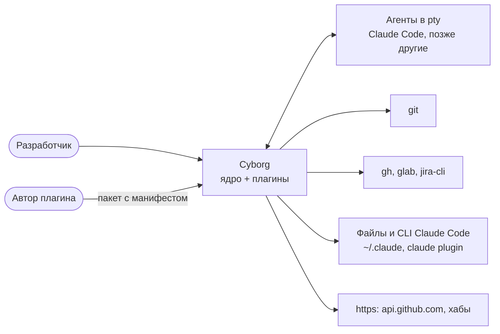
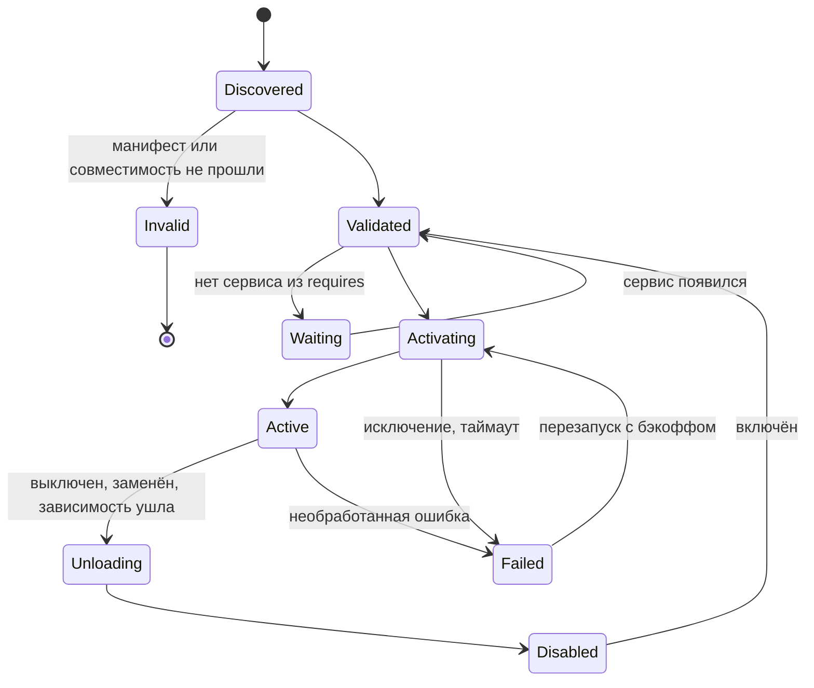
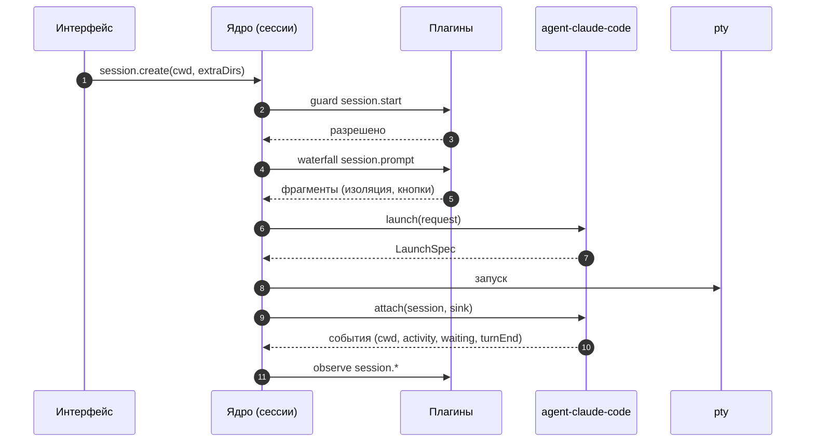

# SAD: Cyborg Harness - ядро и плагины

> **Документ частично заменён [SAD2](sad2.md).** Он действует там, где не расходится с SAD2; при расхождении верен SAD2. Тела заменённых разделов сохранены как история решений и помечены строкой в начале.

| Раздел SAD | Что с ним | Где теперь |
|---|---|---|
| 1-3 Назначение, принципы, контекст | остаются; принципы 2, 3, 5 и 6 уточнены критерием компактности и изоляцией трёх видов | [SAD2, 2](sad2.md#2-что-есть-ядро), [6](sad2.md#6-этапы) |
| 4 Процессы | заменён | [SAD2, 1](sad2.md#1-общая-архитектура) (хосты плагинов, pty-хост, рендерер); [ADR-CH-0012](../adr/ADR-CH-0012-hosts-watchdog-pty-host.md) |
| 5 Состав ядра | заменён | [SAD2, 2-3](sad2.md#2-что-есть-ядро); [ADR-CH-0009](../adr/ADR-CH-0009-core-boundary-and-compactness.md) |
| 6.1 Манифест | уточнён: `engines`, `provides` / `requires` / `optional` / `consumes`, `permissions`, `ui`, `config`, `state`, `lock` | [SAD2, 3.3-3.4](sad2.md#33-версии-и-миграции); [ADR-CH-0002](../adr/ADR-CH-0002-manifest-and-compatibility.md) |
| 6.2 Жизненный цикл | уточнён: граф проверяется до запуска кода, каскада перезапуска нет | [SAD2, 3.2](sad2.md#32-загрузка-плагинов) |
| 6.3 Контекст плагина | заменён | [SAD2, 3.4](sad2.md#34-связь-между-плагинами), [3.7](sad2.md#37-безопасность-данных-и-контроль-плагинов); [ADR-CH-0010](../adr/ADR-CH-0010-contracts-instead-of-services.md) |
| 7 Точки расширения | заменён | [SAD2, 4](sad2.md#4-взаимодействие-плагинов); [ADR-CH-0010](../adr/ADR-CH-0010-contracts-instead-of-services.md) |
| 8 События | заменён | события - часть контракта владельца, [SAD2, 4](sad2.md#4-взаимодействие-плагинов); события окна - [3.9](sad2.md#39-системные-клавиши-и-события); [ADR-CH-0010](../adr/ADR-CH-0010-contracts-instead-of-services.md) |
| 9.1 Провайдеры: агент | уточнён: содержание контракта остаётся, агент - обычный плагин, поставщик `cyborg.agent` | [ADR-CH-0004](../adr/ADR-CH-0004-agent-provider-contract.md), [ADR-CH-0010](../adr/ADR-CH-0010-contracts-instead-of-services.md) |
| 9.2 Провайдеры: трекер | уточнён: не точка расширения, плагин `trackers` с контрактом `cyborg.project-settings` | [SAD2, 5.2](sad2.md#52-описание-контракта-на-примере-cyborgprojects), [7](sad2.md#7-расхождения-с-sad-и-adr-пакета) |
| 10 Слоты | заменён | [SAD2, 3.8](sad2.md#38-изоляция-рендера); [ADR-CH-0013](../adr/ADR-CH-0013-plugin-ui-iframe-bridge.md) |
| 11 Шлюз IPC | заменён: шлюз безопасности и мост через `MessagePort`; прокладка совместимости каналов остаётся ([ADR-CH-0006](../adr/ADR-CH-0006-strangler-migration-and-parity.md)) | [SAD2, 3.7-3.8](sad2.md#37-безопасность-данных-и-контроль-плагинов); [ADR-CH-0011](../adr/ADR-CH-0011-isolation-stages.md), [ADR-CH-0013](../adr/ADR-CH-0013-plugin-ui-iframe-bridge.md) |
| 12 Доверие и изоляция | заменён: уровни L0-L2 вместо изоляции трёх видов | [SAD2, 3.5-3.7, 6](sad2.md#6-этапы); [ADR-CH-0011](../adr/ADR-CH-0011-isolation-stages.md), [ADR-CH-0012](../adr/ADR-CH-0012-hosts-watchdog-pty-host.md) |
| 13 Данные | заменён: разделы `config` и `state` со схемой и версией, секреты | [SAD2, 3.10](sad2.md#310-главный-конфиг-и-состояние), [секреты](sad2.md#секреты); [ADR-CH-0014](../adr/ADR-CH-0014-secrets-config-state.md) |
| 14 Классификация | заменён | [SAD2, 5](sad2.md#5-пример-базовая-часть), [5.5](sad2.md#55-пробелы-паритета-найденные-сверкой-с-кодом); ядро по [ADR-CH-0009](../adr/ADR-CH-0009-core-boundary-and-compactness.md) |
| 15 Структура репозитория | остаётся: плагины - папки в одном пакете; состав `core/` и список плагинов - по SAD2 | [SAD2, 2](sad2.md#2-что-есть-ядро), [5](sad2.md#5-пример-базовая-часть) |
| 16 Сборка и поставка | остаётся; сторонние плагины и установка - второй этап | [SAD2, 6.2](sad2.md#62-этап-2-изоляция-доступа-по-поводу) |
| 17 Наблюдаемость | остаётся; журнал плагинов уточнён | [SAD2, 3.2](sad2.md#32-загрузка-плагинов) |
| 18 Тестирование | уточнён: тесты дисциплины первого этапа, тест сторожа | [SAD2, 6.1](sad2.md#61-этап-1-ядро-без-изоляции-доступа) |
| 19 Нефункциональные требования | остаются; бюджеты накладных расходов - числами относительно базовой линии | [SAD2, 2](sad2.md#2-что-есть-ядро), вопрос 9 |
| 20 Ограничения и допущения | уточнены: допущения о `utilityProcess` проверены замерами | [ресёрч-2](../../research/sad2-validation.md) |

> Решения составителя по запросу владельца (2026-11-02), не согласованы. Интерфейсы ниже - **эскизы** для обсуждения, не окончательные сигнатуры: фиксируются на фазе P1 ([дорожная карта](../../05-plans/roadmap.md)). Основания решений - в [ADR](../adr/) и [ресёрче](../../research/README.md).

## 1. Назначение и охват

Документ описывает целевое устройство Cyborg после перестройки в ядро и плагины: состав ядра, модель плагина, точки расширения, контракты провайдеров, границы доверия, данные, сборку и тестирование. Исходное состояние - [Cyborg сегодня](../../research/cyborg-today.md). Требования - [SRS](../../01-product/01-plugin-host/srs.md) и соседние. Порядок работ - [дорожная карта](../../05-plans/roadmap.md).

Вне охвата: свой цикл модели, облако, мобильный клиент, учётные записи, публичный каталог плагинов (после P5).

## 2. Принципы

| № | Принцип | Следствие |
|---|---|---|
| 1 | Сессия нативная | Ядро запускает `claude` (и другие CLI) в pty как есть; вывод не подменяется |
| 2 | Ядро - минимум | В ядро идёт то, без чего не работает остальное или что защищает границы |
| 3 | Нулевая привилегия первых лиц | Встроенные плагины пользуются только публичным API, тем же путём, что сторонние |
| 4 | Всё, что регистрируется, откатывается | Каждая регистрация возвращает `Disposable`; выгрузка плагина снимает всё |
| 5 | Контракт важнее реализации | Заменяемые возможности устроены как Definition, Provider, Consumer |
| 6 | Доверие явное | Три уровня; права сторонних плагинов - в манифесте и проверяются в шлюзе |
| 7 | Паритет прежде красоты | Каждый шаг миграции закрывается паритетными проверками |
| 8 | Мало API | Семь точек расширения; всё новое с префиксом `experimental_` |
| 9 | Видимость | Состояние любого плагина (активен, ждёт сервис X, ошибка и причина) видно в интерфейсе и в логе |

## 3. Контекст



## 4. Процессы

> Заменён SAD2, раздел 1; ADR-CH-0012.

| Процесс | Что в нём | Доверие |
|---|---|---|
| Главный (Node) | Ядро; встроенные плагины (часть `main`) | Доверенный |
| Окно (renderer, песочница, без Node) | Оболочка (слоты, терминал, вкладки); интерфейсные части встроенных плагинов | Доверенный код, недоверенные данные |
| pty | Агент (`claude` и др.) | Права пользователя |
| Процесс плагина (`utilityProcess`, P4) | Сторонний плагин; доступ к ОС только через RPC и права манифеста | Недоверенный |
| Изолированное окно плагина (P4-P5) | Интерфейс стороннего плагина; общение сообщениями | Недоверенный |

Пригодность `utilityProcess` и изолированных окон для нашей задачи - допущение, проверяется спайком в начале P4 (риск R9 в [OVERVIEW](../../OVERVIEW.md#8-риски)).

## 5. Состав ядра

> Заменён SAD2, разделы 2-3; ADR-CH-0009.

| Компонент | Что делает | Сегодняшний код (основа) |
|---|---|---|
| **Загрузчик плагинов** (`PluginHost`) | Обнаружение, проверка манифеста и совместимости, разрешение зависимостей (`requires`), активация, выгрузка, статус, безопасный режим, диагностика | нет |
| **Реестр сервисов** | `provide`/`get` по ключу, `inject` из манифеста, каскад перезапуска зависимых | нет (связи в `main.ts`) |
| **Шина событий** | Три режима: observe, waterfall, guard | `EventEmitter` в `sessions.ts` |
| **Шлюз IPC** | Каналы ядра и плагинов, проверка формы и пределов, пространства имён, версия API, прокладка для старых каналов | `ipcMain.handle` в `main.ts`, `preload.ts` |
| **Границы путей и процессов** | `AllowedPaths`, запуск внешних программ с таймаутом и пределом вывода, безопасное чтение git | `allowed-paths.ts`, `createCliRunner`, `git.ts` |
| **Рантайм сессий** | pty, файл событий, реестр провайдеров, события `session.*` | `sessions.ts`, `events-store.ts` |
| **Воркспейс** | Файл воркспейса, проекты, замок, «Недавние», разрешённые корни | `projects.ts`, `workspaces.ts` |
| **Оболочка окна** | Окно, меню, вкладки сессий, тема, шрифт, заголовок, терминал, слоты, хост диалогов | `app.ts`, `tabs.ts`, `menu.ts`, `theme.ts` |
| **Реестр команд** | Команды, сочетания, пункты меню; единая проверка конфликтов сочетаний | `commands.ts` (часть), `menu.ts` |
| **Настройки и хранилище** | Схема настроек из манифестов, две области (пользователь, воркспейс), атомарная запись JSON в пространстве плагина | `jsonfile.ts`, `prefs.ts`, `*-store.ts` |
| **Уведомления ОС** | Сервис показа уведомлений | `notify-args.ts` |

## 6. Модель плагина

### 6.1 Манифест (эскиз)

> Уточнён SAD2, раздел 3.3-3.4; ADR-CH-0002.

Блок `cyborg` в `package.json`; схема строгая, лишние поля отклоняются; проверка до загрузки кода.

```json
{
  "name": "cyborg-plugin-search",
  "version": "0.1.0",
  "cyborg": {
    "id": "search",
    "title": "Поиск",
    "engines": { "cyborg": "^0.2.0", "api": 1 },
    "main": "dist/main.js",
    "renderer": "dist/renderer.js",
    "activation": "lazy",
    "requires": ["git", "workspace"],
    "provides": [],
    "capabilities": ["process.git", "fs.read:project"],
    "contributes": {
      "commands": [
        { "id": "search.file", "title": "Найти файл…", "hotkey": { "mac": "Cmd+P", "other": "Ctrl+Shift+P" } }
      ],
      "menus": [{ "menu": "search", "command": "search.file" }],
      "settings": { "search.mode": { "type": "string", "enum": ["file", "text", "changes"], "default": "file", "scope": "workspace" } }
    }
  }
}
```

- `id` уникален; префикс `cyborg.` зарезервирован за встроенными.
- `engines.cyborg` - диапазон версий приложения, `engines.api` - целочисленная версия API плагинов. Проверка и до импорта кода, и при обновлении.
- `contributes` - **декларативный вклад**: команды, меню, настройки видны ядру без запуска плагина. На этом строится статическая проверка конфликтов сочетаний (исключает класс ошибок D-27 фичи 12) и ленивая активация.
- `capabilities` - права ([раздел 12](#12-доверие-и-изоляция)). У встроенных плагинов список тот же, но проверяется только на этапе сборки.

### 6.2 Жизненный цикл

> Уточнён SAD2, раздел 3.2: граф проверяется до запуска кода, состояния «ждёт сервис» и каскада перезапуска нет.



Правила:
1. **Активация с тайм-боксом** (30 с по умолчанию, измеримо). Сбой активации не роняет приложение; плагин получает `Failed` с причиной.
2. **Статус виден**: `Waiting` показывает, какого сервиса не хватает (не молчаливое ожидание).
3. **Откат регистраций**: выгрузка вызывает все `Disposable` плагина в обратном порядке; затем каскадно выгружаются зависимые.
4. **Атомарная перезагрузка** (для разработки и обновлений): новая версия загружается как кандидат, прежняя снимается только после успешной активации; при ошибке остаётся прежняя со статусом «reload failed».
5. **Безопасный режим**: запуск с флагом или переменной окружения активирует только встроенные плагины и ядро.
6. **Ленивая активация**: `activation: "lazy"` - при первом вызове команды, первом показе слота или первом запросе сервиса; `startup` - при запуске.

### 6.3 Контекст плагина (эскиз)

> Заменён SAD2, разделы 3.4, 3.7; ADR-CH-0010.

```ts
// Публичный API: единственное, что видит плагин. Всё новое - с префиксом experimental_.
interface PluginContext {
  readonly id: string;
  readonly log: Logger;
  readonly subscriptions: DisposableStore;           // всё сюда, выгрузка снимает

  services: { provide<T>(key: ServiceKey<T>, impl: T): Disposable; get<T>(key: ServiceKey<T>): T };
  events:   { on(name, h): Disposable; waterfall(name, h): Disposable; guard(name, h): Disposable; emit(name, payload): void };
  commands: { register(id: string, handler: (args?) => unknown): Disposable; run(id: string, args?): Promise<unknown> };
  ipc:      { handle(channel: string, schema: Schema, h: (args, caller) => unknown): Disposable; push(channel: string, payload): void };
  settings: { get<T>(key: string): T; onChange(key: string, h): Disposable };
  storage:  { read(name: string): Promise<unknown>; write(name: string, data: unknown): Promise<void> }; // атомарно, в своём пространстве
  process:  { run(program: string, args: string[], opts?): Promise<RunResult> };                          // только программы из capabilities
}

interface RendererContext {
  slots:    { register(slot: SlotId, def: { id: string; order?: number; mount(container: HTMLElement, api: SlotApi): Disposable }): Disposable };
  commands: { run(id: string, args?): Promise<unknown>; register(id: string, h): Disposable };
  ipc:      { invoke(channel: string, ...args): Promise<unknown>; on(channel: string, h): Disposable };
  settings: { get<T>(key: string): T; onChange(key: string, h): Disposable };
  dialogs:  { open(def: DialogDef): Promise<unknown> };
  log: Logger;
}
```

Правила: вклад в слот - функция монтирования в переданный узел (React не нужен); компонент **не получает** ни `ctx`, ни другие плагины, только узкий `SlotApi`; `innerHTML` запрещён охранным тестом и для плагинов.

## 7. Точки расширения v1

> Заменён SAD2, раздел 4; ADR-CH-0010.

| № | Точка | Что даёт плагину | Контракт |
|---|---|---|---|
| 1 | **services** | Предоставлять и получать сервисы по ключу, `inject` из манифеста | Раздел 6.3 |
| 2 | **commands** | Команды, сочетания, пункты меню; декларативно в `contributes` | [ADR-CH-0007](../adr/ADR-CH-0007-ui-slots-and-commands.md) |
| 3 | **slots** | Вклад в интерфейс | Раздел 10 |
| 4 | **ipc** | Каналы между частями плагина; проверка формы | Раздел 11 |
| 5 | **events** | Наблюдать, перехватывать (waterfall), запрещать (guard) | Раздел 8 |
| 6 | **settings, storage** | Схема настроек в манифесте, форма строится из схемы, файлы в своём пространстве | Раздел 13 |
| 7 | **providers** | Заменяемые возможности: провайдер агента, провайдер трекера | Разделы 8, 9 |

## 8. События

> Заменён SAD2, раздел 4; ADR-CH-0010.

Тип и режим каждого события объявляются в одном месте (`core/events`), плагин видит только типы из публичного API.

| Событие | Режим | Что несёт | Кто излучает |
|---|---|---|---|
| `session.created`, `session.exit` | observe | `sessionId`, провайдер, cwd, код выхода | рантайм сессий |
| `session.cwd` | observe | новый cwd (дерево идёт за сессией в worktree) | адаптер провайдера |
| `session.activity` | observe | событие хука или его аналог | адаптер провайдера |
| `session.waiting` | observe | причина (запрос разрешения, конец хода, лимит) | адаптер провайдера |
| `session.turnEnd` | observe | последнее сообщение агента (для предложений кнопок) | адаптер провайдера |
| `session.prompt` | **waterfall** | фрагменты системного промпта; плагины добавляют, провайдер собирает (изоляция, предложения кнопок) | рантайм сессий |
| `session.start` | **guard** | запрос на запуск; плагин может только запретить с причиной | рантайм сессий |
| `workspace.changed`, `project.changed` | observe | идентификаторы | воркспейс |

Правила режимов: observe - возвращаемое значение игнорируется, сбой слушателя не влияет на других; **waterfall** - слушатель получает значение и функцию `next()`, забытый `next()` фиксируется диагностикой; **guard** - может только запретить (разрешить нельзя), порядок слушателей не превращает запрет в разрешение, нет ответа за таймаут - запрет.

## 9. Провайдеры

### 9.1 Провайдер агента

> Уточнён ADR-CH-0010: содержание контракта в силе, агент - плагин, поставщик `cyborg.agent` (SAD2, раздел 5).

**Определение (Definition)** - ядро, **провайдеры** - плагины, **потребители** - рантайм сессий и плагины-потребители (`session-history`, `command-buttons`).

```ts
interface AgentProvider {
  readonly id: string;                       // 'claude-code'
  readonly title: string;
  readonly capabilities: {
    resume: boolean; history: boolean; promptAppend: boolean; extraDirs: boolean; hooks: boolean;
  };
  handshake(): Promise<ProviderFacts>;       // найден ли CLI, версия, вошёл ли пользователь; только факты
  launch(req: LaunchRequest): LaunchSpec;    // что запустить в pty; ядро проверяет и запускает само
  attach(session: SessionHandle, sink: AgentEventSink): Disposable; // адаптер событий: хуки, файлы, журналы
  history?: { list(project: ProjectRef): Promise<HistoryEntry[]>; remove(id: string): Promise<void>; resumeArgs(id: string): string[] };
  recover?(exit: ExitInfo): RecoveryHint | null;  // authRequired, notFound, rateLimited: типизированно, не по тексту ошибки
}
interface LaunchRequest { cwd: string; extraDirs: string[]; initialPrompt?: string; resumeId?: string; promptFragments: string[] }
```

Принципы (из [ресёрча](../../research/comparison.md)): рукопожатие сообщает **факты**, ядро не вызывает того, что провайдер не объявил; восстановление типизировано, сопоставления по тексту ошибок нет; провайдер **не запускает процессы сам**: он описывает `LaunchSpec`, а pty создаёт и контролирует ядро.

Первый провайдер - `agent-claude-code`: логика `claude-args.ts`, `claude-hooks.json`, файл событий, разбор событий `Stop`/`Notification`, чтение журналов (`history.ts`), запуск `$SHELL -lc 'exec claude --settings "$CYBORG_SETTINGS" "$@"'`. Поведение должно остаться байт-в-байт прежним ([паритет](../../04-verification/parity-plan.md)).

Структурные провайдеры (SDK, ACP) - отдельный **вид** провайдера с другим контрактом; не входят в v1 ([ADR-CH-0004](../adr/ADR-CH-0004-agent-provider-contract.md)).



### 9.2 Провайдер трекера

> Уточнён SAD2, разделы 5.2 и 7: трекеры - плагин `trackers`, не точка расширения; ADR-CH-0010.

```ts
interface TrackerProvider {
  readonly id: string;                                    // 'github', 'gitlab', 'jira'
  detect(remote: RemoteRef): TrackerRef | null;           // подходит ли remote репозитория
  auth(): Promise<AuthStatus>;                            // вошёл ли пользователь (одним прогретым результатом)
  tasks?: { list(ref, query): Promise<TaskPage>; details(ref, key): Promise<TaskDetails> };
  changeRequests?: { list(ref, query): Promise<MrPage>; details(ref, key): Promise<MrDetails> };
}
```

Потребители - `tasks`, `merge-requests`, `status`; GitHub и GitLab - `tracker-github`, `tracker-gitlab`, Jira - `tracker-jira`. Запросы остаются через `gh`, `glab`, `jira-cli`, токены Cyborg не хранит.

## 10. Слоты интерфейса

> Заменён SAD2, раздел 3.8; ADR-CH-0013.

Слоты соответствуют местам, где интерфейс уже разделён сегодня:

| Слот | Где | Сегодняшние примеры |
|---|---|---|
| `strip.action` | Кнопки в полосе сессий | «Задачи», «MR/PR», «Статус» |
| `sidebar.tab` | Вкладки боковой панели | «Файлы», «Сессии» |
| `session.view` | Виды внутри сессии | «Claude» (терминал), просмотр файла |
| `panel` | Выдвижные панели | панель задач, список MR |
| `terminal.footer` | Полоса под терминалом | кнопки-команды |

Диалоги не слот, а сервис `dialogs.open`: ядро владеет `<dialog>`, доступностью (`aria-labelledby`, фокус, `Esc`) и общими стилями. Правила слота:
1. **Граница ошибок на слот**: исключение при монтировании или обновлении скрывает слот, показывает компактную заглушку, соседи не затрагиваются; сбой попадает в диагностику плагина.
2. **Порядок** задаётся `order` и идентификатором, детерминирован.
3. **Эксклюзивные слоты** (одна реализация за раз, например список сессий): запасная реализация ядра включается, если плагин не активен.
4. Доступность клавиатурой и роли ARIA - обязанность слота и проверяется общим тестом ядра ([ADR-CH-0007](../adr/ADR-CH-0007-ui-slots-and-commands.md)).

## 11. Шлюз IPC

> Заменён SAD2, разделы 3.7-3.8; ADR-CH-0011, ADR-CH-0013.

- **Пространства имён.** Каналы ядра - `core:*`; каналы плагина - `p:<id>:<канал>`; прежние имена (`git:status`, `tasks:list`...) обслуживаются **прокладкой совместимости**, которая перенаправляет на новый канал или сервис, пока интерфейс не переехал.
- **Проверка.** Каждый канал объявляет схему аргументов (внутренний маленький помощник проверки по образцу `validateAction`; новых зависимостей нет); шлюз проверяет форму, пределы и пути (`AllowedPaths`) **до** вызова обработчика.
- **Версия.** `API_VERSION` - целое число; интерфейс и главный процесс сверяют его на старте; несовпадение - явная ошибка, не частичная работа.
- **`preload`.** Один небольшой мост: `invoke(channel, ...)`, `on(channel, handler)`, `send(channel, ...)` с белым списком каналов, который выдаёт шлюз; прежний плоский объект `window.cyborg` на время миграции остаётся тонкой оболочкой над ним.
- **Права.** Для стороннего плагина шлюз сверяет канал и возможность с манифестом ([раздел 12](#12-доверие-и-изоляция)).

## 12. Доверие и изоляция

> Заменён SAD2, разделы 3.5-3.7 и 6; ADR-CH-0011.

| Уровень | Кто | Где работает | Что может |
|---|---|---|---|
| **L0** | Ядро | Главный процесс | Всё, что нужно приложению |
| **L1** | Встроенные плагины (поставляются с приложением) | Главный процесс | Только публичный API (проверяет сборка и храповик), права фиксированы манифестом |
| **L2** | Сторонние плагины | Отдельный процесс; интерфейс в изолированном окне (P4) | Только то, что названо в `capabilities` и подтверждено пользователем при установке |

**Возможности v1 (`capabilities`)**:

| Возможность | Смысл |
|---|---|
| `fs.read:project` | Чтение файлов в разрешённых корнях проекта |
| `process.git` | Безопасный вызов git на чтение |
| `process.run:<программа>` | Запуск названной программы (например `gh`) с пределами |
| `net:<хост>` | Сетевой доступ к названным хостам |
| `session.input` | Отправка ввода в сессию |
| `session.output.read` | Чтение вывода терминала (по умолчанию недоступно) |
| `claude.config.read` | Чтение файлов настроек Claude Code |
| `claude.plugin.run` | Вызов `claude plugin` |
| `ui.dialog`, `ui.slot:<имя>` | Диалоги и слоты |

Правила: возможность без объявления недоступна; шлюз и сервисы проверяют её на каждом вызове; пользователь при установке видит список; **безопасный режим** отключает все L2; закрытые исходы подтверждения опасных действий (разрешено один раз, отклонено, отменено, недоступно - разрешает только первое; нет ответа - отказ). До P4 уровня L2 нет: внешние плагины не загружаются.

## 13. Данные

> Заменён SAD2, раздел 3.10; ADR-CH-0014.

- **Пространства имён.** Данные плагина - `userData/plugins/<id>/`; для перенесённых функций манифест объявляет `storage.legacy: ["commands.json", ...]`, чтобы прежние файлы оставались на прежних путях и читались без миграции.
- **Настройки.** Схема в манифесте; область `user` (папка настроек) или `workspace` (хранилище окна воркспейса); прежние ключи `cyborg.*` сохраняются как алиасы.
- **Формат и версия.** Версия формата данных плагина хранится отдельно от версии приложения; миграция «рядом» (новый файл, прежний не трогается), файл будущей версии открывается с явной ошибкой.
- **Базы данных не вводим**: источник правды по сессиям - журналы Claude Code, конфигурация - JSON.
- **Секреты.** В интерфейс не попадают; права на файлы `0600`; для плагина доступ к секретам только через возможность.

## 14. Классификация

> Заменён SAD2, разделы 5 и 5.5; ADR-CH-0009.

Сопоставление текущего кода с целевым местом. Файлы - из [cyborg-today](../../research/cyborg-today.md#4-функции-и-их-код).

| Целевое место | Что | Текущие файлы |
|---|---|---|
| ядро: загрузчик, сервисы, события | новое | - |
| ядро: шлюз IPC | каналы, проверка, прокладка | `main.ts` (обработчики), `preload.ts`, `ipc-error.ts` |
| ядро: границы | пути и процессы | `allowed-paths.ts`, `open-path.ts`, `createCliRunner` в `trackers.ts`, чтение git из `git.ts` |
| ядро: сессии | pty и события | `sessions.ts` (без Claude), `events-store.ts`, `session-args.ts` |
| ядро: воркспейс | проекты и воркспейсы | `projects.ts`, `workspaces.ts`, `workspace-text.ts`, `sources.ts` (часть) |
| ядро: оболочка | окно, вкладки, тема, шрифт, терминал | `app.ts` (каркас), `tabs.ts`, `list-keys.ts`, `theme.ts`, `font-size.ts`, `dom.ts`, `title.ts`, `platform.ts`, `term-links.ts`, `prefs.ts` |
| ядро: команды и меню | реестр | `menu.ts`, `commands.ts` (разбор и проверка сочетаний) |
| плагин `agent-claude-code` | провайдер | `claude-args.ts`, `sessions.ts` (запуск и хуки), `history.ts` (чтение журналов), `suggestions.ts` (разбор) |
| плагин `files` | дерево, просмотр, ветка | `files.ts`, `git.ts` (переключение), `tree.ts`, `tree-keys.ts`, `viewer.ts`, `roots.ts`, `row-marks.ts`, `neighbor.ts`, `reorder.ts` |
| плагин `search` | поиск | `git-search.ts`, `search-run.ts`, `search-args.ts`, `search-dialog.ts`, `search-model.ts`, `shared/search-pattern.ts` |
| плагины `tasks`, `tracker-github`, `tracker-gitlab` | задачи | `trackers.ts`, `task-details.ts`, `tasks.ts`, `task-model.ts`, `task-flow.ts`, `task-header.ts`, `panel.ts`, `panel-return.ts` |
| плагин `merge-requests` | MR | `mrs.ts`, `mrs-service.ts`, `mr-model.ts`, `mr-refresh.ts` |
| плагины `status`, `tracker-jira` | статус | `jira.ts`, `jira-service.ts`, `status.ts`, `status-model.ts` |
| плагин `command-buttons` | кнопки | `commands.ts` (наборы), `command-store.ts`, `prompts.ts`, `prompt-store.ts`, `suggestions.ts` (предложения), `command-bar.ts`, `command-editor.ts`, `prompt-editor.ts`, `command-values.ts`, `config-editor.ts` |
| плагин `claude-extensions` | окно расширений Claude Code | `extensions*.ts`, `hubs.ts`, `extensions-dialog.ts`, `extensions-model.ts`, `shared/extensions.ts` |
| плагин `session-history` | история | `history.ts` (список, удаление), часть `app.ts` |
| плагин `session-isolation` | изоляция | инструкция из `claude-args.ts` как вклад в `session.prompt` |
| плагин `session-notifications` | «сессия ждёт» | `notify-args.ts`, `notify.ts` |
| плагин `path-drop` | путь перетаскиванием | `drop-path.ts` |

## 15. Структура репозитория (цель)

```text
src/
  core/               загрузчик, реестр сервисов, события, шлюз IPC, границы, сессии, воркспейс, оболочка, команды
  plugin-api/         публичные типы и помощники: всё, что может импортировать плагин
  plugins/
    agent-claude-code/   package.json (блок cyborg), main/, renderer/
    files/  search/  tasks/  merge-requests/  status/  command-buttons/
    claude-extensions/  session-history/  session-isolation/  session-notifications/  path-drop/
    tracker-github/  tracker-gitlab/  tracker-jira/
  shared/             типы для обеих сторон
test/
  core/  plugins/<id>/  test-kit/   тестовый хост плагинов, подставные claude, gh, jira
scripts/
  check-boundaries.mjs   храповик границ
```

Всё в одном пакете; плагины - папки, не отдельные npm-пакеты ([ADR-CH-0001](../adr/ADR-CH-0001-core-and-plugins.md)).

## 16. Сборка и поставка

- Сборка остаётся на esbuild: главный бандл (ядро и `main`-части встроенных плагинов, статически), `preload`, оконный бандл (оболочка и ленивые куски `renderer`-частей плагинов).
- Манифесты встроенных плагинов собираются в реестр при сборке; загрузка встроенных не обращается к диску.
- Нативные модули (`node-pty`) остаются внешними, как сейчас.
- Сторонние плагины (P4): каталог пользователя `userData/plugins-installed/`, артефакт с версией API в `meta.json`, несовместимый мажор отклоняется.

## 17. Наблюдаемость

- Раздел «Плагины Cyborg»: состояние (активен, ждёт сервис X, ошибка и причина, отключён), версия, источник, права, время активации.
- Журнал каждого плагина `userData/logs/plugins/<id>.log` с ротацией.
- Флаг запуска `--dump-plugins` выводит разрешённый граф и порядок активации.
- Время запуска по плагинам попадает в `npm run measure`.

## 18. Тестирование

| Уровень | Что | Как |
|---|---|---|
| Ядро | Загрузчик, откат регистраций, каскад, режимы событий, шлюз | модульные тесты; **HMR-safety тест реестра**: выгрузить плагин и проверить, что ничего не осталось |
| Плагин | Контракт плагина | тестовый хост (`test-kit`): настоящий загрузчик, подставные `claude`, `gh`, `jira`; проверка «только публичный API» |
| Провайдеры | Соответствие контракту | общий набор тестов провайдера, который гоняют все провайдеры |
| Паритет | Поведение осталось прежним | записанные сессии (хуки, вывод), подставные CLI, повтор на каждом коммите, allowlist допустимых расхождений ([план паритета](../../04-verification/parity-plan.md)) |
| Границы | Архитектурные правила | `scripts/check-boundaries.mjs`: ядро не импортирует плагины, плагин не импортирует чужие внутренности, новых прямых обращений к `electron` и `fs` из плагинов не добавляется (храповик со счётчиком) |
| Сквозной | Приложение целиком | дымовой тест с шагами по плагинам |

## 19. Нефункциональные требования

| Свойство | Требование |
|---|---|
| Запуск | Время до готового окна не хуже базового более чем на 10% (замер в P0); встроенные плагины активируются лениво, где возможно |
| Безопасность | Все инварианты [cyborg-today, раздел 9](../../research/cyborg-today.md#9-инварианты-которые-нельзя-потерять) сохраняются; для L2 дополнительно раздел 12 |
| Совместимость | Данные пользователя читаются без миграции; каналы IPC работают через прокладку до конца миграции |
| Наблюдаемость | Любой отказ плагина виден пользователю и в логе |
| Сопровождение | Семь точек расширения, всё новое `experimental_`; upgrade-guide на каждое ломание публичного API |

## 20. Ограничения и допущения

1. Контракт `AgentProvider` рассчитан на **pty-агентов с хуками или файловыми следами**; агент без таких следов даст только запуск и вывод (события `session.cwd` и `session.waiting` придётся подменять эвристикой или оставить недоступными).
2. Пригодность `utilityProcess` и изолированных окон проверяется спайком в P4.
3. Лёгкая внутренняя схема проверки аргументов выбрана вместо новой зависимости; если она окажется громоздкой, вопрос возвращается в ADR-CH-0005.
4. Сторонний интерфейс на обычном DOM в изолированном окне требует отдельного набора слотов (подмножество); границы определяются в P4.
