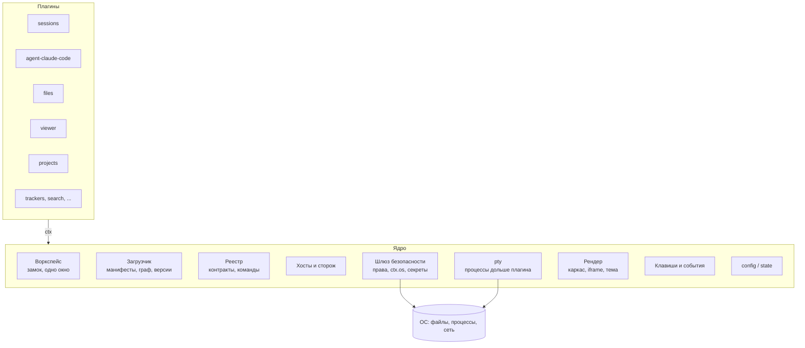
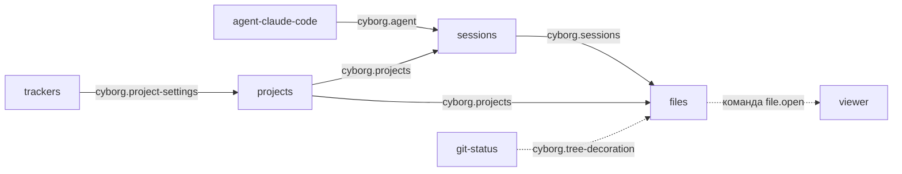
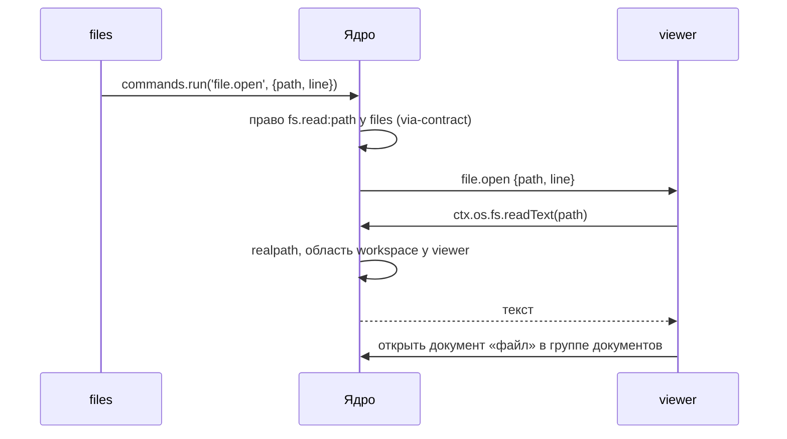

# SAD2: ядро и плагины

> Договорённости владельца и составителя от 2026-11-02 - 2026-11-04, сведённые при разборе пакета. Документ пересматривает границу ядра из [SAD](sad.md): там, где они расходятся, действует этот документ ([раздел 7](#7-расхождения-с-sad-и-adr-пакета)). Интерфейсы - эскизы, сигнатуры фиксируются в P1 [дорожной карты](../../05-plans/roadmap.md). Документ проверен замерами в Electron, разбором аналогов и сверкой с кодом ([ресёрч-2](../../research/sad2-validation.md)); правки по итогам перечислены в [разделе 10](#10-правки-по-итогам-проверки).

## 1. Общая архитектура

Cyborg - это **ядро** и набор **равных плагинов**. Ядро не знает предметной области: в нём нет агентов, сессий, файлов, проектов и трекеров. Всё это плагины. Ядро открывает воркспейс, загружает плагины, связывает их, изолирует их сбои, следит за правами и даёт им экран, клавиши и хранение.



**Процессы.**

| Процесс | Что в нём |
|---|---|
| Главный (Electron main) | ядро: воркспейс, загрузчик, реестр, сторож, шлюз, `config` и `state`; запускает хосты плагинов и pty-хост |
| pty-хост (`utilityProcess` ядра) | процессы pty (`node-pty`) и кольцевые буферы их вывода; код плагинов не исполняет ([3.6](#36-ресурсы-дольше-плагина-pty)) |
| Хосты плагинов (`utilityProcess`, один или несколько) | главные части плагинов по группам ([3.5](#35-изоляция-сбоев-хосты-и-сторож)); плагин видит только `ctx`, во втором этапе - внутри своего `Compartment` |
| Рендерер | каркас окна от ядра; UI каждого плагина - в своём `<iframe>` с origin `cyborg-plugin://<id>/` ([3.8](#38-изоляция-рендера)) |

Код плагина ходит к ОС только через ядро. В первом этапе это дисциплина, которую проверяют тесты, во втором - граница `Compartment` ([раздел 6](#6-этапы)).

## 2. Что есть ядро

Ядро - хост плагинов: оно открывает воркспейс, загружает, связывает и изолирует плагины, контролирует их доступ к ОС и даёт им экран, клавиши и хранение.

**Компактность - ограничение на всё ядро.** Задача попадает в ядро, только если выполнены оба условия:

1. она нужна всем плагинам или окну без плагинов;
2. плагин не может решить её сам, не нарушив гарантию, которую ядро даёт остальным.

Проекты - плагин: они нужны не всем, и `projects` справляется сам. pty - в ядре: процесс должен пережить перезапуск своего плагина, а этого плагин себе не гарантирует. «Недавние» - в ядре: воркспейс выбирается до загрузки любого плагина. Шина событий - нигде: связь идёт через API владельца.

**Накладные расходы - с бюджетом.** Время старта, память на хост и на `<iframe>`, задержка вызова через шлюз и вывода терминала задаются числами относительно базовой линии сегодняшнего Cyborg (`scripts/measure.mjs`); сами числа - открытый вопрос 9.

**В ядре нет:** агента и его запуска, сессий и их восстановления, дерева файлов, просмотрщика, проектов, трекеров, уведомлений о сессиях, источников секретов, общей шины событий, реестра сервисов по произвольным ключам, `inject`, waterfall и guard.

**Центральных плагинов нет.** Ядро не выделяет ни один плагин, в коде ядра нет имён плагинов. Окно без плагинов - нормальное состояние: в нём доступно управление плагинами. Поставка Cyborg - это список встроенных плагинов и больше ничего.

## 3. Цели ядра

| | Цель | Что гарантирует |
|---|---|---|
| [3.1](#31-воркспейс-как-главная-сессия) | Воркспейс как главная сессия | один воркспейс - одно окно и одно согласованное состояние |
| [3.2](#32-загрузка-плагинов) | Загрузка плагинов | сломанный граф виден до запуска кода; окно без плагинов работает |
| [3.3](#33-версии-и-миграции) | Версии и миграции | обновление Cyborg или плагина не ломает остальных и не теряет данные |
| [3.4](#34-связь-между-плагинами) | Связь между плагинами | плагины знают друг друга только через контракт |
| [3.5](#35-изоляция-сбоев-хосты-и-сторож) | Изоляция сбоев | зависание или падение плагина не трогает другие хосты, окно и агентов |
| [3.6](#36-ресурсы-дольше-плагина-pty) | Ресурсы дольше плагина | перезапуск хоста или окна не убивает процессы агентов |
| [3.7](#37-безопасность-данных-и-контроль-плагинов) | Безопасность данных и контроль плагинов | плагин делает только объявленное; секреты не попадают в `config`, `state` и журнал |
| [3.8](#38-изоляция-рендера) | Изоляция рендера | плагин рисует только у себя; каркас появляется до кода плагинов |
| [3.9](#39-системные-клавиши-и-события) | Системные клавиши и события | системное сочетание срабатывает одинаково из любого `<iframe>`; конфликт виден при загрузке |
| [3.10](#310-главный-конфиг-и-состояние) | Главный конфиг и состояние | плагин видит только свой раздел; ошибка в разделе ломает только его владельца |

### 3.1. Воркспейс как главная сессия

Воркспейс - главная сессия приложения: файл `config` воркспейса, его `state` и одно окно.

- Открытие: `--workspace <файл>` или «Недавние»; ядро берёт замок `<файл>.lock`.
- **Один воркспейс - одно окно.** Как сегодня, воркспейс открывает отдельный процесс приложения со своим окном и общим каталогом данных; запуск второго процесса на тот же воркспейс отказывает сообщением «Воркспейс уже открыт» (FR-1029, FR-1033 основного корпуса). Передача фокуса окну владельца - улучшение после паритета, не часть первой версии.
- Закрытие окна или смена воркспейса: плагины выключаются через `Disposable`, живые pty завершаются после подтверждения пользователя ([3.6](#36-ресурсы-дольше-плагина-pty)), замок снимается.
- Перезагрузка окна - не закрытие: воркспейс, хосты и pty остаются.
- «Недавние» и окно без воркспейса - забота ядра: выбрать воркспейс нужно до загрузки любого плагина.

### 3.2. Загрузка плагинов

1. Прочитать `plugins.enabled` (файл пользователя, перекрытый файлом воркспейса). Больше ядру для старта ничего не нужно.
2. Прочитать манифесты, проверить совместимость версий ([3.3](#33-версии-и-миграции)).
3. Разрешить граф контрактов **до запуска кода**: недостающий `requires`, два поставщика при кратности `one`, цикл - плагин не загружается, причина пишется в журнал.
4. Нарисовать каркас окна по манифестам ([3.8](#38-изоляция-рендера)).
5. Разложить плагины по хостам ([3.5](#35-изоляция-сбоев-хосты-и-сторож)) и активировать в порядке графа; активация может быть ленивой - по первому показу вида или первой команде.

- Журнал плагинов: отказы загрузки, ошибки активации, отказы прав, перезапуски хостов; виден в «Плагины Cyborg».
- Безопасный режим выключает все плагины без исключений.
- Смена набора плагинов в v1 - перезапуск хостов и окна: горячей выгрузки и каскада перезапуска нет, но `Disposable` ведутся с первого дня. Процессы агентов перезапуск переживают ([3.6](#36-ресурсы-дольше-плагина-pty)).

### 3.3. Версии и миграции

**Плагин и API ядра.**

```jsonc
// манифест плагина
"id": "trackers",
"version": "2.3.0",
"engines": { "cyborg": "^1" }   // версия API плагинов: ctx и элементы ядра
```

- Несовместимый `engines.cyborg` - плагин не загружается, причина в журнале.
- API плагинов версионируется семантически; элемент ядра не удаляется и не меняет атрибуты в пределах мажорной версии.

**Контракты.**

- **Семантические версии.** Минорное изменение: новый необязательный член, новое необязательное поле, новое значение в объединении событий - потребитель обязан пропускать незнакомое. Мажорное: удаление или переименование, новое обязательное поле аргумента, смена смысла.
- **Владение.** Пространство имён `cyborg.*` закреплено за репозиторием Cyborg и пакетом `@cyborg/contracts`. Сторонние контракты называются по автору (`acme.*`) и публикуются своими пакетами объявлений.
- **Переход между мажорными версиями.** Поставщик может давать две версии сразу (`"provides": { "cyborg.sessions": ["1.4", "2.0"] }`); каждый потребитель получает ту, что просил.
- **Устаревание.** Член с пометкой `@deprecated` живёт минимум до следующей мажорной версии; ядро пишет в журнал, кто его вызывает.

**Разделы `config` и `state`.** Плагин обновился и сменил формат, пользователь поправил файл руками и ошибся - ни то, ни другое не должно ронять плагин или окно.

```jsonc
// манифест плагина
"config": { "schema": "./config.schema.json", "version": 3 },
"state":  { "schema": "./state.schema.json",  "version": 1 }
```

- Ядро проверяет раздел по схеме до активации и при изменении файла воркспейса извне (файл отслеживается).
- Версия раздела ниже версии плагина - ядро до активации вызывает `migrate(fromVersion, data)` плагина и сохраняет результат.
- Версия раздела выше (плагин откатили) - плагин не активируется, раздел не трогается, причина в журнале.
- Раздел не прошёл схему - отказ только этому плагину с записью в журнале; остальные работают.

### 3.4. Связь между плагинами

Ядро ведёт реестр контрактов (`provides` / `requires` / `optional` / `consumes`) и реестр команд и передаёт вызовы: между плагинами, между UI и главной частью одного плагина, между хостами. Для плагина вызов выглядит одинаково, в одном хосте поставщик или в другом. Как плагины этим пользуются - [раздел 4](#4-взаимодействие-плагинов).

### 3.5. Изоляция сбоев: хосты и сторож

Главные части плагинов работают не в главном процессе, а в хостах (`utilityProcess`). Плагины одного хоста делят процесс и цикл событий: зависание одного останавливает соседей, падение хоста роняет все его плагины. Поэтому группировкой по хостам управляет пользователь.

```jsonc
"plugins": {
  "enabled": ["sessions", "agent-claude-code", "files", "viewer", "projects", "trackers", "search"],
  "hosts": {
    "builtin":  ["sessions", "agent-claude-code", "files", "viewer", "projects"],
    "trackers": ["trackers", "search"]
  }
}
```

- `plugins.hosts` - часть `config` с теми же уровнями: пользователь и воркспейс.
- По умолчанию встроенные плагины - в хосте `builtin`, каждый сторонний - в своём хосте. Плагин, не названный ни в одной группе, идёт по умолчанию.
- Манифест может попросить отдельный хост (`"host": "own"`). Пользователь вправе переопределить, но «Плагины Cyborg» показывают предупреждение.
- **Внутри хоста** исключение при активации или в вызове ловит хост: отказывает только этот плагин, с записью в журнале.
- **Сторож.** Ядро регулярно проверяет, отвечает ли хост; нет ответа дольше порога - хост перезапускается. Виновник - плагин с незавершённым вызовом или активацией; после нескольких зависаний подряд плагин выключается с записью в журнале. Падение хоста идёт тем же путём. Стартовые значения для проверки: ответ хоста раз в 5 секунд, порог 15 секунд без ответа, не более 3 перезапусков хоста за 5 минут, плагин выключается после 3 зависаний подряд; ориентиры - VS Code (heartbeat и до 5 перезапусков pty-хоста, 3 падения за 5 минут у удалённого хоста). Перезапуска зависшего локального хоста в изученных системах нет, поэтому сторож проверяется отдельным тестом ([6.1](#61-этап-1-ядро-без-изоляции-доступа), шаг 2).
- Перезапуск хоста не трогает другие хосты, окно и pty ([3.6](#36-ресурсы-дольше-плагина-pty)). Плагины хоста активируются заново; потребители из других хостов узнают о пропаже и возврате поставщика из `ctx.contracts.onChange`.
- Цена измерена ([ресёрч-2, 2.1](../../research/sad2-validation.md#21-хост-плагинов-в-utilityprocess)): около 15 МБ физической памяти и 70-100 мс на хост, круг вызова 47 мкс; десять хостов - 150 МБ.

### 3.6. Ресурсы дольше плагина: pty

Ресурс ОС, который должен пережить своего владельца, держит ядро. Сегодня это pty: плагин решает, что запустить, ядро запускает процесс и держит его у себя. Ядро не знает, что это агент: для него это pty с программой из права плагина.

**Держит pty не главный процесс, а отдельный `utilityProcess` ядра - pty-хост** (не плагин и не общий хост плагинов). Зависание или падение нативного `node-pty` не должно замораживать окно; в VS Code терминал живёт в отдельном процессе по той же причине. `node-pty` в `utilityProcess` загружается (проверено). Сторож ([3.5](#35-изоляция-сбоев-хосты-и-сторож)) следит и за pty-хостом; при его перезапуске процессы pty теряются, и плагины получают это как завершение.

```ts
// главная часть agent-claude-code; манифест: "permissions": { "pty": ["claude"] }
const pty = await ctx.os.pty.spawn({
  program: 'claude', args, cwd, env,   // аргументы и env собирает плагин
  cols, rows,
  persist: true,                       // пережить перезапуск хоста и окна
});
pty.onData(chunk => { /* разбор для статуса сессии */ });
pty.write(input); pty.resize(cols, rows); pty.kill();

// после перезапуска хоста
for (const info of await ctx.os.pty.list()) {      // только pty этого плагина
  const h = await ctx.os.pty.attach(info.id);      // тот же PtyHandle
  // h.backlog - хвост вывода, накопленный, пока плагина не было
}
```

| | Ядро | Плагин |
|---|---|---|
| что запускать: программа, аргументы, env, cwd | проверяет по праву `pty` | решает |
| процесс (`node-pty` в pty-хосте ядра) | держит | - |
| буфер вывода, пока владельца нет | ведёт | читает при `attach` |
| когда завершать | спрашивает пользователя, если плагин выключают | `kill()` |

- Перезапуск хоста или окна - pty живы, владелец возвращается через `attach`.
- Плагин выключают - ядро спрашивает, завершать ли его процессы. Плагин удалён, воркспейс закрыт или приложение завершается - процессы завершаются.
- Короткие процессы `ctx.os.process` при падении хоста завершаются: их результат больше некому принять. Перезапуск переживает только pty с `persist`.
- Буфер кольцевой, размер на pty - настройка ядра. Хвост сырой и может начинаться посреди escape-последовательности; после `attach` ядро отправляет `resize`, и TUI (`claude`) по `SIGWINCH` перерисовывает экран сам. VS Code и предложение для Zed идут дальше: восстанавливают экран снимком состояния терминала (headless-xterm с сериализацией) вместе с размерами; что выбрать, решит спайк с настоящим `claude` (открытый вопрос 12).
- Осиротевший pty (плагин не вернулся после перезапуска хоста) завершается по истечении льготного времени, как в VS Code; значение - настройка ядра, выбирается в P1.

**Горячий путь мимо хоста.** Экран терминала живёт в `<iframe>` плагина `sessions`, а у UI-части `ctx.os` нет. Главная часть выдаёт своему UI билет на просмотр:

```ts
// главная часть sessions
const ticket = await pty.share();              // одноразовый, только для своего UI
// UI-часть
const view = await ctx.terminal.open(ticket);  // data / write / resize, мимо хоста
```

Вывод идёт из pty-хоста прямо в `<iframe>` по `MessagePort`, ввод - обратно: хост плагина может зависнуть, а терминал работает. Порт создаёт главный процесс и раздаёт концы, в потоке он не участвует; замер: поток около 1,9 ГБ/с, круг 45 мкс ([ресёрч-2, 3.3](../../research/sad2-validation.md#33-мост-окно---хост-и-задержки)). UI-часть не получает права на pty, ей доступен только процесс, который показала собственная главная часть.

### 3.7. Безопасность данных и контроль плагинов

Доступ к ОС разбит на пространства имён. Нет права в манифесте - нет объекта в `ctx.os`: ни чтения, ни записи.

| Пространство | Что даёт | Право в манифесте |
|---|---|---|
| `fs.read` / `fs.write` / `fs.watch` | файлы | области путей |
| `process` | запуск программ | список программ, опционально первые аргументы |
| `pty` | терминал | список программ; агент стартует через оболочку пользователя (`$SHELL -lc 'exec claude …'`, чтобы получить его `PATH`), поэтому в списке оболочка |
| `net` | HTTP | список хостов |
| `shell` | открыть путь или URL в системе | области путей, схемы URL |
| `clipboard` | буфер обмена | `read` / `write` |
| `notify` | системные уведомления | да / нет |
| `env` | переменные окружения | список имён |
| `secrets` | своё хранилище секретов | не нужно, только свои ключи |
| `secrets.ref` | секреты из внешнего источника по ссылке ([секреты](#секреты)) | маски ссылок: `vault://kv/data/jira*` |
| `dialog` | выбор файла | не нужно, выбор пользователя сам становится правом |
| `ui.lock` | закрыть окно замком ([3.8](#38-изоляция-рендера)) | да / нет; в окне согласия - «может закрыть окно Cyborg», наравне с `process` |

**Области путей:** `workspace` (репозитории проектов и cwd живых сессий; задают плагины с правом `security.roots`), `plugin-data`, `plugin-temp` (всегда свои), явные пути и маски, `granted` (выбор в `dialog`).

**Правила шлюза:**

- вызывающего ядро определяет по каналу, а не со слов плагина;
- путь проверяется после `realpath`, на открытом дескрипторе; вне области - всегда `PermissionDenied`, никогда `NotFound`;
- защищённые пути закрыты всегда: данные приложения, файл воркспейса и замок, запись в `.git/` (кроме явной области `workspace.git`);
- права через чужой контракт не передаются: член контракта объявляет нужное право, и шлюз проверяет его у **вызывающего** (`reason: 'via-contract'`);
- каждый отказ пишется в журнал плагинов.

**Честная граница:** `process` и `pty` дают программе все права пользователя ОС. Списки аргументов и запрет опасных флагов - смягчение, а не защита; окно подтверждения показывает такое право как «полный доступ через программу».

**Два класса плагинов.** Честная граница касается немногих: базовым модулям (`sessions`, агенты, `files`, git, поиск) нужны процессы и файлы, и их права широки. Интеграции по HTTP API (Jira, GitHub, GitLab, Confluence, Vault) режутся до сети к своему хосту и своего токена - для них изоляция даёт полную гарантию:

```jsonc
// плагин jira: ни файлов, ни процессов, ни буфера обмена
"permissions": {
  "net": ["config:baseUrl"]   // хост из своего раздела config
}
// токен - в своём хранилище ctx.secrets или ссылкой $secret
```

- Хост из `config:<поле>` ядро берёт из раздела плагина. Окно согласия показывает «ходит на хост из настройки baseUrl: jira.company.com»; смена значения на новый хост требует подтверждения пользователя.
- Сегодняшние трекеры работают через CLI (`gh`, `glab`, `jira`) и токенов в приложении не хранят; пока так, плагину нужно право `process` на эти программы, и он относится к широкому классу. В узкий класс он попадает вместе с переходом на HTTP API - это новое требование, а не перенос.
- Отсюда правило для интеграций: HTTP API, а не CLI. Обёртка над `gh` или `glab` требует `process` и попадает под честную границу; тот же плагин на API остаётся в узком классе.

**Что даёт каждый этап.** В первом этапе хост - обычный процесс Node: шлюз делает права видимыми и ловит ошибки, но плагин, который захочет, достанет `require('node:fs')`. Гарантию «ничего сверх объявленного» для стороннего кода даёт второй этап ([6.2](#62-этап-2-изоляция-доступа-по-поводу)): процесс на плагин с `--permission` и `Compartment` вторым слоем. Одного `Compartment` для этого недостаточно ([ресёрч-2, 2.3 и 4.2](../../research/sad2-validation.md)): общая виртуальная машина пробивается.

#### Секреты

Секреты держатся на двух ролях, и смешивать их нельзя.

1. **Хранилище ядра** (`ctx.os.secrets`, `safeStorage`) - корень доверия. Работает без плагинов; ключи хранятся как `<pluginId>/<key>`, и каждый плагин видит только свои. Без шифрования ОС (Linux без keyring) вызов получает `Unavailable`, а не запись открытым текстом. При удалении плагина его секреты стираются.
2. **Источник секретов** (Vault, 1Password, `pass`) - предметная область, то есть плагин, поставщик контракта `cyborg.secret-source`. Свой собственный токен источник хранит в хранилище ядра.

**Почему источник не подменяет хранилище ядра.** Если ядро отправит все `secrets.get` в плагин, тот увидит секреты всех плагинов, разделение по владельцам перестанет быть заботой ядра, а выключение плагина лишит секретов всех остальных, включая токен самого источника.

**Ссылки.** В `config` лежит не значение, а ссылка:

```jsonc
"trackers": { "byProject": { "p1": {
  "jira": { "enabled": true, "token": { "$secret": "vault://kv/data/jira#token" } }
} } }
```

Ссылка без схемы (`{ "$secret": "jira-token" }`) указывает на хранилище ядра вызывающего плагина, поэтому без источника всё работает как сегодня.

**Контракт.** `cyborg.secret-source`, кратность `many`, но поставщик выбирается по схеме ссылки: два поставщика одной схемы - отказ при загрузке, как при `one`.

```jsonc
// поставщик: vault
"provides": { "cyborg.secret-source": { "version": "1.0", "schemes": ["vault"] } },
"permissions": { "net": ["vault.company.local"] }

// потребитель: trackers
"consumes": { "cyborg.secret-source": { "version": "^1", "many": true } },
"permissions": { "secrets.ref": ["vault://kv/data/jira*", "vault://kv/data/gitlab*"] }
```

```ts
export interface SecretValue { value: string; expiresAt?: number }   // аренда источника

export interface SecretSource {
  /** @requires secrets.ref:ref */
  resolve(ref: string): Promise<SecretValue>;
  /** Пути без значений - для выбора ссылки в форме. */
  /** @requires secrets.ref:prefix */
  list?(prefix: string): Promise<string[]>;
}

// в ctx потребителя
ctx.secrets.resolve(ref: string | { $secret: string }): Promise<SecretValue>;
```

**Как ядро разрешает ссылку.**

1. Проверяет ссылку по праву `secrets.ref` **вызывающего** - тот же механизм `via-contract`, что для `fs.read`. Источник не знает, кто спросил, и не решает, кому что можно.
2. Ссылку без схемы разрешает из своего хранилища, по ключам вызывающего; иначе выбирает поставщика по схеме.
3. Передаёт вызов и возвращает значение. Нет поставщика схемы или он выключен - `Unavailable`; ссылка вне права - `PermissionDenied`.

**Правила.**

- Значение секрета никогда не пишется в `config`, `state` и журнал; ядро не логирует ни результат `resolve`, ни аргументы с ним.
- Ядро значения не кэширует, чтобы аренды и отзыв в источнике работали. Кэш до `expiresAt` - решение потребителя, в его памяти.
- Значение не проходит через третьи плагины: ни через `projects`, ни через форму настроек. Форма хранит только выбор «локально» или «ссылка» и саму ссылку; путь для ссылки помогает выбрать `list()`.
- Окно подтверждения прав показывает у потребителя «читает секреты `vault://kv/data/jira*`», у источника - «отдаёт секреты другим плагинам по их правам».

### 3.8. Изоляция рендера

Ядро знает только **роды областей**: боковая колонка с заголовком, основная область с группой документов, панель инструментов основной области, всплывающий слой, слой замка (`overlay`, только для плагина с правом `ui.lock`). Плагин объявляет в манифесте виды и типы документов: род области и `order`.

Расстановка = манифесты + изменения пользователя. Изменения пользователя - это `state`; закрепить расстановку для команды можно явным сохранением в `config` воркспейса. **Предустановленного лаяута нет**: всё известно из данных до запуска кода плагинов, поэтому каркас рисуется сразу.

Ещё в рендере: токены темы и шрифта, слой диалогов, фокус и системное меню; клавиши - [3.9](#39-системные-клавиши-и-события).

**Средства UI для плагинов.** Общего фреймворка нет: плагин пишет свой UI на чём угодно внутри своего `<iframe>`. Ядро даёт два средства, и оба работают без фреймворка и из любого:

- **токены темы** - CSS-переменные цветов, шрифтов, отступов и радиусов; ядро передаёт их в каждый `<iframe>` и обновляет при смене темы;
- **элементы ядра** - веб-компоненты (Custom Elements) кнопки, поля, списка, дерева, вкладок, пустого состояния и индикатора загрузки, на токенах темы. Плагин подключает их скриптом ядра по адресу, который отдаёт CSP своего origin.

Почему не фреймворк: его версия стала бы частью API плагинов, и мажорное обновление сломало бы все сторонние плагины разом; каждый `<iframe>` всё равно грузит свою копию, так что общий фреймворк не экономит бандл. Набор элементов ядра версионируется вместе с API плагинов ([3.3](#33-версии-и-миграции)): элемент не удаляется и не меняет атрибуты в пределах мажорной версии.

**Чужой UI в свой не встраивается - в v1 «задача, а не виджет».** Плагин не монтирует вид другого плагина. Нужен чужой UI - плагин вызывает команду или член контракта владельца; владелец сам показывает свой документ или диалог и возвращает данные:

```ts
// редактор кнопок просит JSON у просмотрщика вместо встраивания Monaco
const text = await viewer.editJson({ title: 'Кнопки', value, schema });  // undefined - пользователь отменил
```

Сегодня редактор кнопок встраивает Monaco (`src/renderer/config-editor.ts:85`); при переносе он переходит на такой вызов. Встраиваемые виды ядро не поддерживает, пока не появится случай, который так не решается (например, составной экран из карточек разных плагинов).

**UI плагина: свой `<iframe>` с первого плагина.** Каждый вид и тип документа плагина живёт в своём `<iframe>` с CSP. Свой документ даёт плагину свой DOM, CSS и `window`. Origin выбирается по классу плагина: кадр с собственным origin `cyborg-plugin://<id>/` получает **свой процесс рендера** и стоит около 17 МБ, кадры с общим origin - около 3 МБ ([ресёрч-2, 3.1](../../research/sad2-validation.md#31-процессы-и-память)). Поэтому **встроенные плагины делят один origin `cyborg-plugin://builtin/`**, а **сторонние получают свой**. У встроенных плагинов общий origin не даёт физической изоляции DOM, и правило «не трогать чужой DOM» проверяется статически вместе с остальной дисциплиной первого этапа ([6.1](#61-этап-1-ядро-без-изоляции-доступа)). Вариант `sandbox` без `allow-same-origin` даёт изоляцию DOM по цене общего origin, но лишает кадр хранилищ origin и не проверен с Monaco (открытый вопрос 11). Monaco и xterm работают в нём как на обычной странице. Это не дорогая часть изоляции: её даёт браузер, а дорогая - изоляция доступа главных частей - остаётся вторым этапом ([6.2](#62-этап-2-изоляция-доступа-по-поводу)).

```ts
// ui.js плагина; манифест: "ui": { "views": { "tree": "./ui.js" } }
export function mount(root: HTMLElement, ctx: UiContext): Disposable;
```

- `UiContext` - урезанный `ctx`: команды, контракты, клавиши, слой диалогов, тема, свой `state`. `ctx.os` в UI нет: доступ к ОС есть только у главной части.
- Скрытая область не отмонтируется: DOM сохраняется, плагин получает `ctx.onVisibilityChange`. `dispose` - только при выключении плагина или закрытии документа; так терминал не теряет прокрутку и выделение.
- Что ядро достраивает на границе фрейма: перехват системных сочетаний до страницы ([3.9](#39-системные-клавиши-и-события)), порядок фокуса между областями, передачу токенов темы, мост к главному процессу. Меню и диалоги выходят за прямоугольник фрейма только через слой ядра; перетаскивание - по MIME контрактов.
- Мост: preload в подкадрах не нужен. Главный процесс создаёт `MessageChannelMain`, один конец отдаёт хосту или pty-хосту, другой - странице оболочки; preload оболочки передаёт порт странице через `window.postMessage`, страница - нужному `<iframe>` через `contentWindow.postMessage(сообщение, origin, [порт])`. Дальше данные идут напрямую (проверено, [ресёрч-2, 3.3](../../research/sad2-validation.md#33-мост-окно---хост-и-задержки)).
- **CSP по умолчанию:** `default-src 'none'; script-src 'self'; style-src 'self' 'unsafe-inline'; connect-src 'self'; img-src 'self' data:`. Проверено: встроенный скрипт не выполняется, запросы в интернет и на другие origin блокируются, `parent.document` и мост оболочки недоступны. Сеть UI плагину не нужна: всё, что выходит наружу, идёт через главную часть и шлюз `ctx.os.net`; иначе страница плагина обходит права.

**Блокировка окна.** Механизм - в ядре, политика и проверка - в плагине ([5.4](#54-пример-узкого-плагина-блокировка-по-пину)). Плагин не может закрыть чужие `<iframe>`, не нарушив изоляцию рендера, а замок, который снимает кто-то другой, ничего не стоит.

```ts
// манифест: "permissions": { "ui.lock": true }, "ui": { "overlay": "./lock.js" }
const lock = await ctx.ui.lock({ hideNotifications: true });
// ... пользователь подтвердил себя
await lock.release();
```

Пока окно заблокировано:

- чужие `<iframe>` скрыты (`visibility: hidden`), а не только перекрыты, и `inert`: ни мышь, ни фокус до них не доходят; виден только `overlay` владельца замка;
- системные сочетания отключены, кроме сочетаний владельца замка ([3.9](#39-системные-клавиши-и-события));
- слой диалогов ставит чужие диалоги в очередь; с `hideNotifications` системные уведомления идут без текста: «Cyborg: новое событие»;
- управление плагинами недоступно: выключить плагин замка из-под замка нельзя;
- главные части работают: агенты выполняются, pty живы. Замок закрывает экран, а не работу.

Правила замка:

- Снять замок может только тот, кто его поставил. Два замка от двух плагинов - окно открывается, когда сняты оба.
- Состояние «заблокировано» держит ядро. Хост владельца упал - окно остаётся закрытым; сторож перезапускает хост, плагин активируется и снова показывает свой `overlay`.
- Манифест с `"lock": { "onStart": true }` активирует плагин сразу, а не лениво: ядро рисует каркас с закрытыми областями, пока плагин не снимет замок или не поставит свой.

**Вкладки после перезапуска.** Расстановка видов, ширины, открытые документы и их порядок - `state` ядра. Документ восстанавливается, если его тип объявлен в манифесте как `restorable`: поставщик типа отдаёт `serialize()` (данные) и принимает `restore(data)`. Поставщика нет - вкладка показывается как недоступная, а не пропадает. Что лежит в данных документа и как его поднять, решает владелец типа: для терминала сессии это `sessions` ([5.3](#53-восстановление-сессий)).

### 3.9. Системные клавиши и события

**Клавиши.** Сочетания объявляются в манифесте и привязываются к командам:

```jsonc
"keybindings": [
  { "key": "CmdOrCtrl+Shift+F", "command": "search.open" },
  { "key": "CmdOrCtrl+T", "command": "sessions.new" }
]
```

- Ядро перехватывает объявленные сочетания до страницы, в главном процессе. Целевой способ - `before-input-event` окна и акселераторы меню: сочетания должны срабатывать одинаково из каркаса и из любого `<iframe>`, включая терминал. **Для `before-input-event` с фокусом внутри `<iframe>` это не подтверждено:** синтетические нажатия до него не доходят, нужен спайк с настоящей клавиатурой (открытый вопрос 11). До спайка системные сочетания остаются акселераторами меню, как сегодня (`menu.ts`): они срабатывают на уровне ОС до страницы. Остальные клавиши идут в область с фокусом как обычно.
- Список системных сочетаний держится коротким: терминалу нужны почти все клавиши (`Ctrl+C`, `Ctrl+R`).
- Конфликт - два плагина на одно сочетание - виден при загрузке, в журнале и в «Плагины Cyborg». Сочетание достаётся встроенному плагину, между равными - первому по id; пользователь переназначает его в `config`, и его привязки перекрывают манифесты.
- **Сочетания, которые задаёт пользователь** (горячие клавиши кнопок-команд, сегодня F1-F4 по умолчанию, из `commands.json`), в манифест не попадают и срабатывают по условию: не при автоповторе, не в поле ввода (кроме поля xterm), не при открытом диалоге, только для видимой сессии. Для них нужна динамическая регистрация `ctx.keys.register({ key, command, when })` с общей проверкой конфликтов, включая акселераторы меню. Дефект сегодняшнего кода (D-27: хоткей кнопки, совпавший с акселератором меню, не срабатывает) закрывается, когда меню и кнопки идут через один реестр.
- Плагин не вешает глобальных обработчиков: в своём `<iframe>` он видит только клавиши, пришедшие в его фокус.
- Пока окно под замком, работают только сочетания владельца замка ([3.8](#38-изоляция-рендера)).

**События окна и системы** - подписки с `Disposable`:

| Событие | API |
|---|---|
| фокус окна | `ctx.window.onFocusChange` |
| видимость своей области | `ctx.onVisibilityChange` (UI-часть) |
| смена темы | `ctx.theme.onChange` |
| сон и пробуждение | `ctx.system.onSuspend` / `ctx.system.onResume` |
| простой пользователя N секунд | `ctx.system.onIdle(seconds, cb)` |
| блокировка экрана ОС | `ctx.system.onScreenLock` |
| завершение приложения | `ctx.system.onBeforeQuit` - с бюджетом времени, после него хост завершается |
| изменение своего раздела `config` | `ctx.config.onChange` |

### 3.10. Главный конфиг и состояние

| | Config | State |
|---|---|---|
| Что | намеренные настройки | память машины: активный проект, ширины, раскрытые узлы, расстановка |
| Где | файл воркспейса + файл пользователя | каталог приложения, ключ по воркспейсу |
| API | `ctx.config` - только свой раздел | `ctx.state` - только свой раздел |

Значения секретов не лежат ни там, ни там; в `config` допустима только ссылка на секрет ([секреты](#секреты)).

```jsonc
{
  "cyborg": 2,
  "plugins": { "enabled": ["sessions", "agent-claude-code", "files", "viewer", "projects", "trackers"] },
  "settings": {
    "projects": { "items": [{ "id": "p1", "name": "Cyborg", "description": "", "repos": ["/home/me/Work/Cyborg"] }] },
    "trackers": { "byProject": { "p1": { "github": true, "gitlab": false, "jira": { "enabled": false, "projects": [] } } } }
  }
}
```

Старый формат `{projects, lastProjectId, commands}` (`src/main/workspaces.ts`, `src/main/projects.ts`) `config` переводит один раз: `id`, `name`, `description`, `repos` - в `settings.projects`; `trackers` и `jira` - в `settings.trackers.byProject`; `commands` - в раздел плагина `command-buttons`; `lastProjectId` - в state. Туда же переезжают файлы пользователя (`commands.json`, `prompts.json`, `hubs.json`, `trackers.json`) и ключи `localStorage` окна (`cyborg.*`: шрифт, уведомления, фильтры), которые у `<iframe>` с другим origin иначе потеряются. Это единственное место, где ядро знает чужие поля, и оно удаляется через пару версий.

**Порядок.** Пока работает прежний код, его `ProjectStore` стирает все поля файла, кроме `commands` (`OWN_FIELDS`), и считает новый формат повреждённым. Первым шагом миграции он учится сохранять неизвестные поля ([6.1](#61-этап-1-ядро-без-изоляции-доступа), шаг 0).

- Файл воркспейса отслеживается: правка извне проверяется по схеме и доходит до владельца раздела через `ctx.config.onChange`.
- Схемы и миграции разделов - [3.3](#33-версии-и-миграции).
- Третье место хранения - хранилище секретов ядра, только для значений секретов ([секреты](#секреты)).

## 4. Взаимодействие плагинов

1. **Через контракты, а не друг через друга.** Поставщик не знает потребителей, потребитель не знает поставщика; обе стороны знают только контракт. Контракт - имя, версия и типы; типы лежат в пакете объявлений `@cyborg/contracts` без логики.
2. **Кратность объявляет потребитель.** `one` - ровно один поставщик, при двух ядро отказывает при загрузке и выбор за пользователем. `many` - все поставщики собираются списком.
3. **Ещё два вида связи без зависимости:** команда по имени («пусть сделает кто-нибудь») и тип данных при перетаскивании и в буфере (`application/x-cyborg-path`).
4. **Общей шины событий нет.** Событие - часть контракта того, кто владеет предметом: `sessions.onChange`, `projects.onChange`.
5. **API контракта асинхронный и только с данными.** Обратный вызов - только подписка с `Disposable`. Поэтому тот же API работает через RPC между хостом плагинов и окном.
6. **Подписки привязаны к вызывающему:** ядро снимает их при выгрузке плагина.
7. **Раздел `config` - не канал связи:** плагин видит только свой раздел.
8. **Версии контрактов семантические:** правила - [3.3](#33-версии-и-миграции).

```jsonc
// манифест потребителя
"requires": { "cyborg.sessions": "^1" },
"optional": { "cyborg.projects": "^1" },
"consumes": { "cyborg.tree-decoration": { "version": "^1", "many": true } }
// манифест поставщика
"provides": { "cyborg.tree-decoration": "1.0" }
```

```ts
const decorations = ctx.contracts.all<TreeDecoration>('cyborg.tree-decoration');
ctx.subscriptions.add(ctx.contracts.onChange('cyborg.tree-decoration', refresh));
const sessions = ctx.contracts.get<SessionsApi>('cyborg.sessions');
ctx.subscriptions.add(sessions.onChange(e => { /* ... */ }));
```

## 5. Пример: базовая часть

Базовая часть - агент, сессии, дерево файлов, просмотрщик и проекты. Это пять обычных плагинов; ни один не знает о другом по имени.



| Плагин | Даёт | Потребляет | Права |
|---|---|---|---|
| `sessions` | `cyborg.sessions`: реестр сессий, документ-терминал, события, `create` / `send` / `paste` / `reveal`, приём броска пути; команда `sessions.new` | `cyborg.agent` (many), `cyborg.projects` (optional) | `security.roots` (cwd живых сессий); право `pty` у агента, `sessions` получает билет на просмотр через `cyborg.agent` |
| `agent-claude-code` | `cyborg.agent`: запуск `claude` с хуками, адаптер событий `Stop` / `Notification`, `resume`; вид «Сессии» (история) | `cyborg.projects` (optional: история привязана к репозиториям проекта) | `pty` (оболочка пользователя с командой `claude`), `fs.read` и `fs.write` на `~/.claude/projects` (удаление истории - запись), `plugin-data` (файл хуков и события сессий), `env` (очистка `CLAUDE*`) |
| `files` | вид «Файлы»; бросок пути как MIME | `cyborg.sessions`, `cyborg.projects` (optional), `cyborg.tree-decoration` (many); команда `file.open` | `fs.read`, `fs.watch`: `workspace` |
| `viewer` | документ «файл» (Monaco), исполнитель `file.open`, `cyborg.editor` | - | `fs.read: workspace`, `shell.openPath: workspace` |
| `projects` | `cyborg.projects`, диалог проекта, команды `projects.new` / `projects.edit` | `cyborg.project-settings` (many) | `security.roots` |

Корни дерева - репозитории активного проекта и cwd активной сессии. Без `projects` дерево показывает только cwd сессий. Терминал сессии и файл - документы разных типов в одной группе: вкладки группы заменяют нынешнюю полосу сессий, а её кнопки («Статус», «Задачи», «MR/PR», «Новая сессия») переходят на панель инструментов основной области.

### 5.1. Как это работает: файл из дерева в просмотрщик



### 5.2. Описание контракта на примере `cyborg.projects`

Так описывается любой контракт базы: кто поставщик и кратность, типы, что в контракт сознательно не входит, жизненный цикл.

**Поставщик** `projects`, кратность `one`. **Потребители** - `files`, `sessions` (optional), `trackers`.

```ts
export interface Project {
  id: string;
  name: string;
  description: string;
  /** Абсолютные пути, порядок задаёт пользователь. */
  repos: string[];
}

export type ProjectsEvent =
  | { type: 'added'; project: Project }
  | { type: 'updated'; project: Project; changed: Array<'name' | 'description' | 'repos'> }
  | { type: 'removed'; id: string }
  | { type: 'activated'; id: string | null };

export interface ProjectsApi {
  list(): Promise<Project[]>;
  get(id: string): Promise<Project | null>;
  /** Активный проект окна; хранится в ctx.state. */
  active(): Promise<string | null>;
  activate(id: string): Promise<void>;
  /** Проект, которому принадлежит путь: самый длинный совпавший корень. */
  ownerOf(path: string): Promise<string | null>;
  onChange(listener: (e: ProjectsEvent) => void): Disposable;
}
```

- **Изменения - не в контракте.** Записи меняет только владелец через свой диалог; остальные вызывают команды `projects.new` и `projects.edit {id}` и узнают результат из событий.
- **Корни для ядра - не в контракте.** `projects` передаёт их ядру `ctx.security.setRoots(paths)` по праву `security.roots`; ядро объединяет их с cwd сессий в область `workspace`.
- **Удаление.** Запись вычёркивается, затем идёт `removed`; каждый потребитель сам чистит свои ключи. Ключ-сирота выключенного плагина безвреден и вычищается сверкой с `list()` при активации.

**Настройки проекта у других плагинов** - контракт `cyborg.project-settings` (many). Поставщик (например, `trackers`) отдаёт секцию формы данными: `fields()`, `load(draft)`, `validate(draft, values)`, `save(projectId, values)`. Диалог рисует `projects`, значения хранит поставщик в своём разделе (`settings.trackers.byProject[id]`). Чужой UI в чужой диалог не монтируется; значений секретов в форме нет - токен вводится в окне поставщика по его команде, а форма хранит только ссылку `$secret` ([секреты](#секреты)).

### 5.3. Восстановление сессий

Это поведение `sessions`, а не ядра. Ядро даёт три опоры: живые pty ([3.6](#36-ресурсы-дольше-плагина-pty)), `state` ([3.10](#310-главный-конфиг-и-состояние)) и восстановление вкладок через `serialize` / `restore` ([3.8](#38-изоляция-рендера)). `sessions` решает, что и когда поднять, агент знает, как продолжить свою сессию.

| | Перезапуск хоста или окна | Перезапуск приложения |
|---|---|---|
| Процессы агентов | живы: pty принадлежит ядру | завершены |
| Сессии | `sessions` подключается к живым pty | `sessions` поднимает их заново через `resume` агента |
| Лаяут и документы | из state | из state |

**Сессии после перезапуска приложения.** `sessions` ведёт в своём state список открытых сессий: `{agent, resumeId, cwd, projectId, title, order}`. При старте вкладки восстанавливаются сразу, а процесс агента запускается через `resume` поставщика `cyborg.agent` при первом показе вкладки - старт с десятью сессиями не поднимает десять `claude`. Настройка `sessions.restore`: `lazy` (по умолчанию), `eager`, `off`.

**Файл событий хуков.** Сейчас его имя включает pid процесса Cyborg (`src/main/sessions.ts:121`); для подключения после перезапуска оно строится от устойчивого id сессии, а файл лежит в `plugin-data` плагина агента. Сегодня id сессии - счётчик в памяти, обнуляемый при каждом старте (`sessions.ts`); устойчивый идентификатор вводится первым шагом ([6.1](#61-этап-1-ядро-без-изоляции-доступа), шаг 0).

### 5.4. Пример узкого плагина: блокировка по пину

Плагин `pin-lock` показывает, как ложится на ядро плагин, которому нужно влиять на чужой UI: механизм замка даёт ядро ([3.8](#38-изоляция-рендера)), а сам плагин решает, когда закрывать окно и как пользователю себя подтвердить. Пин, отпечаток или пароль ОС - разные плагины на одном механизме.

```jsonc
// манифест pin-lock: ни файлов, ни сети, ни процессов
"permissions": { "ui.lock": true },     // секреты - своё хранилище, права не нужно
"ui": { "overlay": "./lock.js" },
"lock": { "onStart": true },
"config": { "schema": "./config.schema.json", "version": 1 }
```

```ts
export function activate(ctx: PluginContext) {
  const cfg = ctx.config.get<LockConfig>();     // { idleSeconds, onScreenLock, onResume, hotkey }
  const lockNow = () => ctx.ui.lock({ hideNotifications: true });
  ctx.subscriptions.add(
    ctx.system.onIdle(cfg.idleSeconds, lockNow),
    ctx.system.onScreenLock(lockNow),
    ctx.system.onResume(lockNow),
    ctx.commands.register('pin-lock.lock', lockNow),   // сочетание - в keybindings манифеста
  );
}
```

- Пин хранится хешем с солью (scrypt) в `ctx.os.secrets` плагина; самого пина нигде нет.
- После нескольких неверных попыток задержка между попытками растёт.
- Пока пин не задан, плагин окно не закрывает, а `overlay` при первом показе предлагает его задать.
- Права - `ui.lock` и своё хранилище секретов: узкий класс плагинов ([3.7](#37-безопасность-данных-и-контроль-плагинов)), второй этап изолирует его целиком.

**Честная граница.** Замок защищает экран от того, кто подошёл к столу, а не данные. Перезапуск приложения в безопасном режиме выключает все плагины, а с ними и замок; файлы, `state` и сессии Claude Code в `~/.claude` доступны любому, кто вошёл в ОС под этим пользователем. Защита данных - шифрование диска и блокировка ОС.

### 5.5. Пробелы паритета, найденные сверкой с кодом

Пять плагинов базовой части покрывают не всё. Чего ещё не хватает, чтобы сегодняшние функции переехали без потерь ([ресёрч-2, раздел 5](../../research/sad2-validation.md#5-сверка-с-кодом)):

| Что нужно | Где сегодня | Предложение |
|---|---|---|
| Владелец git | шесть каналов `git:*`; `headContent` нужен `viewer` для diff, а у него нет права на процессы; `git:switch` отказывает, если репозиторий занят сессией | плагин `git`, контракт `cyborg.git` (`root`, `branch`, `status`, `headContent`, `branches`, `switch`), право `process` на `git`; потребители `files`, `viewer`, `search`, `trackers`, `command-buttons` |
| Кнопки-команды и промпты | `commands.json`, `prompts.json`, подстановки `{branch}` и другие, редакторы | плагин `command-buttons`: раздел `config`, вклад в панель инструментов, динамические сочетания |
| Окно «Расширения» | `extensions:*`, `hubs:*`: читает `~/.claude/*` и `.mcp.json` репозиториев, запускает `claude` через оболочку, ходит по https | плагин `claude-extensions`; права описываются при переносе |
| Вклады плагинов в меню | `project:selected` включает пункты «Свойства проекта», «Поиск», «Расширения»; `notifications:toggle`, `session:reveal` | `contributes.menus` в манифесте: пункт, команда, состояние `enabled` и `checked` берётся из контракта владельца |
| Сочетания с условиями | горячие клавиши кнопок | `ctx.keys.register` ([3.9](#39-системные-клавиши-и-события)) |
| Отмена запросов | поиск отменяет прежний запрос через `AbortController`; `structuredClone` сигнал не передаёт | отмена - часть протокола вызова: идентификатор запроса и сообщение об отмене |
| Вклады в промпт запуска агента | `session:create` собирает промпт из `trackers`, `mrs`, `jira`, `prompts` (изоляция FR-9001, предложения кнопок) | контракт-источник фрагментов промпта (`many`), который опрашивает `sessions`; точная форма - в P1 |
| Заголовок и фокус окна | `document.title` = версия + проект + воркспейс (FR-10005), клик по уведомлению показывает окно | `ctx.window.setTitleParts`, `ctx.window.focus()`, событие клика у `notify` |
| Буфер обмена и диалоги в UI | `navigator.clipboard` в терминале, десять вызовов `alert/confirm` | команда ядра для буфера; асинхронный слой диалогов (синхронная семантика теряется) |
| Каталог, выбранный в диалоге | `dialog:pickDir` сразу даёт каталог в `AllowedPaths`, нужный `files` и git до сохранения проекта | выбор идёт через `projects` с правом `security.roots`; личная область `granted` не подходит |
| Бросок файлов ОС в окно | `webUtils.getPathForFile` синхронный и нужен в кадре с целью броска (FR-3004) | принимать drop в оболочке и передавать путь командой; проверить в спайке (вопрос 11) |
| Решение «показывать ли уведомление» | принимает UI по активной сессии и фокусу окна | `session-notifications` получает фокус из `ctx.window.onFocusChange`, активную сессию - из `cyborg.sessions` |
| Расхождения матрицы паритета | привязка задачи и MR к сессии, полоса кнопок под терминалом, состав `cyborg.git` (`gitRemotes`, `gitFiles`), цикл `command-buttons` - `trackers`, владелец изоляции сессии, копия повреждённого файла воркспейса, область `path:open` | список с предложениями - [parity-plan, 4.6](../../04-verification/parity-plan.md#46-что-в-матрице-остаётся-открытым); решаются в P0 и P1 до фиксации контрактов |
| Тесты | `smoke.mjs` по DOM окна, `static-guards.test.ts` по спискам писателей файлов и ключей `localStorage` | переписываются вместе с переносом при сохранении утверждений ([parity-plan](../../04-verification/parity-plan.md)) |

## 6. Этапы

Разделы 1-5 описывают целевую картину. Строится она в два этапа: первый даёт все цели ядра, кроме гарантии доступа; второй - гарантию доступа, когда для неё появится повод.

Изоляция бывает трёх видов, и стоят они по-разному:

| Вид | Чем даётся | Этап |
|---|---|---|
| сбоев | хосты и сторож ([3.5](#35-изоляция-сбоев-хосты-и-сторож)) | первый |
| рендера | `<iframe>` на плагин ([3.8](#38-изоляция-рендера)) | первый |
| доступа | `Compartment` в хосте, окна согласия | второй |

Ценность прав двоякая. **Прозрачность:** по манифесту видно, что плагин просит, - это работает и без песочницы, поэтому список прав виден с первого этапа. **Гарантия:** плагин не может ничего сверх объявленного - это даёт только изоляция второго этапа; в одном процессе злонамеренный код обходит шлюз. Для базовых модулей с `process` и `pty` гарантия ограничена честной границей: известно, какую программу плагин запускает и с какими флагами, но не что сделает сама программа. Для интеграций по HTTP API она полная: сеть к своему хосту и свой токен ([3.7](#37-безопасность-данных-и-контроль-плагинов), «Два класса плагинов»). Именно интеграции чаще всего и пишут сторонние авторы.

### 6.1. Этап 1: ядро без изоляции доступа

**Что входит** - все цели раздела 3:

- воркспейс и одно окно на воркспейс ([3.1](#31-воркспейс-как-главная-сессия));
- загрузка, журнал, безопасный режим ([3.2](#32-загрузка-плагинов));
- версии и миграции, перенос формата `{projects, lastProjectId}` ([3.3](#33-версии-и-миграции));
- реестр контрактов и команд ([3.4](#34-связь-между-плагинами)); реестр сервисов по ключам, шина и `inject` не нужны;
- хост `builtin` и группы хостов со сторожем ([3.5](#35-изоляция-сбоев-хосты-и-сторож));
- pty у ядра ([3.6](#36-ресурсы-дольше-плагина-pty));
- `ctx.os` с проверкой прав по манифесту; хранилище секретов ядра и ссылки `$secret`, источник секретов от плагина - когда появится первый; «Плагины Cyborg» показывают объявленные права человеческим языком, теми же строками, что потом войдут в окно согласия ([3.7](#37-безопасность-данных-и-контроль-плагинов));
- `<iframe>` с `mount`, токены темы и элементы ядра ([3.8](#38-изоляция-рендера));
- системные клавиши и события ([3.9](#39-системные-клавиши-и-события));
- `config` и `state` по разделам ([3.10](#310-главный-конфиг-и-состояние));
- контракт `cyborg.agent` и плагин `agent-claude-code`.

**Чего нет:** `Compartment`, окон согласия, установки плагинов. Загружаются только плагины из поставки; плагин команды попадает в поставку сборкой.

**Дисциплина, которая сохраняет путь ко второму этапу.** Обязательна с первого плагина и проверяется тестами, а не ревью:

- члены контрактов асинхронные, аргументы и результаты - данные, которые переживают `structuredClone`; в режиме разработки шлюз проверяет это на каждом вызове;
- плагин импортирует только `@cyborg/contracts` и свои модули: ни чужого плагина, ни `node:*`, ни `electron` (статическая проверка импортов в `test/`);
- доступ к ОС только через `ctx.os`; вызов без права в манифесте - `PermissionDenied`, как во втором этапе; хост без `Compartment` не мешает плагину обойти шлюз, поэтому импорты проверяются статически;
- UI плагина общается со своей главной частью и с ядром только через `ctx`; DOM соседей отделён границей `<iframe>`.

**Порядок:**

0. Подготовка на текущем коде: научить `ProjectStore` сохранять неизвестные поля файла воркспейса; заменить счётчик id сессии устойчивым идентификатором. Оба шага малы и снимают блокировки миграции ([3.10](#310-главный-конфиг-и-состояние), [5.3](#53-восстановление-сессий)).
1. pty-хост ядра с `persist` и `attach` и восстановление сессий - ещё на текущем коде, это видно пользователю сразу. Восстановление сессий требует отмены non-goal основного корпуса (открытый вопрос 15).
2. Замеры и спайки до каркаса. Сделаны ([ресёрч-2](../../research/sad2-validation.md)): стоимость хостов и `<iframe>`, мост `MessagePort`, права Node, `ses`. Остаются: клавиши настоящей клавиатурой, Monaco и xterm в кадре, `claude` в pty-хосте (повторный `resize` и перерисовка после `attach`), сторож (перезапуск зависшего хоста).
3. Каркас: воркспейс, загрузка, версии, реестр контрактов, `config` и `state` с переносом, хост `builtin` со сторожем, `<iframe>` с `mount`.
4. Пилот `session-notifications`, а не `path-drop`: `path-drop` в этой модели - часть `sessions` (приём MIME) и не проверяет ни контракт, ни права.
5. Перенос остальных функций по одному плагину, каждый с проверкой паритета ([parity-plan](../../04-verification/parity-plan.md)).

### 6.2. Этап 2: изоляция доступа по поводу

**Повод** - любое из:

- плагин от автора вне команды, который нужно дать установить пользователю;
- каталог плагинов.

**Что входит:** процесс на плагин (Electron как Node) с `--permission`: `utilityProcess` этот флаг принимает, но не применяет (проверено, [ресёрч-2, 2.2](../../research/sad2-validation.md#22-права-node-флаг-принимается-но-не-действует)); `Compartment` в этих процессах вторым слоем (спайк `ses` сделан: работает, ограничения в [2.3](../../research/sad2-validation.md)); окна согласия; установка и подпись (открытый вопрос 8). Цена процесса на плагин: около 12 МБ и обмен через главный процесс (поток к `<iframe>` идёт не напрямую, около 50 мкс сверху). Сеть и окружение флагом не закрываются, их держит шлюз.

Если дисциплина первого этапа соблюдена, переход меняет среду выполнения хоста, а не код плагинов.

## 7. Расхождения с SAD и ADR пакета

| Тема | Пакет | Здесь |
|---|---|---|
| Граница ядра | рантайм сессий, воркспейс, уведомления, шина ([SAD §5](sad.md)) | десять целей раздела 3 и критерий компактности; сессий, уведомлений и шины в ядре нет |
| Связи | реестр сервисов, `inject`, waterfall, guard ([SAD §6.3, §7](sad.md), ADR-CH-0005) | контракты в манифесте, проверка до запуска, кратность, без каскада |
| Агент | точка расширения «провайдер агента», `registerAgent` (ADR-CH-0004) | обычный плагин, поставщик `cyborg.agent` |
| Лаяут | слоты в оболочке, разрез `app.ts` последним (ADR-CH-0007) | роды областей в ядре, `kind` и `order` в манифестах |
| Изоляция | L0-L1 в одном процессе, L2 для сторонних (ADR-CH-0003) | сбоев и рендера - с первого этапа для всех; доступа - `Compartment` во втором; путь к ОС у любого плагина только через `ctx.os` |
| Проекты и трекеры | воркспейс в ядре, трекеры на шесть плагинов ([SAD §9.2](sad.md)) | плагин `projects`; настройки трекеров через `cyborg.project-settings` |
| pty | процесс сессий в ядре | pty-хост ядра отдельным процессом; прямой путь в `<iframe>` ([3.6](#36-ресурсы-дольше-плагина-pty)) |

## 8. Открытые вопросы

1. Просмотр файла в v1: одно превью на месте терминала, как сейчас, или вкладка в группе документов. Предложение - превью, ради паритета.
2. Диапазоны `order` для встроенных плагинов.
3. Поля секций `project-settings`: в контракте (`fields()`) или в манифесте, чтобы диалог открывался без активации поставщика.
4. Связь сессии с проектом: `sessions.create({cwd, projectId?})` с `ownerOf` как запасным путём.
5. Списки опасных флагов для `git`, `gh`, `glab`, `claude`: кто ведёт и как сверяет с новыми версиями.
6. Аннотация права на членах контракта: генерировать из типов `@cyborg/contracts` или описывать в манифесте поставщика.
7. Замеры и спайки среды выполнения. **Сделано** ([ресёрч-2](../../research/sad2-validation.md)): хост 15 МБ, 70-100 мс, круг 47 мкс; `ses` работает в `utilityProcess`; `utilityProcess` принимает `--permission` и не применяет. **Осталось:** пороги сторожа (стартовые значения в [3.5](#35-изоляция-сбоев-хосты-и-сторож)), совместимость `ses` с реальными зависимостями плагинов (zod и marked не проходят сканер исходника).
8. Установка сторонних плагинов: источник (каталог, файл, git), подпись или хотя бы хеш, повторное согласие, когда новая версия расширяет права.
9. Бюджеты горячих путей: вывод терминала, события хуков, обход дерева, ввод в поиске - допустимая задержка шлюза и RPC в миллисекундах, чем замеряется.
10. Набор тестов контракта: общий для всех поставщиков (`cyborg.agent`, `cyborg.secret-source`, `cyborg.project-settings`), чтобы сторонний поставщик проверял себя тем же, что и встроенный.
11. Спайк UI до первого этапа. **Сделано:** память и процессы кадров ([3.8](#38-изоляция-рендера)), мост через `MessagePort` без preload в подкадрах, закрытая CSP. **Осталось:** перехват клавиш при фокусе внутри `<iframe>` настоящей клавиатурой; перетаскивание `application/x-cyborg-path` между кадрами и бросок файла ОС; Monaco (воркеры) и xterm под `sandbox` и на кастомной схеме; поведение `role: copy/paste` меню Edit во вложенном кадре.
12. Что держит экран терминала после перезапуска хоста: кольцевой буфер сырого вывода или снимок состояния терминала (headless-xterm), как в VS Code. Решает спайк с настоящим `claude`.
13. Модель процессов и окон: процесс на воркспейс (как сегодня, FR-1029/1033) или одно приложение с несколькими окнами. Предложение - оставить процесс на воркспейс.
14. Вклады плагинов в меню, сочетания с условиями, отмена запросов и вклады в промпт агента: форма API ([5.5](#55-пробелы-паритета-найденные-сверкой-с-кодом)).
15. Восстановление сессий ([5.3](#53-восстановление-сессий)) противоречит non-goal основного корпуса (`docs/01-product/brd.md`, FR-1015, FR-2014). Нужно решение владельца и изменение корпуса при переносе.
16. Владелец git: отдельный плагин `git` с контрактом `cyborg.git` ([5.5](#55-пробелы-паритета-найденные-сверкой-с-кодом)).
17. Как работает прежний `ProjectStore` рядом с новым форматом: предложение - научить его сохранять неизвестные поля первым шагом ([3.10](#310-главный-конфиг-и-состояние)).

## 9. Риски

| Риск | Чем грозит | Что делаем |
|---|---|---|
| `Compartment` принимают за границу против злого кода | общая виртуальная машина пробивается (Figma ушла с такой песочницы после нескольких побегов), сторонний плагин выходит наружу | граница - процесс на плагин с `--permission`, `Compartment` вторым слоем; `ses` в нашей среде работает, но сканер отвергает часть бандлов (zod, marked), см. [ресёрч-2, 2.3](../../research/sad2-validation.md) |
| `utilityProcess` не применяет `--permission` | рассчитывали на второй слой, а его нет | процесс Electron как Node для плагинов второго этапа ([6.2](#62-этап-2-изоляция-доступа-по-поводу)); сеть и окружение закрывает только шлюз |
| Цена RPC через шлюз на горячих путях | терминал и дерево заметно медленнее, чем сегодня | бюджеты из открытого вопроса 9 и замер; поток вывода pty идёт из ядра в рендерер напрямую, не через хост |
| Память на `<iframe>` плагина | кадр с собственным origin - отдельный процесс рендера, около 17 МБ против 3 МБ при общем origin (измерено): десяток видов - около 170 МБ | общий origin для встроенных плагинов, свой - для сторонних ([3.8](#38-изоляция-рендера)) |
| `node-pty` в главном процессе зависает или падает | замороженное окно, потеря всех сессий | pty-хост отдельным процессом со сторожем ([3.6](#36-ресурсы-дольше-плагина-pty)) |
| Сторож не имеет прецедента | перезапуск зависшего локального хоста в VS Code не делается, поведение в Electron не испытано | стартовые пороги ([3.5](#35-изоляция-сбоев-хосты-и-сторож)) и отдельный тест на зависший хост до каркаса |
| UI плагина получает сеть через CSP | страница обходит права `net` шлюза | CSP по умолчанию с `connect-src 'self'` ([3.8](#38-изоляция-рендера)); проверено |
| Восстановление сессий противоречит non-goal корпуса | принятая архитектура нарушает действующее требование | открытый вопрос 15; решение до P1 |
| Старый `ProjectStore` стирает поля нового формата | потеря настроек в переходный период | шаг 0 первого этапа ([6.1](#61-этап-1-ядро-без-изоляции-доступа)) |
| Клавиши с фокусом внутри `<iframe>` не перехватываются в главном процессе | системные сочетания молчат в терминале | акселераторы меню как сегодня; спайк с настоящей клавиатурой (вопрос 11) |
| Память на процесс хоста | группировка «каждый сторонний в свой хост» дорога при десятке плагинов | замер (открытый вопрос 7); группировку меняет пользователь ([3.5](#35-изоляция-сбоев-хосты-и-сторож)) |
| Право `process` или `pty` даёт все права пользователя | плагин с этим правом обходит песочницу целиком | честная граница в окне согласия, списки опасных флагов, право выдаётся на конкретную программу ([3.7](#37-безопасность-данных-и-контроль-плагинов)) |
| Плагин-источник секретов скомпрометирован | утечка всех секретов его схемы | источник видит только запросы по своей схеме; две одинаковые схемы - отказ; значения не кэшируются и не пишутся ([секреты](#секреты)) |
| Восстановление сессий зависит от `resume` агента | после смены формата у Claude Code сессии не поднимаются | `resume` - член контракта `cyborg.agent`, сбой показывает вкладку с причиной, а не теряет её |
| Потеря поведения при переносе встроенных функций в плагины | регрессии, которых никто не заметил | паритет по записанным сессиям ([parity-plan](../../04-verification/parity-plan.md)); перенос по одному плагину |
| Ломающие изменения контрактов и элементов ядра | сторонние плагины перестают работать после обновления Cyborg | семантические версии, две мажорные версии одновременно, `@deprecated` с журналом ([3.3](#33-версии-и-миграции)) |
| «Задача, а не виджет» не покрывает составные экраны | экран «Статус» из карточек разных плагинов не собрать | встраиваемые виды - отдельное решение, когда появится такой случай ([3.8](#38-изоляция-рендера)) |
| Набор элементов ядра становится API | цена сопровождения и медленные изменения вида | набор минимальный, расширяется по запросу авторов плагинов |
| Файл воркспейса правят извне | потеря правок, противоречивый config | проверка по схеме при изменении файла ([3.10](#310-главный-конфиг-и-состояние)); один воркспейс - одно окно ([3.1](#31-воркспейс-как-главная-сессия)) |
| Изоляцию откладываем, а плагины первого этапа пишутся в обход дисциплины | второй этап требует переписать плагины, а не транспорт | правила дисциплины проверяются тестами, а не ревью ([6.1](#61-этап-1-ядро-без-изоляции-доступа)) |
| Блокировку по пину принимают за защиту данных | пользователь оставляет машину без блокировки ОС | честная граница в описании плагина и в окне согласия ([5.4](#54-пример-узкого-плагина-блокировка-по-пину)); безопасный режим и перезапуск снимают замок |
| Плагин с `ui.lock` закрывает окно без причины | работа остановлена, пользователь не может открыть окно | право в окне согласия наравне с `process`; безопасный режим выключает плагин |

## 10. Правки по итогам проверки

Документ проверен [ресёрчем-2](../../research/sad2-validation.md): замеры в Electron 45, разбор аналогов, сверка с кодом. Изменено:

| Раздел | Что | Почему |
|---|---|---|
| 3.1 | «Второй экземпляр передаёт путь первому» заменено сегодняшним поведением: процесс на воркспейс, повторное открытие отказывает | в коде нет `requestSingleInstanceLock`; иначе противоречие с FR-1029 и FR-1033 |
| 3.5 | Цена хоста - числом; стартовые пороги сторожа | замер: 15 МБ, 70-100 мс; ориентиры VS Code; прецедента сторожа нет |
| 2, 3.6 | pty держит отдельный pty-хост ядра; снимок экрана как вариант; льготное время сироты | VS Code ptyHost; `node-pty` загружается в `utilityProcess`; прямой путь не дороже; зависание нативного модуля не должно замораживать окно |
| 3.6 | Скорость моста - числом | замер: 1,9 ГБ/с, 45 мкс |
| 3.7 | `pty` через оболочку; трекеры сегодня на CLI; второй этап - процесс на плагин | `sessions.ts`; `trackers.ts`; `utilityProcess` не применяет `--permission`; `Compartment` не граница |
| 3.8 | Origin: общий для встроенных, свой для сторонних; CSP по умолчанию; мост без preload в подкадрах | замер: 17 МБ против 3 МБ на кадр; проверка изоляции кадра; проверка моста |
| 3.9 | `before-input-event` в кадре не подтверждён; динамические сочетания с условиями | синтетические события не проходят; код: хоткеи кнопок условные; дефект D-27 |
| 3.10, 5.3 | Миграция: `commands`, файлы пользователя, `localStorage`, порядок со старым `ProjectStore`; устойчивый id сессии | код: `OWN_FIELDS`, `nextId++` |
| 5 | Права агента, права `sessions` | код: оболочка, запись истории, файлы хуков, `env` |
| 5.5 | Новый раздел: пробелы паритета | сверка 58 каналов и корпуса с моделью SAD2 |
| 6.1, 6.2 | Шаг 0; спайки сделаны и оставшиеся; второй этап - процесс на плагин | выше |
| 7, 8, 9 | Строка о pty; вопросы 7 и 11 обновлены, добавлены 12-17; шесть новых рисков, три изменены | выше |
