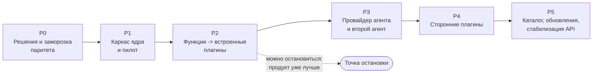

# Дорожная карта: от цельного приложения к ядру и плагинам

> План составителя по запросу владельца (2026-11-02), не согласован. Сроки не даны намеренно: оценки - относительные (S, M, L, XL), календарь определяет владелец после ответов на [открытые решения](../OVERVIEW.md#9-открытые-решения-нужен-ответ-владельца). Порядок переноса обоснован в [ADR-CH-0006](../03-architecture/adr/ADR-CH-0006-strangler-migration-and-parity.md), проверки - в [плане паритета](../04-verification/parity-plan.md).

## 1. Общая схема

После P2 продукт уже принёс пользу (модульность, единый реестр сочетаний, видимое состояние плагинов); P3-P5 можно отложить, не потеряв сделанного.

## 2. Фазы

### P0. Решения и заморозка паритета (S)

**Цель:** принять документы этого пакета и зафиксировать точку отсчёта.

| Работа | Результат |
|---|---|
| Ответы владельца на [открытые решения](../OVERVIEW.md#9-открытые-решения-нужен-ответ-владельца) | Решения D-07 фичи 01, D-11 фичи 02 закрыты |
| Принять ADR-CH-0001..0008 (статус `review` -> `approved`) | Архитектура согласована |
| Снять базовые метрики ([раздел 8 плана паритета](../04-verification/parity-plan.md#8-базовые-метрики-p0)) | Таблица с временем запуска и размерами |
| Собрать матрицу паритета скриптом и записать первые сценарии | `test/parity/` с 15 записями, матрица без пустых строк |
| Решить, куда переехать документам: в основной корпус (`docs/01-product/` и далее) или оставить рядом | Решение владельца |

**Выход:** решения приняты; матрица и базовые метрики записаны; существующие 893 теста и дымовой тест зелёные на `e4beb72`.

### P1. Каркас ядра и пилот (M)

**Цель:** вырастить ядро внутри работающего кода, не меняя поведения, и проверить его на одном плагине.

| Работа | Результат |
|---|---|
| `src/plugin-api` (типы), `src/core/host` (загрузчик, реестр сервисов, шина событий, `Disposable`) | FR-CH-1001..1008, FR-CH-2001, FR-CH-2002 |
| Шлюз IPC с пространствами имён и прокладкой над текущими обработчиками | FR-CH-2007, FR-CH-3003; все 58 каналов отвечают как раньше |
| Реестр команд и сочетаний с проверкой конфликтов при загрузке | FR-CH-2004; закрывает D-27 фичи 12 |
| Раздел «Плагины Cyborg», журнал плагинов, `--dump-plugins`, безопасный режим | FR-CH-1009, FR-CH-1010 |
| Храповики границ и реестр API на аудит | FR-CH-3005, FR-CH-1012 |
| **Пилот: `path-drop`** переносится в плагин | Первая функция на публичном API; правок `main.ts`, `preload.ts`, `app.ts` в объёме пилота - минимум, остальное фиксируется как долг каркаса |

**Выход:** паритет зелёный; пилот работает через публичный API; бюджеты запуска в норме; у ядра есть HMR-safety тесты реестров.

### P2. Функции во встроенные плагины (XL)

**Цель:** перенести все функции по одной, от малорисковых к рискованным. Порядок ([D-02 фичи 03](../01-product/03-migration/decision-log.md)):

| Шаг | Плагин | Что переезжает | Главный риск |
|---|---|---|---|
| 1 | `session-notifications` | Уведомления «сессия ждёт» | Малый |
| 2 | `search` | Окно поиска, `git-search`, три вида | Диалог и сочетания переходят на сервис и реестр |
| 3 | `command-buttons` | Кнопки, промпты, предложения модели | Связь с провайдером через `session.prompt` и событие `session.turnEnd` |
| 4 | `claude-extensions` | Окно расширений Claude Code, хабы, статистика; **переименование** в «Расширения Claude Code» | Затрагивает меню, тесты, документацию |
| 5 | `tracker-github`, `tracker-gitlab`, `tasks` | Задачи, провайдеры трекеров | Самая объёмная логика (`trackers.ts`, 707 строк) |
| 6 | `merge-requests` | MR и PR | Бюджет и пул запросов |
| 7 | `tracker-jira`, `status` | Карточка «Статус» | Зависит от шагов 5 и 6 |
| 8 | `session-isolation` | Вклад в `session.prompt` | Должен быть байт-в-байт тем же |
| 9 | `files` | Дерево, просмотр, смена ветки | Самый связанный с оболочкой, `app.ts` |
| 10 | Оболочка | Слоты в `app.ts`, диалоги на сервис, разрез `index.html` и `styles.css` | Самая рискованная; идёт последней |

Каждый шаг - отдельный PR с чек-листом ([раздел 6 плана паритета](../04-verification/parity-plan.md#6-чек-лист-pr-переноса)).

**Выход:** все функции в плагинах; `main.ts`, `preload.ts`, `app.ts` - сборка ядра без логики функций; прокладка каналов ещё работает; паритет зелёный; бюджеты в норме.

### P3. Провайдер агента и второй агент (L)

**Цель:** выделить Claude Code из ядра и доказать контракт вторым агентом.

| Работа | Результат |
|---|---|
| `agent-claude-code`: запуск, хуки, адаптер событий, история, восстановление | FR-CH-2009, FR-CH-2010; паритет записанных сессий |
| `session-history` на возможности провайдера | Нет знаний о формате журналов в ядре |
| Общий набор тестов провайдера | Проходят `agent-claude-code` и подставной провайдер |
| **Второй провайдер** (выбор владельца, D-11 фичи 02) | Подключён без правок ядра; контракт при необходимости уточнён |
| Удаление прокладки каналов (отдельный PR) | Старые каналы убраны, `window.cyborg` - тонкая оболочка или удалён |

**Выход:** второй провайдер работает; ядро не содержит литералов `claude`; паритет зелёный.

### P4. Сторонние плагины (L)

**Цель:** безопасно загружать чужие плагины и дать авторам инструменты.

| Работа | Результат |
|---|---|
| **Спайк** `utilityProcess` и изолированного окна ([риск R9](../OVERVIEW.md#8-риски)) | Решение: идём или откладываем L2 (ADR-CH-0003, п. 7) |
| Уровень L2: процесс плагина, RPC, проверка возможностей в шлюзе | FR-CH-2012 |
| Окно подтверждения прав, закрытые исходы, безопасный режим для L2 | FR-CH-2013, FR-CH-1009 |
| Набор автора: шаблон, тестовый хост, проверка «только публичный API», руководство | FR-CH-1013 |
| Установка из локальной папки | Сценарии [установки](../02-use-cases/third-party-install-permissions/scenario.md) и [автора](../02-use-cases/author-writes-plugin/scenario.md) |
| Пробный плагин от шаблона до установки за день | MOE BR-CH-004 |

**Выход:** пробный плагин работает в L2; тесты отказов показывают 0 обходов проверки прав; безопасный режим отключает L2.

### P5. Каталог, обновления, стабилизация (L)

**Цель:** распространение и обещание совместимости.

| Работа | Результат |
|---|---|
| Каталог плагинов (по образцу хабов) и установка из каталога | После решения владельца (вопрос 7) |
| Обновление плагинов с откатом по слепку и окном стабилизации | Из bb 5.2 |
| Стабилизация API: снятие `experimental_` с проверенных членов, `upgrade-guide` | Обещание совместимости (вопрос 6) |
| Пересмотр границы ядра и плагинов (допустим перенос функции в обе стороны) | Итоговый ADR |

**Выход:** решения владельца по каталогу и обещанию совместимости; стабилизированная часть API; руководство для авторов.

## 3. Сквозные работы

| Работа | Когда |
|---|---|
| Корпус: перенос этих документов в `docs/01-product/` и счётчики `.req_counter` | После P0 (решение владельца), затем по мере фаз; `check:corpus` на каждом PR |
| Руководство пользователя и страница «Архитектура» | Обновляются по мере переноса; раздел «Плагины Cyborg» - в P1 |
| Журнал ломающих изменений `upgrade-guide` | С P1 для публичного API |
| Постмортемы | После каждой находки о загрузчике или паритете: превращается в тест или проверку |
| Замер бюджетов | На каждой фазе |

## 4. Что делаем сразу после принятия

1. Ответы владельца на семь открытых решений.
2. P0: базовые метрики, матрица, первые записи паритета.
3. P1: каркас и пилот `path-drop`.

## 5. Риски фаз

Сведены в [OVERVIEW, раздел 8](../OVERVIEW.md#8-риски); для P2 главный - разрез оболочки (`app.ts`), для P4 - пригодность `utilityProcess`, для P3 - контракт, выточенный под один агент.
