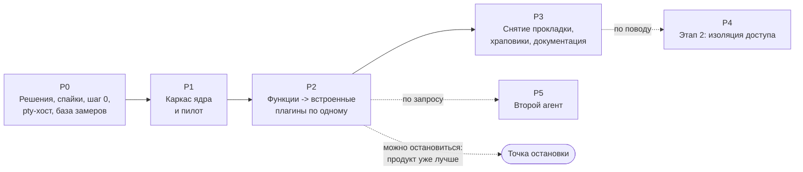

# Дорожная карта: от цельного приложения к ядру и плагинам

> План составителя по запросу владельца (2026-11-02), перестроен под [SAD2, раздел 6](../03-architecture/design/sad2.md#6-этапы) и [ресёрч-2](../research/sad2-validation.md); не согласован. Сроков и оценок в человеко-днях нет: относительные оценки (S, M, L, XL) прежней версии сняты, потому что состав фаз изменился, а новых оценок исходный материал не даёт. Календарь определяет владелец после ответов на [открытые решения](../OVERVIEW.md#9-открытые-решения-нужен-ответ-владельца). Порядок переноса обоснован в [ADR-CH-0006](../03-architecture/adr/ADR-CH-0006-strangler-migration-and-parity.md) и ниже, проверки - в [плане паритета](../04-verification/parity-plan.md). Номера вопросов - из [SAD2, раздела 8](../03-architecture/design/sad2.md#8-открытые-вопросы); соответствие строкам таблицы решений OVERVIEW дано в P0. Идентификаторы FR-CH и NFR-CH - из сводок «Сводка по SAD2» в конце [фичи 01](../01-product/01-plugin-host/srs.md#3-сводка-по-sad2), [02](../01-product/02-extension-contracts/srs.md#3-сводка-по-sad2) и [03](../01-product/03-migration/srs.md#3-сводка-по-sad2).

## 1. Общая схема

Первый этап SAD2 (все цели ядра без гарантии доступа) - фазы P0-P3; второй этап (изоляция доступа) - P4 по поводу; P5 - второй агент по запросу владельца.

После P2 продукт уже принёс пользу (модульность, единый реестр сочетаний, видимое состояние плагинов, живые pty при перезагрузке окна); P3 можно отложить, оставив прокладку; P4 и P5 запускаются только по причине и не блокируют друг друга.

| Фаза | Короткое содержание | Зависит от |
|---|---|---|
| P0 | решения владельца, четыре спайка, шаг 0 и pty-хост на текущем коде, база замеров | - |
| P1 | каркас ядра, прокладка, `config` и `state` с миграцией, хост `builtin` со сторожем, `<iframe>` с `mount`, пилот `session-notifications` | P0 |
| P2 | перенос остальных функций по одному плагину, от листьев к тугим узлам | P1 |
| P3 | снятие прокладки, затяжка храповиков, документация и набор автора | P2 |
| P4 | процесс на плагин с `--permission`, `Compartment` вторым слоем, окна согласия, установка | P3 и повод |
| P5 | второй агент как поставщик `cyborg.agent` | P2 и выбор владельца |

## 2. Фазы

### P0. Решения, спайки, шаг 0, pty-хост, база замеров

**Цель:** закрыть то, что SAD2 и ресёрч-2 оставили открытым, подготовить текущий код к миграции и снять базу, не начиная каркаса. Первый видимый пользователю результат: процессы сессий переживают перезагрузку окна.

**Состав.**

| Работа | Результат | Требования |
|---|---|---|
| **Решения владельца** по вопросам 12-17 SAD2 (строки 8-13 [таблицы OVERVIEW](../OVERVIEW.md#9-открытые-решения-нужен-ответ-владельца)): 12 - сырой хвост или снимок экрана (закрывает спайк); 13 - процесс на воркспейс (предложение: оставить); 14 - форма API меню, сочетаний с условиями, отмены запросов, вкладов в промпт (сигнатуры - в P1); **15 - восстановление сессий** (противоречит non-goal корпуса, нужно до P1); 16 - плагин `git`; 17 - `ProjectStore` рядом с новым форматом | решения записаны в decision-log и SAD2; при отказе по 15 FR-CH-3014 снимается, корпус не меняется | FR-CH-3014, FR-CH-1014 |
| **Решения по открытому в матрице** ([4.6 плана паритета](../04-verification/parity-plan.md#46-что-в-матрице-остаётся-открытым)): граница `trackers` ([4.4](../04-verification/parity-plan.md#44-граница-trackers), предложение - один плагин), владелец `prompts.json` и цикл `command-buttons` <-> `trackers`, место полосы кнопок под терминалом, состав `cyborg.git`, привязка задачи к сессии | решения записаны до начала P1, где фиксируются контракты | FR-CH-3016, FR-CH-2011, FR-CH-2005 |
| Принять ADR (`review` -> `approved`): ADR-CH-0009..0014 и уточнённые ADR-CH-0001, 0002, 0004, 0006, 0008; ADR-CH-0003, 0005, 0007 заменены и остаются в истории | архитектура согласована | - |
| **Шаг 0** на текущем коде: `ProjectStore` сохраняет неизвестные поля файла воркспейса (сегодня `OWN_FIELDS` стирает всё, кроме `commands`, и формат `{cyborg: 2, settings}` считается повреждённым); счётчик `nextId++` заменяется устойчивым id сессии; имя файла событий хуков строится от этого id, а не от pid | тест на файле с неизвестными полями, id не повторяется после перезапуска, существующие тесты зелёные | FR-CH-3010, FR-CH-2010 |
| **pty-хост на текущем коде**: `node-pty` переезжает из главного процесса в `utilityProcess` ядра; `persist`, `list`, `attach`, кольцевой буфер вывода, `resize` после `attach`; льготное время сироты. Часть «восстановление сессий после перезапуска приложения» (список сессий в `state`, `resume`) идёт только после решения 15 | вывод и ввод проходят, как раньше; сессия переживает перезагрузку окна; тест с подставной программой: `spawn`, падение хоста, `list` и `attach` возвращают тот же pty с `backlog` | FR-CH-1021, FR-CH-1022, ADR-CH-0012 |
| **Спайки** (раздел 7 ресёрча-2): (1) клавиши настоящей клавиатурой: `before-input-event` и акселераторы меню при фокусе в `<iframe>`, `Cmd+Shift+F`, `Ctrl+C`, `Cmd/Ctrl+Shift+N` и `Cmd/Ctrl+0` (последние два живут только в слушателе окна), `role: copy/paste`; (2) Monaco (воркеры) и xterm под `sandbox` и на кастомной схеме, перетаскивание `application/x-cyborg-path` между кадрами, бросок файла ОС; (3) настоящий `claude` в pty-хосте: запуск с хуками, повторный `resize` и перерисовка TUI после `attach`, сырой хвост против снимка экрана; (4) сторож: зависший хост, перезапуск, поиск виновника, выключение после трёх зависаний | результаты записаны в ресёрч-2 и закрывают вопросы 11 и 12 SAD2; спайк (3) выполняется до или как первая часть pty-хоста | FR-CH-2028, FR-CH-2021, FR-CH-1018, FR-CH-1021, FR-CH-3009 |
| **База замеров**: `scripts/measure.mjs` сегодня замеряет только загрузку панели задач и MR через CLI; расширить замерами времени до готового окна, памяти, открытия окон поиска, «Расширения», панелей, вывода терминала на реальной сессии; размер бандлов | заполнена [таблица плана паритета, раздел 8](../04-verification/parity-plan.md#8-базовые-метрики-p0); без неё бюджет «не хуже +10%» непроверяем | FR-CH-3007, NFR-CH-1001 |
| **Матрица и записи паритета**: скрипт строит матрицу по 14 фичам, 153 требованиям, 58 каналам (51 `handle` и 7 `on`) и 14 событиям; сценарии S1-S18 ([раздел 5 плана паритета](../04-verification/parity-plan.md#5-записанные-сессии-и-подставные-программы)) записаны на текущей сборке | матрица без пустых строк; записи проходят на `e4beb72` | FR-CH-3001, FR-CH-3004 |
| Решить, куда переехать документам пакета: в основной корпус (`docs/01-product/` и далее) или оставить рядом | решение владельца | - |

**Выход (проверяемые критерии).**

- решения 15, 16, 17, 13 приняты и записаны; по остальным принято предложение по умолчанию из OVERVIEW либо решение перенесено в P1 с причиной;
- все четыре спайка выполнены, результат каждого (получилось, не получилось, что меняется в SAD2) записан;
- шаг 0 и pty-хост закрыты тестами из FR-CH-3010 и FR-CH-1021; все тесты (`npm test`) и дымовой тест зелёные на текущем коде, число утверждений существующих тестов не уменьшилось;
- таблица базовых метрик заполнена, в том числе старт, память и вывод терминала;
- скрипт паритета зелёный: ни одной строки без владельца и проверки, 58 каналов и 14 событий найдены.

**Риски.**

| Риск | Что делаем |
|---|---|
| Спайк клавиш показывает, что `before-input-event` в кадре не работает | системные сочетания остаются акселераторами меню (как сегодня); сочетания вне меню (`Cmd/Ctrl+Shift+N`, `Cmd/Ctrl+0`) переводятся в пункты меню или в перехват оболочки |
| Спайк показывает проблему Monaco или xterm под `sandbox` | общий origin без `sandbox` для встроенных плагинов (ресёрч-2, 3.1) остаётся основным вариантом; `sandbox` - не предпосылка |
| `claude` в pty-хосте не перерисовывается после `attach` | вариант со снимком экрана (headless-xterm) вместо сырого хвоста; оценка работ - после спайка |
| pty-хост добавляет задержку в вывод терминала | замер против базы (+10%), бюджет «не более кадра, 16 мс» из предложения вопроса 9 |
| Владелец не отвечает по вопросу 15 | восстановление после перезапуска приложения не реализуется (FR-CH-3014 остаётся условным); pty-хост для перезагрузки окна и хоста идёт без него. Разрез - трактовка составителя: SAD2, 6.1 (шаг 1) называет «pty-хост ... и восстановление сессий» вместе и ограничение относит ко всему шагу |
| Правка `ProjectStore` меняет поведение для живых пользователей | существующие тесты `ProjectStore` не меняются; откат шага не стирает данные ([NFR-CH-3001](../01-product/03-migration/srs.md#nfr-ch-3001-обратимость-шага)) |

**Зависимости:** нет входящих; решения владельца блокируют P1.

### P1. Каркас ядра и пилот

**Цель:** вырастить ядро внутри работающего кода, не меняя поведения, и проверить его на одном плагине. Ядро - хост без предметной области ([ADR-CH-0009](../03-architecture/adr/ADR-CH-0009-core-boundary-and-compactness.md)).

**Состав.**

| Работа | Результат | Требования |
|---|---|---|
| `@cyborg/contracts` и `src/plugin-api` (типы), манифест со строгой схемой, версия API | первая версия пакета объявлений; структура репозитория - решение 5 OVERVIEW | FR-CH-1001, 1002, 1012, 2014 |
| **Воркспейс** как главная сессия: замок, одно окно, «Недавние», окно без плагинов | повторное открытие занятого воркспейса отказывает, как сегодня (FR-1029, FR-1033) | FR-CH-1014, 1015, 1019 |
| **Загрузка**: `plugins.enabled`, граф контрактов до запуска кода, состояния плагинов, `Disposable`, ленивая активация | сломанный граф виден до запуска кода | FR-CH-1003, 1004, 1006, 1008, 2001 |
| **Реестр контрактов и команд**, события в контрактах владельца, статические сочетания с проверкой конфликтов при загрузке | закрывает D-27 фичи 12 вместе с динамическими сочетаниями | FR-CH-2001, 2002, 2004, 2017 |
| **`config` и `state`** по разделам со схемой и версией, `migrate` до активации; **перенос** формата `{projects, lastProjectId, commands}`, файлов пользователя и ключей `localStorage` | тест миграции на эталонных файлах `e4beb72`, повторный запуск ничего не меняет | FR-CH-2008, 3006, 3011, 3012 |
| **Хост `builtin`** (`utilityProcess`), группы по `plugins.hosts`, **сторож** для хостов и pty-хоста с начальными порогами (ответ раз в 5 с, порог 15 с, 3 перезапуска за 5 минут, выключение после 3 зависаний) | отдельный тест на зависший хост, окно и pty живы | FR-CH-1005, 1016, 1017, 1018, NFR-CH-1002, 1005 |
| **Рендер**: роды областей и виды по манифестам, `<iframe>` с `mount`, CSP по умолчанию, origin по классу плагина, мост `MessagePort` без preload, токены темы и элементы ядра, слой диалогов, билет `pty.share()` | каркас рисуется до кода плагинов | FR-CH-2005, 2006, 2021, 2022, 2023, 2024, 2025, NFR-CH-2001, 2002, 2005 |
| **Шлюз `ctx.os`** с правами по манифесту, журнал, хранилище секретов ядра и ссылки `$secret`, «Плагины Cyborg», `--dump-plugins`, **безопасный режим** | права видны человеческим языком | FR-CH-1009, 1010, 2007, 2012, 2018, 2019, 2020 |
| **Клавиши и события**: системные сочетания, `ctx.keys.register` с условиями, события окна и системы, вклады в меню, заголовок и фокус окна, буфер обмена, каталог из диалога, отмена запросов, форма контракта-источника фрагментов промпта | пробелы паритета SAD2, 5.5 закрыты формой API | FR-CH-2016, 2028, 2029, 2030, 2031, 2032, 2033, 2034 |
| **Прокладка каналов** над текущими обработчиками: все 58 каналов и 14 событий отвечают как раньше | тест прокладки (механизм 7) | FR-CH-3003 |
| **Храповики границ** и тесты дисциплины первого этапа, реестр API на аудит, HMR-safety тест реестров | стартовое значение счётчика: 21 из 38 модулей `src/main` с прямыми `node:*`, `electron`, `node-pty`; 20 файлов окна импортируют `../main/*` | FR-CH-3005, 1020, 1012 |
| **Переходные адаптеры** над старым кодом для контрактов, которых ещё нет как плагинов: `cyborg.sessions` (активная сессия, cwd, ожидание, показ) и `cyborg.projects`. Нужны пилоту и первым переносам; это предложение составителя, SAD2 такой слой не описывает | адаптер заменяется настоящим плагином на соответствующем шаге P2 | - |
| **Пилот `session-notifications`** (FR-10006): право `notify`; потребляет `cyborg.sessions` и `ctx.window.onFocusChange`; вклад в меню `notifications:toggle`; каналы `session:notify`, `session:unnotify`, `notifications:state` и событие `session:reveal`. Не `path-drop`: он в SAD2 часть `sessions` и не проверяет ни контракт, ни права | первая функция на публичном API; правок `main.ts`, `preload.ts`, `app.ts` в объёме пилота - минимум, остальное фиксируется как долг каркаса | FR-CH-3013, 2033, 2031 |

**Выход (проверяемые критерии).**

- паритет зелёный: матрица без пустых строк, прокладка отвечает на 58 каналов, записи S1-S18 проходят;
- пилот работает через публичный API, дисциплина (`structuredClone`, импорты, `ctx.os`) проверена тестами на нём;
- тест миграции (S18) зелёный; прежний `ProjectStore` не стирает данные нового формата;
- сторож: отдельный тест на зависший хост пройден; падение хоста плагина не трогает окно и pty;
- бюджеты запуска и горячих путей в пределах +10% от базы P0; задержка вызова через шлюз против предложения 1 мс на p99;
- безопасный режим выключает все плагины; окно без плагинов открывается и показывает «Плагины Cyborg»;
- у ядра есть HMR-safety тесты реестров.

**Риски.**

| Риск | Что делаем |
|---|---|
| Контракты `cyborg.sessions` и `cyborg.projects` проектируются по адаптеру над старым кодом и выточены под него | форма контрактов фиксируется по SAD2, 5 и 5.2, адаптер подгоняется под неё; общий набор тестов контракта (вопрос 10 SAD2) пишется сразу |
| Пилот слишком мал: не трогает pty, дерево и поиск, горячие пути не проверены | первая проверка горячих путей - в P2, шаги `search` и `files`; бюджеты замеряются там |
| Две дорожки кода (старая и плагины) и прокладка вместе | отдельный PR на каждый шаг, откат шага ([NFR-CH-3001](../01-product/03-migration/srs.md#nfr-ch-3001-обратимость-шага)) |
| Цена `<iframe>` и хостов выше, чем замерено на пустых кадрах | замер на реальных видах; общий origin для встроенных (3 МБ против 17 МБ); группы хостов настраивает пользователь |
| Сторож без прецедента ведёт себя иначе в реальном Electron | пороги - стартовые и настраиваются; тест на зависший хост до каркаса уже в P0 |

**Зависимости:** выход P0 (решения 13, 15, 16, 17; закрытые спайки; шаг 0; pty-хост; база замеров).

### P2. Функции во встроенные плагины

**Цель:** перенести все функции по одной с паритетом. Каждый шаг - отдельный PR с [чек-листом](../04-verification/parity-plan.md#6-чек-лист-pr-переноса). Порядок строится по связности (ресёрч-2, 5.2 п. 5 и 5.3), от плагинов, которые ни от кого не зависят, к тугим узлам; принцип «по возрастанию риска» из [ADR-CH-0006](../03-architecture/adr/ADR-CH-0006-strangler-migration-and-parity.md) сохранён, состав шагов изменён: прежние `tasks`, `merge-requests`, `status`, `tracker-*`, `session-history`, `session-isolation`, `path-drop` в SAD2 отдельными плагинами не значатся ([4.1 плана паритета](../04-verification/parity-plan.md#41-функции-и-целевые-плагины)).

**Порядок и обоснование.**

| Шаг | Плагин | Что переезжает (фичи, каналы) | Почему здесь | Главный риск |
|---|---|---|---|---|
| P1 | `session-notifications` | уведомления «сессия ждёт»: фича 10 (FR-10006), 3 канала | **пилот P1** | горячих путей не трогает |
| A1 | `search` | фича 13 (9 требований): `fs:files`, `search:text`, `search:changes`, `menu:search` | лист: на него никто не опирается; из внешнего нужен только `git` (пока своим правом `process`, см. B1) | отмена запросов через протокол вместо `AbortController` ([FR-CH-2016](../01-product/02-extension-contracts/srs.md#fr-ch-2016-отмена-запросов)); поиск отдаёт в окно весь список файлов репозитория; первый замер горячего пути через хост |
| A2 | `claude-extensions` | фича 14 (17 требований): 7 каналов `extensions:*`, `hubs:*`, `menu:extensions`; **переименование** в «Расширения Claude Code» ([FR-CH-3008](../01-product/03-migration/srs.md#fr-ch-3008-переименование-окна-расширения)) | лист: читает `~/.claude/*`, `.mcp.json` репозиториев, ходит по https и запускает `claude` через оболочку, не связан с остальными плагинами | самый объёмный по коду из листьев (2753 строки с окном); права `process`, `net`, `fs` описываются при переносе; затрагивает меню, тесты, руководство |
| B1 | `git` | 6 каналов `git:*`; контракт `cyborg.git` | приёмник: нужен `files`, `viewer`, `search`, `trackers`, `command-buttons`; сам почти ни от чего не зависит, кроме проверки занятости репозитория сессией ([4.6, п. 3-4](../04-verification/parity-plan.md#46-что-в-матрице-остаётся-открытым)). Выделение до потребителей избавляет их от адаптера git; `search` переключается на контракт малым PR | состав `cyborg.git` (`gitRemotes`, `gitFiles`); отметки git в дереве (`cyborg.tree-decoration`) |
| B2 | `viewer` | `fs:read`; документ «файл» (Monaco), команда `file.open`, `editJson` | приёмник: исполнитель `file.open` для `files`; `editJson` нужен редакторам `command-buttons` | Monaco в `<iframe>` (спайк P0); `editJson` обязан нести проверку владельца ([4.6, п. 7](../04-verification/parity-plan.md#46-что-в-матрице-остаётся-открытым)) |
| B3 | `files` | фичи 04, 07 (UI), 03 (FR-3001): `fs:list`, дерево, меню выбора ветки, источник MIME | потребляет `cyborg.sessions` и `cyborg.projects` (пока через адаптеры), `cyborg.git`, команду `file.open`; самый связанный с оболочкой из средних | горячий путь: `listDir` последовательными вызовами и опрос `git:status` раз в 3 с через хост; разрез `app.ts` (дерево, корни, отметки) |
| C1 | `projects` | 5 каналов: `dialog:pickDir`, `projects:*`, `project:selected`; `menu:project`; `cyborg.projects`, `cyborg.project-settings` (потребитель) | `trackers` требует `cyborg.projects`, поэтому раньше; граница узла `workspaces.ts` -> `projects` и `trackers` режется здесь | `projects:save` валидирует секцию трекеров и сбрасывает вход (`trackers.resetAuth()`); каталог из диалога должен стать доступен до сохранения проекта ([FR-CH-2034](../01-product/02-extension-contracts/srs.md#fr-ch-2034-каталог-выбранный-в-диалоге)); копия повреждённого файла |
| C2 | `trackers` | фичи 01 (30 требований), 02, 11: 14 каналов; три вида; поставщик `cyborg.project-settings` | самая объёмная логика (1870 + 1129 + 1093 строк); требует `projects`, использует `git`, запуск сессий (через адаптер `cyborg.sessions`), шаблоны промптов; граница плагина - [4.4 плана паритета](../04-verification/parity-plan.md#44-граница-trackers) | решения по границе и по `prompts.json`; привязка задачи и MR к сессии только в памяти (FR-1015, FR-2014); `process` на `gh`, `glab`, `jira` |
| C3 | `sessions` и `agent-claude-code` (одним шагом) | `session:create`, `session:resume`, `session:kill`, `history:*`; события `session:*`; вид «Сессии»; изоляция (фича 09); бросок пути (FR-3002, 3003, 3005); ссылки в выводе; `cyborg.sessions`, `cyborg.agent`; билет `pty.share()`; **восстановление сессий - только после решения 15** | `sessions.ts` держит менеджер сессий и запуск `claude` с хуками вместе, их разрез - один шаг; от `cyborg.sessions` зависят все остальные: адаптеры заменяются настоящим контрактом; самый горячий путь, поэтому последним из ядра сессий | вывод терминала через билет (бюджет 16 мс); хуки, `resume`, файл событий без pid; фрагменты промпта из `trackers`, `prompts` и изоляции ([FR-CH-2032](../01-product/02-extension-contracts/srs.md#fr-ch-2032-вклады-в-промпт-запуска-агента)); права агента: оболочка пользователя, запись в `~/.claude/projects` |
| C4 | `command-buttons` | фича 12 (10 требований): 5 каналов `commands:*`, `prompts:*`, `config:reveal`; `menu:commands`, `menu:prompts`, `session:suggest` | потребляет события `sessions` (конец хода), `cyborg.git` (`{branch}`), `trackers` (`{pr}`, `{task}`), `viewer.editJson`, `ctx.keys.register`; из-за этого последний | цикл с `trackers` через промпты; полоса кнопок под терминалом (FR-12001); дефект D-27 закрывается единым реестром; `commands:*` читает файл пользователя и раздел воркспейса |
| C5 | Оболочка | остаток `app.ts`, `index.html`, `styles.css`, `main.ts`, `preload.ts`, `menu.ts` | идёт последней: после переноса плагинов в ней остаётся только каркас по манифестам | самая рискованная: `app.ts` (1360 строк) разрезается не по плагинам, а по мере их переноса |

**Почему такой порядок.**

- *Листья первыми* (`search`, `claude-extensions`, пилот): на них не опирается ни один плагин, исходящих связей почти нет. Отказ шага не ломает остальное, а загрузчик, хосты, `<iframe>` и права проходят проверку на изолированных функциях. Это же снимает основную цену проверки: до тугих узлов уже накоплены записи паритета и замеры горячих путей.
- *Приёмники перед потребителями* (`git`, `viewer`, затем `files`): `files` и позже `command-buttons` и `trackers` вызывают `cyborg.git` и `file.open`; выделив владельца раньше, потребители пишутся сразу на контракт, а не на адаптер над старым кодом.
- *Тугие узлы последними* ([ресёрч-2, 5.2](../research/sad2-validation.md#52-допущения-sad2-которые-код-нарушает), п. 5): `workspaces` -> `projects` и `trackers`; `sessions` -> `suggestions` -> `commands`; `jira`, `mrs`, `trackers` -> `prompts` -> `commands`; `sessions.ts` вместе с запуском агента; `app.ts`. Порядок внутри группы следует графу контрактов: `projects` раньше `trackers` (тот его требует), `sessions` с агентом раньше `command-buttons` (тот потребляет события сессий).
- *Цена выбора.* Переходные адаптеры `cyborg.sessions` и `cyborg.projects` живут до C1 и C3: это временный код. Альтернатива - перенести `projects` и `sessions` раньше, чтобы адаптеры не понадобились, - ставит самый связанный и самый горячий узел первым и противоречит принципу «по возрастанию риска». Порядок `trackers` перед `sessions` - предложение: обратный экономит адаптер для трекеров, но переносит горячий путь раньше; решается по итогам P1.
- Для трекеров один плагин `trackers` с тремя видами - рабочее предложение, не решение SAD2 ([4.4 плана паритета](../04-verification/parity-plan.md#44-граница-trackers)).

**Выход (проверяемые критерии).**

- все 14 фич и 153 требования в плагинах: строка матрицы каждой функции в статусе «перенесено, паритет подтверждён»; 58 каналов и 14 событий имеют владельца-плагин или ядро;
- `main.ts`, `preload.ts`, `app.ts` - сборка ядра без логики функций; переходные адаптеры удалены;
- прокладка каналов ещё работает; паритет зелёный; бюджеты в пределах +10% от базы, горячие пути (вывод терминала, дерево, поиск) замерены;
- `smoke.mjs` и `static-guards.test.ts` переписаны с тем же числом утверждений ([FR-CH-3015](../01-product/03-migration/srs.md#fr-ch-3015-перенос-тестов-с-сохранением-утверждений)), расхождения - в allowlist;
- храповик импортов: число прямых обращений к `electron`, `node:*`, `fs` в перенесённом коде равно нулю.

**Риски:** главный для P2 - разрез оболочки (`app.ts`) и тугие узлы C1-C4; горячие пути через хост (дерево, `git:status`, поиск, вывод терминала); цикл `command-buttons` <-> `trackers`; потеря утверждений при переписывании `smoke.mjs`. См. [9 плана паритета](../04-verification/parity-plan.md#9-риски-паритета-найденные-сверкой-с-кодом).

**Зависимости:** выход P1; для C3 в части восстановления сессий - решение 15.

### P3. Снятие прокладки, храповики, документация для авторов

**Цель:** закрыть первый этап SAD2: убрать временный слой, затянуть проверки границ, дать авторам инструмент. После P3 в ядре нет каналов IPC, привязанных к функциям, и нет временного слоя.

**Состав.**

| Работа | Результат | Требования |
|---|---|---|
| Удаление прокладки каналов отдельным PR после зелёного паритета: старые каналы убраны, `window.cyborg` - тонкая оболочка или удалён; механизм 7 плана паритета снимается вместе с ней, счётчики каналов пересматриваются записью | 58 прежних каналов функций в `main.ts` удалены | FR-CH-3003 |
| Затяжка храповиков: счётчики прямых обращений к `electron`, `node:*`, `fs` доведены до нуля в коде, который достижим из плагина; общие типы вынесены в `@cyborg/contracts`; судьба `experimental_` и реестра аудита решена | `scripts/check-boundaries.mjs` в CI без исключений | FR-CH-3005, 1012 |
| Набор автора: шаблон плагина, тестовый хост (настоящий загрузчик, подставные `ctx.os` и программы), проверки дисциплины, общий набор тестов контракта (вопрос 10 SAD2), порядок сборки плагина в поставку | автор доводит плагин-образец от шаблона до зелёных тестов в тестовом хосте | FR-CH-1013, 1020 |
| Руководство автора, страница «Архитектура», руководство пользователя («Плагины Cyborg»); журнал ломающих изменений `upgrade-guide` | документы опубликованы и ссылаются на реестр контрактов | - |
| Контракт `cyborg.agent` помечен как нестабильный до второго поставщика (P5); обещание совместимости внешним авторам - после решения владельца (вопрос 6 OVERVIEW) | в документации автора указано, что считается стабильным | FR-CH-2014, 2015, 2009 |
| Запись о сроках удаления кода миграции формата («через пару версий») | единственное место, где ядро знает чужие поля, учтено в плане | FR-CH-3011 |

**Выход (проверяемые критерии).**

- прокладка удалена, старых каналов IPC нет; паритет зелёный по контрактам и записанным сессиям; все тесты и дымовой тест зелёные;
- храповики проходят без исключений; в ядре нет имён плагинов (проверка [FR-CH-1019](../01-product/01-plugin-host/srs.md#fr-ch-1019-окно-без-плагинов));
- набор автора собран; плагин-образец от шаблона работает в тестовом хосте и проходит проверки дисциплины;
- закрыт первый этап SAD2: все цели ядра раздела 3 без `Compartment`, окон согласия и установки.

**Риски.**

| Риск | Что делаем |
|---|---|
| Удаление прокладки ломает вызов, о котором забыли | тест прокладки гоняется до последнего PR; удаление - отдельный PR с откатом |
| Документация расходится с реальным API | примеры в руководстве проверяются в тестовом хосте |
| Обещание совместимости даётся рано | срок обещания - решение владельца (вопрос 6 OVERVIEW); до него все новые члены - `experimental_` или нестабильные по решению об их судьбе |

**Зависимости:** выход P2.

### P4. Этап 2: изоляция доступа по поводу

**Цель:** безопасно загружать чужие плагины. Не начинается без повода ([SAD2, 6.2](../03-architecture/design/sad2.md#62-этап-2-изоляция-доступа-по-поводу)): плагин от автора вне команды, который нужно дать установить пользователю, или каталог плагинов. Если дисциплина первого этапа соблюдена ([FR-CH-1020](../01-product/01-plugin-host/srs.md#fr-ch-1020-дисциплина-первого-этапа-проверяется-тестами)), переход меняет среду выполнения хоста, а не код плагинов.

**Состав.**

| Работа | Результат | Требования |
|---|---|---|
| **Процесс на плагин**: Electron как Node (`ELECTRON_RUN_AS_NODE`) с `--permission` и явными путями; `utilityProcess` флаг принимает и не применяет ([ресёрч-2, 2.2](../research/sad2-validation.md#22-права-node-флаг-принимается-но-не-действует)); сеть и окружение флагом не закрываются, их держит шлюз; поток вывода pty к `<iframe>` такого плагина идёт через главный процесс | тесты отказов: чтение вне разрешённого каталога, `child_process`, `worker_threads` - `ERR_ACCESS_DENIED`; сеть и `env` закрыты шлюзом | FR-CH-1023, NFR-CH-1005 |
| **`Compartment`** (`ses`) вторым слоем: проверка совместимости бандлов в начале этапа (`zod` и `marked` не загружаются, `@endo/evasive-transform` не проверен); глобалы из `ctx`; `Date` и `Math` явно | тесты побегов: `Function` через `constructor`, запись в прототипы | FR-CH-1024 |
| **Окна согласия** и закрытые исходы подтверждения; `process` и `pty` показываются как «полный доступ через программу»; смена хоста в `config:baseUrl` требует подтверждения | отказ и согласие записаны в журнал | FR-CH-2013, 2012, 2035 |
| **Установка стороннего плагина**: источник (каталог, файл, git), подпись или хеш, повторное согласие, когда новая версия расширяет права; решение по вопросу 8 SAD2 записывается в ADR до начала работ | механизм установки | FR-CH-1025 |
| Дополнение набора автора для сторонних плагинов, сценарии [установки](../02-use-cases/third-party-install-permissions/scenario.md) и [автора](../02-use-cases/author-writes-plugin/scenario.md) | сценарии проходят | FR-CH-1013 |
| Пробный плагин от шаблона до установки за день (MOE BR-CH-004) | замер по руководству | - |
| Интеграции по HTTP API (`"net": ["config:baseUrl"]`) - узкий класс; переход трекеров с CLI на API - **новое требование, не перенос** | отдельное решение | FR-CH-2035 |

**Выход (проверяемые критерии).**

- пробный плагин работает в процессе с `--permission`; тесты отказов показывают 0 обходов проверки прав;
- безопасный режим выключает и такие плагины; зависание или падение процесса плагина не трогает окно и другие хосты;
- решение по установке и подписи записано в ADR; сценарии установки и автора проходят;
- память на процесс плагина (около 12 МБ по ресёрчу-2) и задержка потока pty через главный процесс (около 50 мкс сверху) укладываются в бюджеты, принятые для этапа.

**Риски.**

| Риск | Что делаем |
|---|---|
| `Compartment` принимают за границу против злого кода | граница - процесс с `--permission`; `Compartment` слой против ошибок и цепочки поставок (Figma, CVE-2023-39532) |
| Модель прав Node - страховка: открытые дескрипторы и символические ссылки её обходят, сеть не покрыта | сеть и окружение закрывает шлюз; тесты отказов на реальных обходах |
| Права `process` и `pty` дают программе все права пользователя | честная граница в окне согласия, списки аргументов и опасных флагов (вопрос 5 SAD2) |
| Захваченный издатель (Cyberhaven) | подпись и источник важны не меньше окна согласия |
| Цена процесса на плагин при десятке плагинов | группировка по хостам остаётся настройкой |

**Зависимости:** выход P3 (набор автора, дисциплина, чистая граница ядра); повод; решения владельца по вопросам 1, 2, 7 OVERVIEW и по вопросу 8 SAD2.

### P5. Второй агент (по запросу)

**Статус.** Сохраняется как условие стабилизации контракта `cyborg.agent` (решение D-05 фичи 02, BR-CH-003): контракт нельзя считать стабильным, пока он выточен под один агент. Не начинается без выбора агента владельцем (вопрос 3 OVERVIEW) и не блокируется P4. Если владелец отказывается, фаза не выполняется, контракт остаётся нестабильным и обещание совместимости для него не даётся; остальные фазы не затронуты.

**Цель:** подключить второго поставщика `cyborg.agent` без правок ядра и `sessions`.

**Состав.**

| Работа | Результат | Требования |
|---|---|---|
| Общий набор тестов контракта (вопрос 10 SAD2): его проходят `agent-claude-code`, подставной поставщик и второй агент | `sessions` работает с подставным поставщиком | FR-CH-2009, 2003 |
| Второй поставщик: любой CLI с хуками либо ACP-агент (выбор владельца); запуск через `ctx.os.pty.spawn` по праву `pty`, события, история, `resume` | подключён без правок ядра; контракт уточняется, если выявлен перекос под один агент | FR-CH-2009, 2010, 1021 |
| Стабилизация `cyborg.agent`: минорные и мажорные правила, `@deprecated` | снятие нестабильной пометки | FR-CH-2014, 2015 |

**Выход (проверяемые критерии).**

- второй поставщик работает; общий набор тестов контракта проходят оба;
- в ядре и в `sessions` нет литералов `claude` (проверка в духе bb `check-provider-literal-ratchet`);
- сценарий [второго агента](../02-use-cases/second-agent/scenario.md) проходит; паритет `agent-claude-code` не нарушен.

**Риски:** контракт, выточенный под один агент; у второго агента нет хуков или иной формат событий; восстановление сессий (если решение 15 положительное) зависит от `resume` каждого агента.

**Зависимости:** выход P2 (шаг C3: `sessions` и `agent-claude-code`); выбор агента владельцем.

## 3. Сквозные работы

| Работа | Когда |
|---|---|
| Корпус: перенос документов пакета в `docs/01-product/` и счётчики `.req_counter` | После P0 (решение владельца), затем по мере фаз; `check:corpus` на каждом PR |
| Руководство пользователя и страница «Архитектура» | Обновляются по мере переноса; раздел «Плагины Cyborg» - в P1; итоговая редакция в P3 |
| Журнал ломающих изменений `upgrade-guide` | С P1 для публичного API |
| Постмортемы | После каждой находки о загрузчике или паритете: превращается в тест или проверку |
| Замер бюджетов (старт, память, открытие окон, вывод терминала, вызов через шлюз) | На каждой фазе от базы P0; повтор `research/spikes/sad2/` на целевых платформах (замеры только на macOS M1 Pro) |
| Изменение основного корпуса по решению 15 (non-goal «восстановление сессий», FR-1015, FR-2014) и по переименованию «Расширения Claude Code» | Вместе с PR соответствующего шага |

## 4. Что делаем сразу после принятия

1. Ответы владельца по строкам 8-13 [таблицы OVERVIEW](../OVERVIEW.md#9-открытые-решения-нужен-ответ-владельца) (вопросы 12-17 SAD2), в первую очередь по восстановлению сессий; решение 5 (структура репозитория) нужно до P1.
2. P0: шаг 0 и pty-хост на текущем коде, четыре спайка, база замеров, матрица и записи паритета.
3. P1: каркас и пилот `session-notifications`.

## 5. Риски фаз

Сведены в [OVERVIEW, раздел 8](../OVERVIEW.md#8-риски); для P0 главные - спайки клавиш и `claude` в pty-хосте, для P2 - разрез оболочки (`app.ts`) и тугие узлы, для P4 - граница изоляции (`Compartment` не граница, `--permission` в `utilityProcess` не действует), для P5 - контракт, выточенный под один агент. Риски паритета, найденные сверкой с кодом, - [раздел 9 плана паритета](../04-verification/parity-plan.md#9-риски-паритета-найденные-сверкой-с-кодом).
