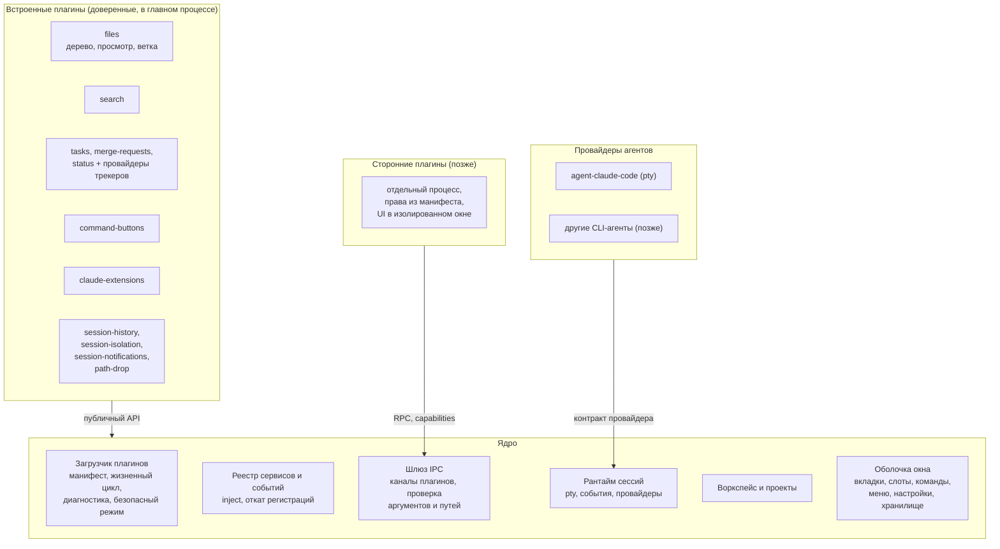

# Cyborg Harness: общее описание и ресёрч

Документ отвечает на три вопроса: **что** мы делаем, **как** и **почему именно так**. Подробности по каждому ответу - в соседних документах, ссылки в тексте. Статус: `review`, решения составителя ждут приёмки владельцем продукта; открытые решения собраны в разделе 9.

## 1. Что делаем и зачем

**Цель.** Превратить Cyborg из цельного приложения в **ядро и плагины**: маленькое ядро (окно, сессии, воркспейс, загрузчик плагинов, шлюз IPC) и всё остальное - дерево файлов, поиск, задачи, MR, статус, кнопки-команды, окно расширений Claude Code - как встроенные плагины на публичном API. Затем открыть тот же API для сторонних плагинов и для других агентов, помимо Claude Code.

**Зачем.**
1. Сегодня каждая новая возможность правит три общих файла (`main.ts`, `preload.ts`, `app.ts`) и копится в одном целом: 14 тыс. строк, 58 каналов, шесть диалогов в одном `index.html`. Чем больше функций, тем дороже каждая следующая и тем больше шанс сломать соседнюю ([сегодня](research/cyborg-today.md)).
2. Cyborg знает про Claude Code напрямую (аргументы, хуки, формат журналов). Чтобы подключить другого агента, нужен шов, которого сейчас нет.
3. Расширения - то, чем пользователи будут отличаться: свои трекеры, свои панели, свои кнопки. Без плагинов каждое такое желание - правка ядра.
4. Два сильных проекта с этой идеей уже существуют ([bb](research/bb.md), [DeepSeek Harness](research/deepseek-harness.md)), и их опыт можно проверить на нашем коде.

**Жёсткое условие: ничего из существующего не теряется.** Все 153 требования, 893 теста и дымовой тест остаются зелёными на каждом шаге; данные пользователя (файл воркспейса, `commands.json`, `prompts.json`, `hubs.json`, настройки окна) читаются новой версией. Как это обеспечивается - раздел 6 и [план паритета](04-verification/parity-plan.md).

**Чего не делаем (границы).** Не пишем свой цикл модели и не заменяем Claude Code: сессия остаётся нативным `claude` в pty. Не строим облако, мобильный клиент, учётные записи и маркетплейс на первом этапе. Не копируем масштаб образцов (372 пакета, контракты по 6000 строк): начинаем с 7 точек расширения.

## 2. Что показал ресёрч

Исследованы два проекта: [bb](https://github.com/get-bb/bb) (агентная IDE, плагины, провайдеры агентов) и [DeepSeek Harness](https://github.com/deepseek-ai/deepseek-harness) (харнес «everything is a plugin» на Cordis). Метод и ограничения - в [research/README.md](research/README.md).

| № | Вывод | Подтверждение |
|---|---|---|
| 1 | Оба проекта строят ядро как **минимум** (хранилище и доставка у bb, загрузчик и реестр сервисов у dsh), а видимые пользователю функции выносят в плагины | [bb 5.7](research/bb.md), [dsh 3](research/deepseek-harness.md) |
| 2 | Рабочая модель плагина - **сервис с `inject` и откатом регистраций**: всё, что плагин зарегистрировал, снимается при выгрузке, зависимые перезапускаются | dsh 2 |
| 3 | **Манифест со строгой схемой** и двумя диапазонами совместимости (приложение и API), проверка до импорта кода; ломающие изменения - с записью «что изменилось, как мигрировать» | bb 5.1, dsh 5 |
| 4 | Заменяемые возможности устроены тремя ролями **Definition, Provider, Consumer**; делить на пакеты заранее не нужно, пока нет второго провайдера | dsh 4 |
| 5 | Агентов подключают **структурным протоколом** (SDK, ACP) и сами строят таймлайн. **Интерактивный CLI в pty не встраивает никто**: у Cyborg контракт провайдера придётся проектировать самим | bb 5.6, dsh 8 |
| 6 | «Не потерять функции» у bb обеспечено **паритетом по записанным сессиям**: записи, повтор на каждом коммите, allowlist допустимых расхождений, закреплённые счётчики | bb 5.6 |
| 7 | У обоих **сторонний плагин исполняется без изоляции**: доверие при установке. Для нас, где рядом живут сессии с правами пользователя, этого мало | bb 5.4, dsh 9 |
| 8 | Цена подхода - ритуалы и масштаб (двуязычные документы, 100% покрытие, сотни скриптов-гейтов). Перенимать надо выборочно | dsh 11 |

Подробное сопоставление и список «берём, не берём» - [comparison.md](research/comparison.md).

## 3. Целевая архитектура

Ключевые решения (каждое - отдельный ADR):

- **Своё маленькое ядро, без Cordis и без форка** ([ADR-CH-0001](03-architecture/adr/ADR-CH-0001-core-and-plugins.md)).
- **Манифест в `package.json`**, строгая схема, `engines.cyborg` и целочисленная версия API, префикс `experimental_` ([ADR-CH-0002](03-architecture/adr/ADR-CH-0002-manifest-and-compatibility.md)).
- **Три уровня доверия**: ядро, встроенные плагины (в главном процессе), сторонние (отдельный процесс, права из манифеста); безопасный режим ([ADR-CH-0003](03-architecture/adr/ADR-CH-0003-trust-and-isolation.md)).
- **Контракт провайдера агента: pty-first** - запуск, события, история, вклад в промпт, восстановление; структурные провайдеры позже ([ADR-CH-0004](03-architecture/adr/ADR-CH-0004-agent-provider-contract.md)).
- **Точки расширения v1: семь**, события трёх режимов ([ADR-CH-0005](03-architecture/adr/ADR-CH-0005-extension-points.md)).
- **Миграция «душителем» с паритетом** ([ADR-CH-0006](03-architecture/adr/ADR-CH-0006-strangler-migration-and-parity.md)).
- **Слоты интерфейса на обычном DOM** и единый реестр команд и сочетаний ([ADR-CH-0007](03-architecture/adr/ADR-CH-0007-ui-slots-and-commands.md)).
- **Именование**: плагин Cyborg и плагин Claude Code - разные вещи ([ADR-CH-0008](03-architecture/adr/ADR-CH-0008-terminology.md)).

Полное описание - [SAD](03-architecture/design/sad.md).

## 4. Что в ядре, а что в плагинах

Принцип: в ядро идёт то, без чего **не работает ничего другое** или что **защищает границы** (пути, процессы, секреты). Всё, что пользователь может выключить и приложение останется приложением, - плагин.

| Функция сегодня | Целевое место | Комментарий |
|---|---|---|
| Окно, вкладки сессий, тема, шрифт, заголовок, терминал (xterm, ссылки в выводе) | **ядро**: оболочка | Оболочка делает слоты и ничего не знает о задачах и MR |
| Воркспейс, проекты, замок, «Недавние» | **ядро** | Все плагины опираются на проект |
| Рантайм сессий: pty, файл событий, реестр провайдеров | **ядро** | Знает про провайдер, но не про Claude Code |
| Шлюз IPC, `AllowedPaths`, запуск внешних программ с пределами, безопасное чтение git | **ядро** | Граница доверия |
| Настройки, хранилище, команды и сочетания, меню, уведомления ОС | **ядро** (сервисы) | Единый реестр исправляет класс ошибок «сочетание занято меню» |
| Claude Code как агент: аргументы, хуки, история, инструкции | **плагин** `agent-claude-code` | Первый провайдер |
| Дерево, просмотр, git-статус, смена ветки | **плагин** `files` | На сервисе git из ядра |
| Поиск файла, текста, изменений | **плагин** `search` | |
| Задачи | **плагин** `tasks` + провайдеры `tracker-github`, `tracker-gitlab` | Точка «трекер»: Definition, Provider, Consumer |
| MR и PR | **плагин** `merge-requests` | |
| Статус проекта и Jira | **плагин** `status` + провайдер `tracker-jira` | |
| Кнопки-команды, промпты, предложения модели | **плагин** `command-buttons` | Предложения модели - вклад в промпт и разбор события `Stop` через точки расширения |
| Окно «Расширения» Claude Code, хабы, статистика | **плагин** `claude-extensions` | Зависит от `agent-claude-code` |
| История сессий (список, продолжить, удалить) | **плагин** `session-history` | Через возможность провайдера |
| Изоляция параллельных сессий | **плагин** `session-isolation` | Вклад в системный промпт провайдера |
| Уведомления «сессия ждёт» | **плагин** `session-notifications` | |
| Вставка пути перетаскиванием | **плагин** `path-drop` | Первый кандидат на пилот |

В ядре остаётся 11 компонентов ([SAD, раздел 5](03-architecture/design/sad.md#5-состав-ядра)), во встроенные плагины уходит 15: 12 функциональных и 3 провайдера трекеров. Точная таблица с файлами - в [SAD](03-architecture/design/sad.md#14-классификация).

## 5. Как это будет работать для пользователя и автора плагина

- **Пользователь** ничего не замечает: те же окна, те же клавиши, те же файлы. Появляется раздел «Плагины Cyborg» (список, состояние, безопасный режим); с ним позже - установка из локальной папки.
- **Автор плагина** создаёт каталог с `package.json` (блок `cyborg`), точкой входа для главного процесса и, если нужно, интерфейса; получает тестовый хост и проверку «только публичный API». Подробнее - [сценарии](02-use-cases/).
- **Мейнтейнер Cyborg** добавляет возможность как плагин на публичном API; правок `main.ts`, `preload.ts` и `app.ts` для этого больше не требуется.

## 6. Как не потерять ничего из того, что есть

Это самое ответственное условие, поэтому оно разложено на механизмы ([ADR-CH-0006](03-architecture/adr/ADR-CH-0006-strangler-migration-and-parity.md), [план паритета](04-verification/parity-plan.md)):

1. **Инвентаризация.** Каждая функция, каждое из 153 требований и каждый из 58 каналов IPC имеют строку в матрице паритета с целевым плагином. Пустая строка блокирует релиз.
2. **Шаги небольшие и обратимые.** Сначала каркас без смены поведения, потом перенос по одной функции от малорисковой к рискованной; оболочка окна - последней.
3. **Совместимость каналов.** Старые имена каналов IPC остаются, пока интерфейс не переехал (тонкая прокладка поверх нового шлюза); новые каналы плагинов имеют пространство имён.
4. **Автоматические гарантии.** 893 теста и дымовой тест зелёные на каждом шаге; «храповики» запрещают ядру импортировать плагины и плагинам - внутренности друг друга; паритетная проверка по записанным сессиям и подставным `claude`, `gh`, `jira`.
5. **Данные.** Форматы файлов не меняются в рамках миграции; если меняется, то версия формата отдельно от версии приложения и миграция «рядом» (ничего не перезаписывается).
6. **Бюджеты.** Время запуска и открытия окон замеряется (`npm run measure`, smoke) и не может ухудшиться сверх заданного.

## 7. План в одном абзаце

Шесть фаз ([дорожная карта](05-plans/roadmap.md)): **P0** - принять решения и заморозить паритет; **P1** - каркас ядра внутри текущего кода и пилот на `path-drop`; **P2** - перенос функций во встроенные плагины от простых к сложным; **P3** - выделение провайдера `agent-claude-code` и проверка контракта вторым провайдером; **P4** - плагины извне: локальная установка, манифест прав, процесс-изоляция, набор для автора; **P5** - каталог, обновления, стабилизация API. Каждая фаза закрывается паритетным гейтом.

## 8. Риски

| Риск | Что делаем |
|---|---|
| Оболочка окна (`app.ts`, 1360 строк) и `index.html` сложнее всего разделить | Идёт последней; сначала слоты в старой оболочке без переноса кода |
| Потеря функции при переносе | Паритетная матрица, шаги по одной функции, зелёные тесты на каждом шаге |
| Утечка доверия: сторонний плагин получает права пользователя | Три уровня доверия, манифест прав с проверкой в шлюзе, безопасный режим, до P4 сторонних плагинов нет |
| Раздувание API и ритуалов, как у образцов | Семь точек расширения, `experimental_` у всего нового, ритуалы только из списка [comparison.md](research/comparison.md) |
| Контракт провайдера не выдержит второго агента | В P3 второй провайдер (хотя бы простой) обязателен до стабилизации |
| Регрессия времени запуска | Бюджет в каждой фазе, ленивая активация плагинов |
| Путаница «плагин» против «плагин Claude Code» | [ADR-CH-0008](03-architecture/adr/ADR-CH-0008-terminology.md), единый глоссарий |
| Не хватит ресурсов на всё сразу | Фазы независимы; после P2 продукт уже стал лучше, а P3-P5 можно отложить |

## 9. Открытые решения (нужен ответ владельца)

| № | Вопрос | Предлагаем по умолчанию |
|---|---|---|
| 1 | Нужны ли **сторонние** плагины вообще, или цель только внутренняя модульность | Да, но после P3; до этого API помечен `experimental_` |
| 2 | Уровень изоляции сторонних плагинов | Отдельный процесс и права из манифеста (ADR-CH-0003) |
| 3 | Какой **второй агент** проверит контракт провайдера | Любой CLI с хуками либо ACP-агент; выбор за владельцем |
| 4 | Имя: как называем плагины Cyborg и раздел | «Плагины Cyborg»; окно «Расширения» переименовать в «Расширения Claude Code» (ADR-CH-0008) |
| 5 | Структура репозитория | Папки внутри одного пакета (`src/core`, `src/plugins/*`), не отдельные npm-пакеты |
| 6 | Обещание совместимости API для внешних авторов | До P5 нет; после - целочисленная версия API и upgrade-guide |
| 7 | Публичный каталог плагинов | Отложено после P5 |

Подробнее - в [decision-log](01-product/01-plugin-host/decision-log.md).

## 10. Карта документов

| Документ | Для чего |
|---|---|
| [README.md](README.md) | Короткое «что, где, зачем» |
| [research/](research/README.md) | Ресёрч: метод, [bb](research/bb.md), [dsh](research/deepseek-harness.md), [сравнение](research/comparison.md), [Cyborg сегодня](research/cyborg-today.md) |
| [00-strategy/](00-strategy/one-pager.md) | Идея и обоснование на одной странице |
| [01-product/](01-product/brd.md) | BRD продукта и три фичи: ядро и загрузчик, контракты (провайдер, трекер, слоты), миграция |
| [02-use-cases/](02-use-cases/) | Сценарии пользователя, автора плагина, мейнтейнера |
| [03-architecture/](03-architecture/design/sad.md) | SAD и 8 ADR |
| [04-verification/](04-verification/parity-plan.md) | План паритета и проверок |
| [05-plans/](05-plans/roadmap.md) | Дорожная карта по фазам |
| [glossary.md](glossary.md) | Термины |
