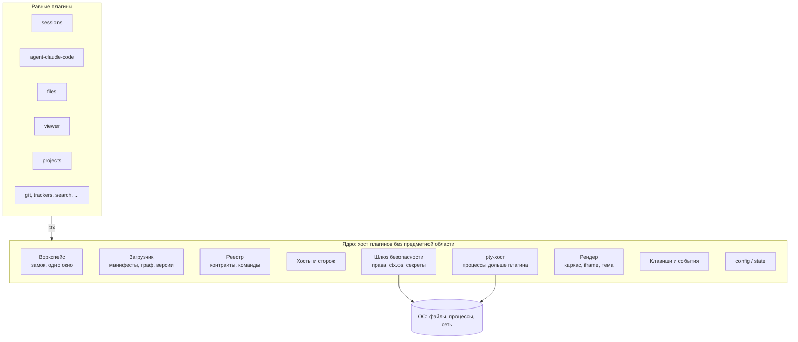

# Cyborg Harness: общее описание и ресёрч

Документ отвечает на три вопроса: **что** мы делаем, **как** и **почему именно так**. Подробности по каждому ответу - в соседних документах, ссылки в тексте. Статус: `review`, 2026-11-05; решения составителя ждут приёмки владельцем продукта, открытые решения собраны в разделе 9. Целевая архитектура - [SAD2](03-architecture/design/sad2.md); где он расходится с [SAD](03-architecture/design/sad.md) и первыми ADR, действует SAD2.

## 1. Что делаем и зачем

**Цель.** Превратить Cyborg из цельного приложения в **ядро и набор равных плагинов**. Ядро - хост плагинов без предметной области: в нём нет агентов, сессий, файлов, проектов и трекеров. Всё это (и дерево файлов, поиск, задачи, MR, статус, кнопки-команды, окно расширений Claude Code) - плагины на публичных контрактах. Затем тот же API открывается сторонним плагинам и другим агентам, помимо Claude Code.

**Десять целей ядра** ([SAD2, раздел 3](03-architecture/design/sad2.md#3-цели-ядра)):

1. воркспейс как главная сессия (один воркспейс - одно окно);
2. загрузка плагинов: граф контрактов проверяется до запуска кода, окно без плагинов работает;
3. версии и миграции: обновление ядра или плагина не ломает остальных и не теряет данные;
4. связь между плагинами только через контракты;
5. изоляция сбоев: хосты плагинов и сторож;
6. ресурсы дольше плагина: pty держит ядро, а не плагин;
7. безопасность данных и контроль плагинов: права в манифесте, секреты;
8. изоляция рендера: UI каждого плагина в своём `<iframe>`;
9. системные клавиши и события;
10. главный конфиг и состояние: плагин видит только свой раздел.

**Критерий компактности.** Задача попадает в ядро, только если (а) она нужна всем плагинам или окну без плагинов и (б) плагин не может решить её сам, не нарушив гарантию, которую ядро даёт остальным. Проекты - плагин; pty и «Недавние» - ядро; шина событий - нигде. Центральных плагинов нет: в коде ядра нет имён плагинов ([ADR-CH-0009](03-architecture/adr/ADR-CH-0009-core-boundary-and-compactness.md)).

**Зачем.**
1. Сегодня каждая новая возможность правит три общих файла (`main.ts`, `preload.ts`, `app.ts`) и копится в одном целом: 14 тыс. строк, 58 каналов (51 `handle` и 7 `on`), шесть диалогов в одном `index.html`. Чем больше функций, тем дороже каждая следующая и тем больше шанс сломать соседнюю ([сегодня](research/cyborg-today.md)).
2. Cyborg знает про Claude Code напрямую (аргументы, хуки, формат журналов). Чтобы подключить другого агента, нужен шов, которого сейчас нет.
3. Расширения - то, чем пользователи будут отличаться: свои трекеры, свои панели, свои кнопки. Без плагинов каждое такое желание - правка ядра.
4. Два сильных проекта с этой идеей уже существуют ([bb](research/bb.md), [DeepSeek Harness](research/deepseek-harness.md)), и их опыт можно проверить на нашем коде.

**Жёсткое условие: ничего из существующего не теряется.** Все 153 требования, 893 теста и дымовой тест остаются зелёными на каждом шаге; данные пользователя (файл воркспейса, `commands.json`, `prompts.json`, `hubs.json`, настройки окна) читаются новой версией. Как это обеспечивается - раздел 6 и [план паритета](04-verification/parity-plan.md).

**Чего не делаем (границы).** Не пишем свой цикл модели и не заменяем Claude Code: сессия остаётся нативным `claude` в pty. Не строим облако, мобильный клиент, учётные записи и маркетплейс на первом этапе. Не копируем масштаб образцов (372 пакета, контракты по 6000 строк): начинаем с контрактов пяти плагинов базовой части.

## 2. Что показал ресёрч

Исследованы два проекта: [bb](https://github.com/get-bb/bb) (агентная IDE, плагины, провайдеры агентов) и [DeepSeek Harness](https://github.com/deepseek-ai/deepseek-harness) (харнес «everything is a plugin» на Cordis). Метод и ограничения - в [research/README.md](research/README.md).

| № | Вывод ресёрча-1 | Подтверждение |
|---|---|---|
| 1 | Оба проекта строят ядро как **минимум** (хранилище и доставка у bb, загрузчик и реестр сервисов у dsh), а видимые пользователю функции выносят в плагины | [bb 5.7](research/bb.md), [dsh 3](research/deepseek-harness.md) |
| 2 | Рабочая модель плагина - **сервис с `inject` и откатом регистраций**: всё, что плагин зарегистрировал, снимается при выгрузке | dsh 2 |
| 3 | **Манифест со строгой схемой** и диапазонами совместимости, проверка до импорта кода; ломающие изменения - с записью «как мигрировать» | bb 5.1, dsh 5 |
| 4 | Заменяемые возможности устроены ролями **Definition, Provider, Consumer**; делить на пакеты заранее не нужно | dsh 4 |
| 5 | Агентов подключают **структурным протоколом** (SDK, ACP). **Интерактивный CLI в pty не встраивает никто**: контракт агента проектируем сами | bb 5.6, dsh 8 |
| 6 | «Не потерять функции» у bb обеспечено **паритетом по записанным сессиям** с allowlist допустимых расхождений | bb 5.6 |
| 7 | У обоих **сторонний плагин исполняется без изоляции**: доверие при установке. Для нас, где рядом живут сессии с правами пользователя, этого мало | bb 5.4, dsh 9 |
| 8 | Цена подхода - ритуалы и масштаб. Перенимать надо выборочно | dsh 11 |

Сопоставление и список «берём, не берём» - [comparison.md](research/comparison.md).

### 2.1. Что взяли и что поменяли после SAD2

| Идея образцов | Решение |
|---|---|
| Манифест со строгой схемой, `engines`, проверка до запуска кода (bb) | **берём**; дополнен связями `provides` / `requires` / `optional` / `consumes` и семантическими версиями вместо целочисленной |
| Паритет по записанным сессиям, храповики границ (bb, dsh) | **берём** ([ADR-CH-0006](03-architecture/adr/ADR-CH-0006-strangler-migration-and-parity.md)) |
| Откат регистраций: всё, что плагин зарегистрировал, снимается при выгрузке (dsh) | **берём** в виде `Disposable`, которые ведутся с первого дня; каскада перезапуска зависимых нет |
| Общая шина событий | **не берём**: событие - часть контракта владельца (`sessions.onChange`) |
| Реестр сервисов по ключам, `inject` (dsh) | **не берём**: связь только через контракты ([ADR-CH-0010](03-architecture/adr/ADR-CH-0010-contracts-instead-of-services.md)) |
| Режимы событий waterfall и guard (dsh) | **не берём** |
| Провайдер агента как точка расширения ядра | **не берём**: агент - обычный плагин, поставщик `cyborg.agent` |
| Слоты интерфейса в оболочке | заменены родами областей в ядре и `<iframe>` на плагин ([ADR-CH-0013](03-architecture/adr/ADR-CH-0013-plugin-ui-iframe-bridge.md)) |

Первоначальные ADR-CH-0003, 0004, 0005 и 0007 заменены или изменены, 0001, 0002, 0006 и 0008 уточнены; история решений сохранена в самих ADR.

### 2.2. Результаты проверки SAD2 (ресёрч-2)

[Ресёрч-2](research/sad2-validation.md) проверил SAD2 замерами в Electron 45 (Apple M1 Pro), разбором аналогов (VS Code, Figma, MetaMask Snaps, Obsidian, Chrome MV3, Zed, Theia, Joplin) и сверкой с кодом. Структура SAD2 принята за целевую; числа:

| Что | Результат |
|---|---|
| Хост плагинов в `utilityProcess` | 15 МБ физической памяти, старт 70-100 мс, круг вызова 47 мкс; десять хостов - 150 МБ |
| `--permission` в `utilityProcess` | флаг принимается, но не действует; действует в процессе Electron как Node (`ELECTRON_RUN_AS_NODE`): 12 МБ, старт 69-75 мс, круг 33 мкс. Сеть и окружение флагом не закрываются |
| Hardened JS (`ses` 2.3.0) | `lockdown` +3,5 МБ; `Compartment` около 12 КБ и 0,1 мкс на вызов; не граница против злого кода (Figma ушла с общей виртуальной машины); zod и marked не проходят сканер исходника |
| `<iframe>` | свой origin - отдельный процесс рендера, около 17 МБ против 3 МБ при общем origin; десять кадров: 190 МБ против 45 МБ |
| Мост окно - хост | без preload в подкадрах через `MessageChannelMain` и `postMessage`; хост - `<iframe>` напрямую: круг 45 мкс, поток 1,9 ГБ/с |
| CSP по умолчанию | встроенный скрипт, сеть, `parent.document` и мост оболочки недоступны |
| Клавиши в `<iframe>` | `before-input-event` не подтверждён (синтетические события не проходят) |
| Код | не подтвердилось: `requestSingleInstanceLock` в коде нет (процесс на воркспейс); `scripts/measure.mjs` замеряет только загрузку панели задач и MR; старый `ProjectStore` стирает неизвестные поля; id сессии - счётчик в памяти; в SAD2 не хватало плагинов `git`, `command-buttons`, `claude-extensions`, `search`, `session-notifications` |

Что осталось непроверенным ([раздел 7 ресёрча-2](research/sad2-validation.md#7-что-осталось-непроверенным)): клавиши настоящей клавиатурой, Monaco и xterm под `sandbox`, настоящий `claude` в pty-хосте, сторож (прецедента нет), горячие пути под нагрузкой, другие платформы.

## 3. Целевая архитектура

**Процессы.** Главный процесс - ядро. Главные части плагинов работают в хостах `utilityProcess` (по умолчанию встроенные плагины - в одном хосте `builtin`, каждый сторонний - в своём); pty держит отдельный pty-хост ядра; UI каждого плагина - в своём `<iframe>` с CSP. За хостами следит сторож с пороговыми значениями (стартовые: ответ раз в 5 с, порог 15 с, не более 3 перезапусков за 5 минут, выключение плагина после 3 зависаний подряд; проверяются тестом, прецедента нет).

Ключевые решения (каждое - отдельный ADR):

- **Граница ядра и критерий компактности** ([ADR-CH-0009](03-architecture/adr/ADR-CH-0009-core-boundary-and-compactness.md)), уточняет [ADR-CH-0001](03-architecture/adr/ADR-CH-0001-core-and-plugins.md): своё маленькое ядро, без Cordis и без форка.
- **Манифест и совместимость**: строгая схема, `engines.cyborg`, семантические версии ([ADR-CH-0002](03-architecture/adr/ADR-CH-0002-manifest-and-compatibility.md)).
- **Контракты вместо реестра сервисов, шины и `inject`; агент как плагин** ([ADR-CH-0010](03-architecture/adr/ADR-CH-0010-contracts-instead-of-services.md)), заменяет [ADR-CH-0005](03-architecture/adr/ADR-CH-0005-extension-points.md), меняет [ADR-CH-0004](03-architecture/adr/ADR-CH-0004-agent-provider-contract.md).
- **Изоляция сбоев и рендера сразу, доступа по поводу** ([ADR-CH-0011](03-architecture/adr/ADR-CH-0011-isolation-stages.md)), заменяет [ADR-CH-0003](03-architecture/adr/ADR-CH-0003-trust-and-isolation.md).
- **Хосты, сторож, pty-хост** ([ADR-CH-0012](03-architecture/adr/ADR-CH-0012-hosts-watchdog-pty-host.md)).
- **UI плагина: `<iframe>`, origin по классу, мост `MessagePort`, CSP** ([ADR-CH-0013](03-architecture/adr/ADR-CH-0013-plugin-ui-iframe-bridge.md)), заменяет [ADR-CH-0007](03-architecture/adr/ADR-CH-0007-ui-slots-and-commands.md).
- **Секреты, config и state** ([ADR-CH-0014](03-architecture/adr/ADR-CH-0014-secrets-config-state.md)).
- **Миграция «душителем» с паритетом** ([ADR-CH-0006](03-architecture/adr/ADR-CH-0006-strangler-migration-and-parity.md)) и **терминология** ([ADR-CH-0008](03-architecture/adr/ADR-CH-0008-terminology.md)): плагин Cyborg и плагин Claude Code - разные вещи.

### 3.1. Связь только через контракты

Плагин объявляет в манифесте `provides`, `requires`, `optional` и `consumes`; кратность `one` или `many` объявляет потребитель. Граф проверяется до запуска кода: недостающий поставщик, два поставщика при `one` или цикл - плагин не загружается, причина в журнале. Версии семантические, поставщик может давать две мажорные одновременно, устаревший член помечается `@deprecated` с записью в журнал. Типы лежат в пакете `@cyborg/contracts`. Команды по имени и MIME при перетаскивании - связи без зависимости. Общей шины нет.

### 3.2. Изоляция: три вида и два этапа

| Вид | Чем даётся | Этап |
|---|---|---|
| сбоев | хосты `utilityProcess` и сторож | первый, для всех плагинов |
| рендера | свой `<iframe>` с CSP; встроенные плагины делят origin `cyborg-plugin://builtin/`, сторонние получают свой | первый, для всех плагинов |
| доступа | процесс на плагин (Electron как Node) с `--permission`, `Compartment` вторым слоем, окна согласия, установка и подпись | второй, по поводу: сторонний автор или каталог плагинов |

Ценность прав двоякая. **Прозрачность** (по манифесту видно, что плагин просит) работает с первого этапа. **Гарантию** «ничего сверх объявленного» даёт только второй этап. Для базовых модулей с `process` и `pty` она ограничена честной границей (программа получает все права пользователя ОС); для интеграций по HTTP API (права `net` на свой хост) она полная.

Дисциплина первого этапа, которая сохраняет путь ко второму, проверяется тестами, а не ревью: члены контрактов асинхронные, данные переживают `structuredClone`; плагин импортирует только `@cyborg/contracts` и свои модули; доступ к ОС только через `ctx.os`.

## 4. Что в ядре, а что в плагинах

Принцип - критерий компактности (раздел 1). В ядре нет агента, сессий, файлов, проектов, трекеров, общей шины событий, реестра сервисов, `inject`, waterfall и guard.

| Функция сегодня | Целевое место | Комментарий |
|---|---|---|
| Воркспейс, замок, «Недавние», один воркспейс - одно окно | **ядро** | Процесс на воркспейс, как сегодня (FR-1029, FR-1033) |
| Загрузка, версии, миграции, журнал, безопасный режим | **ядро** | Граф контрактов проверяется до запуска кода |
| Хосты плагинов и сторож; pty-хост (`node-pty`, кольцевой буфер, `persist`, `attach`) | **ядро** | Процесс агента переживает перезапуск хоста и окна |
| Шлюз прав `ctx.os`, хранилище секретов (`safeStorage`) | **ядро** | Источник секретов (Vault и др.) - плагин `cyborg.secret-source` |
| Каркас окна, роды областей, `<iframe>`, тема, диалоги, блокировка окна `ctx.ui.lock` | **ядро** | Механизм замка в ядре, политика (пин и т. п.) - плагин |
| Клавиши, меню, события окна и системы, `config` и `state` | **ядро** | Единый реестр исправляет класс ошибок «сочетание занято меню» (D-27) |
| Claude Code как агент: запуск, хуки, история, `resume` | **плагин** `agent-claude-code` | Поставщик `cyborg.agent` |
| Сессии, терминал, восстановление, приём броска пути | **плагин** `sessions` | `cyborg.sessions`; билет `pty.share()` для вывода напрямую в `<iframe>` |
| Дерево файлов; просмотрщик (Monaco) | **плагины** `files`, `viewer` | Связь через команду `file.open` |
| Проекты и настройки проекта | **плагин** `projects` | `cyborg.projects`, `cyborg.project-settings` |
| Git: статус, ветка, `headContent`, смена ветки | **плагин** `git` | Контракт `cyborg.git` (вопрос 12) |
| Задачи, MR, статус, Jira | **плагин** `trackers` | Границы по плагинам уточняет [план паритета](04-verification/parity-plan.md) |
| Поиск | **плагин** `search` | |
| Кнопки-команды и промпты | **плагин** `command-buttons` | Динамические сочетания с условиями `ctx.keys.register` |
| Окно «Расширения» Claude Code | **плагин** `claude-extensions` | Права описываются при переносе |
| Уведомления «сессия ждёт» | **плагин** `session-notifications` | Пилот первого этапа |

Базовая часть (агент, сессии, файлы, просмотрщик, проекты) и контракты между ними описаны в [SAD2, разделе 5](03-architecture/design/sad2.md#5-пример-базовая-часть); пробелы паритета, найденные сверкой с кодом, - в [5.5](03-architecture/design/sad2.md#55-пробелы-паритета-найденные-сверкой-с-кодом).

## 5. Как это будет работать для пользователя и автора плагина

- **Пользователь** ничего не замечает: те же окна, те же клавиши, те же файлы. Появляется раздел «Плагины Cyborg» (список, права человеческим языком, журнал, конфликты сочетаний, безопасный режим). Установка сторонних плагинов - второй этап.
- **Автор плагина** создаёт каталог с манифестом (контракты, права, `config` со схемой и версией), главную часть и UI с `mount(root, ctx)`; получает тестовый хост, пакет `@cyborg/contracts` и проверку «только публичный API». Подробнее - [сценарии](02-use-cases/).
- **Мейнтейнер Cyborg** добавляет возможность как плагин на контрактах; правок `main.ts`, `preload.ts` и `app.ts` для этого больше не требуется.

## 6. Как не потерять ничего из того, что есть

Это самое ответственное условие, поэтому оно разложено на механизмы ([ADR-CH-0006](03-architecture/adr/ADR-CH-0006-strangler-migration-and-parity.md), [план паритета](04-verification/parity-plan.md)):

1. **Инвентаризация.** Каждая функция, каждое из 153 требований и каждый из 58 каналов IPC (51 `handle` и 7 `on`) имеют строку в матрице паритета с целевым плагином. Пустая строка блокирует релиз. Сверка с кодом нашла каналы без владельца (`project:selected`, `session:reveal`, `menu:*`) и функции без плагина - они перечислены в SAD2 5.5.
2. **Шаги небольшие и обратимые.** Шаг 0 и pty-хост - ещё на текущем коде; затем каркас, пилот `session-notifications`, потом перенос по одному плагину.
3. **Данные.** Формат файла воркспейса `{projects, lastProjectId, commands}`, файлы пользователя и ключи `localStorage` переносятся в разделы `config` и `state`. Пока работает прежний код, его `ProjectStore` стирает неизвестные поля, поэтому первым шагом он учится их сохранять.
4. **Автоматические гарантии.** 893 теста и дымовой тест зелёные на каждом шаге; проверки дисциплины плагинов (импорты, `structuredClone`, `ctx.os`); паритет по записанным сессиям и подставным `claude`, `gh`, `jira`. Часть утверждений `smoke.mjs` и `static-guards.test.ts` после переноса в `<iframe>` потребует переписать вместе с кодом при сохранении смысла утверждений.
5. **Бюджеты.** `scripts/measure.mjs` сегодня замеряет только загрузку панели задач и MR; базовой линии старта, памяти и вывода терминала нет, её нужно снять до каркаса. Предложенные бюджеты: вызов через шлюз не более 1 мс на p99, вывод терминала не более кадра (16 мс) - открытый вопрос 9 SAD2.

## 7. План в одном абзаце

Два этапа ([SAD2, раздел 6](03-architecture/design/sad2.md#6-этапы), [дорожная карта](05-plans/roadmap.md)). **Первый** - все цели ядра без `Compartment`, окон согласия и установки плагинов: шаг 0 (`ProjectStore` сохраняет неизвестные поля, устойчивый id сессии), pty-хост на текущем коде, оставшиеся спайки (клавиши, Monaco и xterm в кадре, `claude` в pty-хосте, сторож), каркас, пилот `session-notifications`, перенос функций по одному плагину с паритетным гейтом. **Второй** - изоляция доступа, когда появится повод: сторонний автор или каталог плагинов. Если дисциплина первого этапа соблюдена, переход меняет среду выполнения хоста, а не код плагинов.

## 8. Риски

| Риск | Что делаем |
|---|---|
| `Compartment` принимают за границу против злого кода | Граница - процесс на плагин с `--permission`; `Compartment` вторым слоем; `utilityProcess` флаг не применяет |
| Сторож не имеет прецедента | Стартовые пороги и отдельный тест на зависший хост до каркаса |
| Память на `<iframe>` и хосты | Общий origin для встроенных плагинов (3 МБ против 17 МБ), группы хостов настраивает пользователь |
| Цена вызова через шлюз на горячих путях (терминал, дерево, поиск) | Вывод pty идёт из pty-хоста в `<iframe>` напрямую; бюджеты и базовая линия до каркаса |
| Клавиши с фокусом внутри `<iframe>` не перехватываются в главном процессе | Акселераторы меню, как сегодня; спайк с настоящей клавиатурой |
| Восстановление сессий противоречит non-goal основного корпуса | Решение владельца до начала работ (вопрос 11 ниже) |
| Старый `ProjectStore` стирает поля нового формата | Шаг 0 |
| Потеря функции при переносе | Паритетная матрица, шаги по одному плагину, зелёные тесты на каждом шаге |
| Плагины первого этапа пишутся в обход дисциплины | Правила проверяются тестами, а не ревью |
| Право `process` или `pty` даёт все права пользователя | Честная граница в окне согласия, право на конкретную программу |
| Ломающие изменения контрактов | Семантические версии, две мажорные одновременно, `@deprecated` с журналом |
| Раздувание API и ритуалов, как у образцов | Критерий компактности, набор элементов ядра минимальный, ритуалы только из списка [comparison.md](research/comparison.md) |
| Контракт `cyborg.agent` не выдержит второго агента | Второй агент обязателен до стабилизации контракта |
| Путаница «плагин» против «плагин Claude Code» | [ADR-CH-0008](03-architecture/adr/ADR-CH-0008-terminology.md), единый глоссарий |

Полный список рисков - [SAD2, раздел 9](03-architecture/design/sad2.md#9-риски).

## 9. Открытые решения (нужен ответ владельца)

| № | Вопрос | Предлагаем по умолчанию |
|---|---|---|
| 1 | Нужны ли **сторонние** плагины вообще, или цель только внутренняя модульность | Да; их допуск - второй этап по поводу (сторонний автор, каталог) |
| 2 | Уровень изоляции сторонних плагинов | Процесс на плагин с `--permission`, `Compartment` вторым слоем (ADR-CH-0011) |
| 3 | Какой **второй агент** проверит контракт `cyborg.agent` | Любой CLI с хуками либо ACP-агент; выбор за владельцем |
| 4 | Имя: как называем плагины Cyborg и раздел | «Плагины Cyborg»; окно «Расширения» переименовать в «Расширения Claude Code» (ADR-CH-0008) |
| 5 | Структура репозитория | Папки внутри одного репозитория; оформление пакета `@cyborg/contracts` (отдельный пакет объявлений) уточняется в P1 |
| 6 | Обещание совместимости API для внешних авторов | Семантические версии и две мажорные одновременно (SAD2 3.3); с какого срока обещание действует - решает владелец |
| 7 | Публичный каталог плагинов | Отложено после второго этапа |
| 8 | Что держит экран терминала после перезапуска хоста: сырой хвост или снимок (headless-xterm) (вопрос 12 SAD2) | Отдельный pty-хост; решает спайк с настоящим `claude` |
| 9 | Модель процессов: процесс на воркспейс или одно приложение с окнами (вопрос 13) | Оставить процесс на воркспейс (паритет FR-1029, FR-1033) |
| 10 | Форма API: вклады плагинов в меню, сочетания с условиями, отмена запросов, вклады в промпт агента (вопрос 14) | Эскизы в SAD2 5.5, сигнатуры фиксируются в P1 |
| 11 | Восстановление сессий противоречит non-goal основного корпуса (вопрос 15) | Нужно решение владельца и изменение корпуса; в пакете оформлено как условие |
| 12 | Кто владеет git (вопрос 16) | Отдельный плагин `git` с контрактом `cyborg.git` |
| 13 | Как жить старому `ProjectStore` рядом с новым форматом (вопрос 17) | Научить его сохранять неизвестные поля первым шагом |

Остальные открытые вопросы SAD2 (превью файла, диапазоны `order`, поля `project-settings`, списки опасных флагов, бюджеты горячих путей, установка и подпись сторонних плагинов, набор тестов контрактов, оставшиеся спайки UI) - в [SAD2, разделе 8](03-architecture/design/sad2.md#8-открытые-вопросы). Подробнее - в [decision-log](01-product/01-plugin-host/decision-log.md).

## 10. Карта документов

| Документ | Для чего |
|---|---|
| [README.md](README.md) | Короткое «что, где, зачем» |
| [research/](research/README.md) | Ресёрч-1: метод, [bb](research/bb.md), [dsh](research/deepseek-harness.md), [сравнение](research/comparison.md), [Cyborg сегодня](research/cyborg-today.md); ресёрч-2: [проверка SAD2](research/sad2-validation.md) и [скрипты замеров](research/spikes/sad2/README.md) |
| [00-strategy/](00-strategy/one-pager.md) | Идея и обоснование на одной странице |
| [01-product/](01-product/brd.md) | BRD продукта и три фичи: хост плагинов, контракты, миграция |
| [02-use-cases/](02-use-cases/) | Сценарии пользователя, автора плагина, мейнтейнера |
| [03-architecture/](03-architecture/design/sad2.md) | [SAD2](03-architecture/design/sad2.md) (целевая архитектура), [SAD](03-architecture/design/sad.md) (детали, частично заменён) и 14 ADR |
| [04-verification/](04-verification/parity-plan.md) | План паритета и проверок |
| [05-plans/](05-plans/roadmap.md) | Дорожная карта |
| [glossary.md](glossary.md) | Термины |
