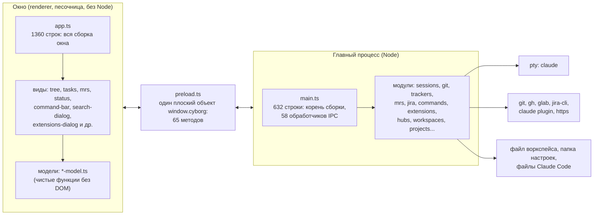

# Cyborg сегодня: исходное состояние

Снимок на коммите `e4beb72` (master, 2026-11-02). Цифры сняты с кода скриптом, не оценены на глаз; пересчитываются командами из раздела 9. Это точка отсчёта для миграции: всё, что здесь названо, должно после переноса остаться работающим.

## 1. Что представляет собой продукт

Электрон-приложение на TypeScript: рабочее место для параллельных сессий настоящего Claude Code. Сессия - обычный `claude` в pty (`node-pty`), терминал xterm.js, просмотр файлов Monaco. Cyborg ничего в `claude` не подменяет и узнаёт о нём из хуков (`--settings`), вызовов `git`, `gh`, `glab`, `jira-cli`, `claude plugin` и чтения файлов Claude Code. Своего клиента модели нет. Требования продукта и 14 фич описаны в корпусе (`docs/01-product/`), решения - в 18 ADR; сейчас 153 требования (FR и NFR).

## 2. Размер

| Область | Строк | Файлов |
|---|---|---|
| `src/main` (без тестов) | 7057 | 38 |
| `src/renderer` (TypeScript) | 6828 | 45 |
| `src/renderer/styles.css` | 2233 | 1 |
| `src/renderer/index.html` | 253 | 1 |
| `src/shared` | 321 | 2 |
| тесты (`test/` и `src/main/*.test.ts`) | 10 479 | 56 |
| `scripts` (сборка, тесты, smoke, корпус, замер) | 1463 | 6 |

Тестов 893, один пропускается (файловые системы, не допускающие имена не в UTF-8). Дымовой тест запускает собранное приложение с подставными `claude`, `gh`, `jira` и ведёт его по DevTools Protocol. CI - macOS и Linux, отдельное задание проверяет корпус.

## 3. Слои и процессы



## 4. Функции и их код

Сопоставление на основе импортов и корпуса. Размер - строки исходников без тестов.

| Функция (фича корпуса) | Главный процесс | Интерфейс | Строк всего |
|---|---|---|---|
| Сессии, хуки, история, уведомления (04, 08, 09) | `sessions`, `claude-args`, `events-store`, `session-args`, `history`, `notify-args` | `notify`, `term-links`, `drop-path` | 805 |
| Дерево, просмотр, git, смена ветки (04, 07) | `files`, `git`, `allowed-paths`, `open-path` | `tree`, `tree-keys`, `viewer`, `roots`, `row-marks`, `neighbor`, `reorder` | 1063 |
| Поиск (13) | `git-search`, `search-run`, `search-args` | `search-dialog`, `search-model` | 856 |
| Проекты и воркспейсы (01, 10) | `projects`, `workspaces` | `sources`, `title`, `workspace-text` | 914 |
| Задачи (01) | `trackers`, `task-details` | `tasks`, `task-model`, `task-flow`, `task-header`, `panel`, `panel-return` | 1870 |
| MR и PR (02) | `mrs`, `mrs-service` | `mrs`, `mr-model`, `mr-refresh` | 1129 |
| Статус и Jira (11) | `jira`, `jira-service` | `status`, `status-model` | 1093 |
| Кнопки-команды, промпты, предложения модели (12) | `commands`, `command-store`, `prompts`, `prompt-store`, `suggestions` | `command-bar`, `command-editor`, `prompt-editor`, `command-values`, `config-editor` | 1099 |
| Окно «Расширения» Claude Code (14) | `extensions`, `-read`, `-act`, `-handlers`, `-usage`, `hubs` | `extensions-dialog`, `extensions-model` | 2753 |
| Оболочка: окно, меню, вкладки, шрифт, тема, заголовок (10) | `main`, `preload`, `menu` | `app`, `tabs`, `list-keys`, `theme`, `dom`, `prefs`, `font-size`, `platform`, `ago`, `ipc-error`, `render-ticket` | 2574 |

Остальное (`jsonfile`, `jira-keys`, `pid`, `globals.d.ts`) - вспомогательное, 50 строк.

## 5. Интерфейс между процессами

**Запрос с ответом** (`ipcMain.handle`, 58 каналов), по группам: `fs` (3), `git` (6), `session` (7), `history` (2), `tasks` (4), `mrs` (3), `jira` (6), `trackers` (1), `extensions` (4), `hubs` (3), `commands` и `prompts` (по 2), `search` (2), `projects` (3), `workspace` (3), `dialog` (2), `path`, `url`, `config`, `notifications`, `project` (по 1).

**События главного процесса интерфейсу**: `session:data`, `session:exit`, `session:cwd`, `session:activity`, `session:suggest`, `session:waiting`, `session:reveal`, `menu:commands`, `menu:prompts`, `menu:search`, `menu:extensions`, `menu:project`, `menu:create-workspace`, `notifications:toggle`.

Все эти каналы собраны в одном объекте `preload.ts`; типы интерфейса выводятся из него. Главный процесс проверяет аргументы каждого канала сам (ADR-0002): форма, пределы и пути через `AllowedPaths`.

## 6. Данные и состояние

- **Файл воркспейса** (путь выбирает пользователь): проекты, источники задач, кнопки воркспейса; рядом замок `<файл>.lock`.
- **Папка настроек приложения** (`userData`): `commands.json`, `prompts.json`, `hubs.json`, `extensions-usage.json`, `recent-workspaces.json`, `claude-hooks.json`, `sessions/` (события живых сессий), `workspaces/` (хранилище окна каждого воркспейса); устаревшие `projects.json` и `trackers.json` только читаются.
- **Настройки окна** (`localStorage` в каталоге воркспейса): ключи `cyborg.fontSize`, `cyborg.notifications`, `cyborg.tasks.*`, `cyborg.mrs.*`, `cyborg.search.*`, `cyborg.extensions.*`.
- **Файлы Claude Code** (`~/.claude`, `.claude/`, `.mcp.json`): читаются; меняются только вызовом `claude plugin`.
- Базы данных нет, журнала событий приложения нет: источник правды по сессиям - журналы самого Claude Code.

## 7. Что уже даёт швы для разделения

Швы есть, но они не оформлены как контракты:

1. **Внешние программы - через runner.** Сервисы получают функцию запуска (`CliRunner`) снаружи, поэтому тесты и smoke подменяют `claude`, `gh`, `jira`.
2. **Фабрики обработчиков и хранилища.** `createExtensionsHandlers`, `HubStore`, `CommandStore`, `PromptStore`, `TrackersService`, `MrsService`, `JiraService` собираются в `main.ts` и не знают друг о друге почти ничего.
3. **Модели без DOM.** `*-model.ts` - чистые функции, отдельно от видов; их тесты идут без окна.
4. **Проверка путей в одном месте**: `AllowedPaths`.
5. **`SessionManager` излучает события** (`session:*`), а не вызывает интерфейс.
6. **Интерфейс меню** `WorkspaceMenu` (`menu.ts`) - уже узкий набор обратных вызовов.
7. **Охранные тесты** (`static-guards`): нет `innerHTML`, на диск пишут только известные модули.

## 8. Что мешает разделению (связность)

| Место | Проблема |
|---|---|
| `main.ts` | Корень сборки и одновременно `ipcMain.handle` для всех 58 каналов, включая логику; импортирует 26 модулей. Любая новая функция правит этот файл |
| `preload.ts` | Один плоский объект на 65 методов; нет понятия «канал принадлежит функции» |
| `app.ts` | 1360 строк, импортирует 34 модуля, собирает всё окно: вкладки, панели, дерево, кнопки, диалоги, горячие клавиши |
| `index.html` | Разметка всех шести `<dialog>` и всех панелей зашита в один файл; `styles.css` на 2233 строки общий |
| `menu.ts` | Меню «Воркспейс», «Поиск», «Расширения» зашиты, у каждой функции свои пункты и сочетания |
| Сочетания клавиш | Список занятых сочетаний (`commands.ts`) ведётся вручную и не знает акселераторов меню «Поиск» и «Расширения»: известный дефект (D-27 фичи 12) |
| `sessions.ts`, `claude-args.ts`, `history.ts` | Cyborg знает про Claude Code напрямую: аргументы, хуки, формат журналов, инструкции изоляции и кнопок |
| Трекеры | GitHub и GitLab зашиты в `trackers.ts`; Jira - отдельным путём |
| Промпты кнопок | Зашиты ссылки на `dex-auto` и тексты для конкретных действий |
| Терминология | «Расширения» в Cyborg - это плагины Claude Code; слово «плагин» без уточнения станет двусмысленным |
| Настройки окна | Ключи `cyborg.*` в `localStorage` без единого реестра |

## 9. Инварианты, которые нельзя потерять

1. Сессия остаётся нативной: `claude` запускается как есть, вывод терминала не подменяется.
2. Интерфейс не получает ОС напрямую; аргументы каналов проверяет главный процесс; пути - только из `AllowedPaths`.
3. По умолчанию только чтение; из git меняется только ветка (`git switch`), вызовы git идут без хуков, `fsmonitor` и фильтров репозитория.
4. Секреты (`env`, `headers`, аргументы MCP, токены) не попадают в интерфейс.
5. В интерфейсе нет `innerHTML`; недоверенные данные попадают в DOM текстом.
6. Все 153 требования корпуса, 893 теста и дымовой тест зелёные; нет новых зависимостей без причины.
7. Данные пользователя читаются новой версией: файл воркспейса, `commands.json`, `prompts.json`, `hubs.json`, настройки окна.

## 10. Команды для пересчёта

```bash
# размеры
cat $(ls src/main/*.ts | grep -v '\.test\.ts') | wc -l
cat src/renderer/*.ts | wc -l
# каналы
grep -ohE "ipcMain\.(handle|on)\('[^']+'" src/main/main.ts | wc -l
# проверки
npm run typecheck && npm test && npm run check:corpus && npm run smoke
```
