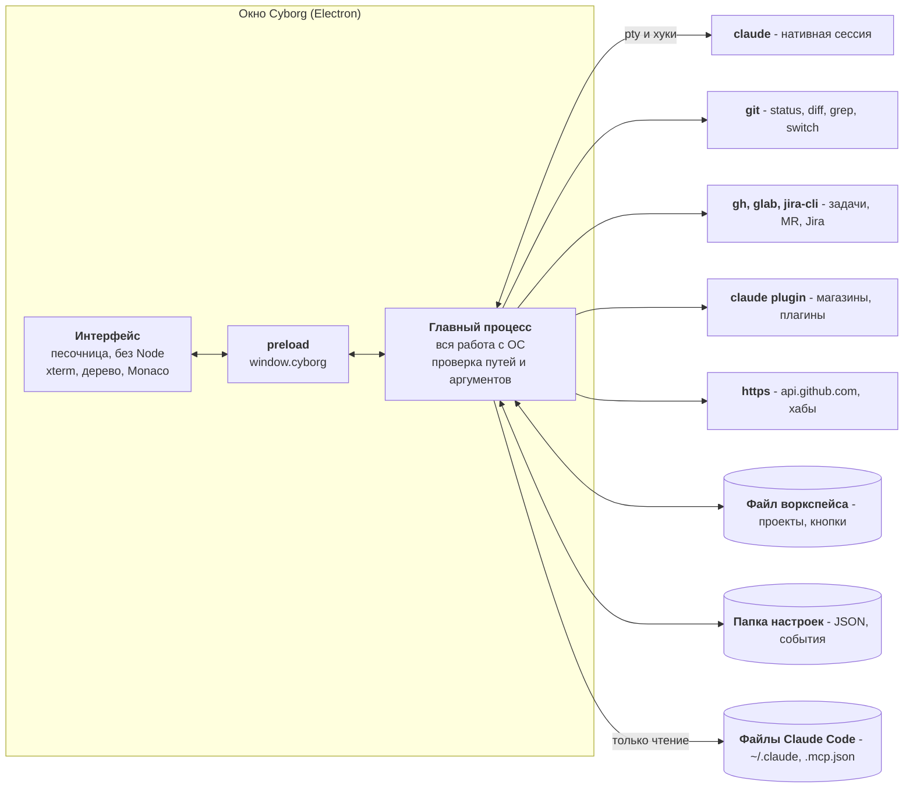
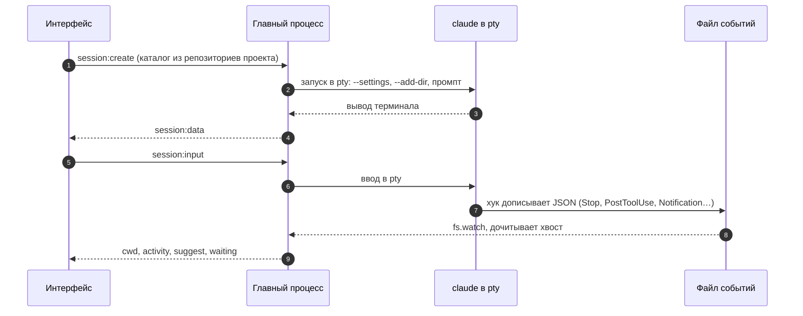
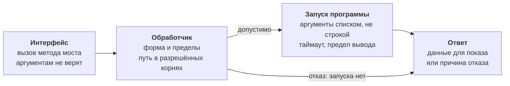

Cyborg - Electron-приложение на TypeScript вокруг обычного `claude`. Оно запускает CLI в псевдотерминале и добавляет то, что видно снаружи: события хуков, состояние git, трекеры, файлы Claude Code. Своего клиента модели в нём нет.

## Принципы

| Принцип | Что это значит в коде | Решение |
|---|---|---|
| Сессия нативная | `claude` запускается как есть; добавляются только `--settings` с хуками, `--append-system-prompt` и `--add-dir`. Вывод терминала не оборачивается. | ADR-0003, ADR-0012 |
| Чужое - через программы пользователя | `git`, `gh`, `glab`, `jira-cli`, `claude`. Токенов Cyborg не хранит и не читает. | ADR-0005, ADR-0007, ADR-0013 |
| По умолчанию только чтение | Единственная изменяющая команда git - `git switch` по вашему клику. Перечень записей Cyborg - в [данных](/concepts/data/#что-cyborg-пишет). | ADR-0011 |
| Интерфейсу не доверяют | Каждый канал главного процесса проверяет форму аргументов и пути. | ADR-0002 |
| Данные простые | JSON-файлы и журналы Claude Code, без базы. | ADR-0014 |

## Общая схема

Файлы Claude Code Cyborg только читает, а меняет их вызовом `claude plugin`.

### Что где лежит

| Часть | Каталог | Роль |
|---|---|---|
| Интерфейс | `src/renderer` | Показывает данные и принимает ввод. `app.ts` собирает окно, остальное - модули по возможностям. **Модели** (`*-model.ts`) - чистые функции без DOM, их тесты идут без окна; **виды** (`*-dialog.ts`, `panel`, `tree`) строят DOM вызовом `el()`, `innerHTML` запрещён охранным тестом. |
| Мост | `src/main/preload.ts` | Единственный объект `window.cyborg`. Тип API выводится из самого preload. |
| Главный процесс | `src/main` | Вся работа с ОС; точка входа `main.ts`, меню - `menu.ts`. |
| Общее | `src/shared` | Типы и чистые проверки, нужные обеим сторонам (запрос поиска, окно «Расширения»). |

Главный процесс разбит по областям:

| Область | Модули | Что делает |
|---|---|---|
| Сессии | `sessions`, `claude-args`, `events-store`, `session-args`, `history` | pty, хуки, события, история по журналам Claude Code. |
| Файлы и git | `files`, `allowed-paths`, `open-path`, `git`, `git-search`, `search-run` | Дерево, просмотр, поиск; git только на чтение. |
| Проекты | `projects`, `workspaces` | Файл воркспейса, замок, «Недавние». |
| Трекеры | `trackers`, `mrs`, `mrs-service`, `task-details`, `jira`, `jira-service` | Задачи, MR, Jira, снимки списков. |
| Кнопки | `commands`, `command-store`, `prompts`, `prompt-store`, `suggestions` | Наборы кнопок, промпты, предложения модели. |
| Расширения | `extensions*`, `hubs` | Магазины, плагины, скиллы, MCP, хабы, статистика вызовов. |

Запуск внешних программ в сервисы приходит снаружи (runner), поэтому тесты подставляют `claude`, `gh` и `jira`, а дымовой тест запускает приложение с подставными программами.

## Жизнь сессии

Шаги 3-6 идут всё время, пока сессия работает; шаги 7-9 - по событиям хуков.

- **Запуск.** `$SHELL -lc 'exec claude --settings "$CYBORG_SETTINGS" "$@"'`: логин-шелл даёт `PATH` пользователя. Каталог сессии принимается, только если он входит в репозитории проекта.
- **События.** Хуки `SessionStart`, `UserPromptSubmit`, `PostToolUse`, `Stop`, `Notification` дописывают JSON в файл этой сессии (каталог `0700`, файл `0600`). Файл удаляется вместе с сессией.
- **Что берётся из события.** Рабочий каталог (дерево идёт за сессией в worktree), факт активности (обновление git), кнопки, предложенные моделью в хвосте ответа, и ожидание человека (уведомление). Подробности - в [хуках](/concepts/hooks/).
- **Чего хуки не дают.** Правки вне сессии событий не порождают, их подхватывает опрос `git status` раз в 3 секунды, пока окно видно.

## Откуда берутся данные

| Что | Источник | Обновление |
|---|---|---|
| Дерево и ветка | `git` | Опрос раз в 3 с, пока окно видно, и событие хука |
| Просмотр файла, сравнение | Файл (до 5 МБ), `git` | При открытии |
| Поиск | `git grep`, `git diff`, `git ls-files` | По запросу; новый запрос отменяет прежний |
| Задачи и MR | `gh api`, `glab api` | Снимок в памяти, фон раз в 5 мин для уже открывавшихся вкладок, «Обновить» |
| Пайплайн и апрувы MR | Вторая фаза выборки | В пределах бюджета и пула запросов (ADR-0008) |
| Статус | `jira-cli` и те же MR | Раз в 5 мин и при открытии карточки, если данным больше минуты |
| Магазины, плагины | `claude plugin list --json`, `marketplace list --json`, файлы | При открытии окна «Расширения», до закрытия кэш |
| Скиллы, команды, агенты, MCP | Файлы: `SKILL.md`, `~/.claude.json`, `.mcp.json`; связь - `claude mcp list` | Файлы при открытии; связь только по кнопке |
| Статистика вызовов | Журналы `~/.claude/projects/**/*.jsonl` | Дочитывается только дописанное; кэш `extensions-usage.json` |
| Хабы магазинов | Встроенные списки, GitHub API по теме, https-адреса хабов | При открытии вкладки «Хабы»; ответ GitHub 5 мин |
| История сессий | Журналы Claude Code | При открытии вкладки «Сессии» |

## Границы доверия

- **Окно.** Изоляция контекста и песочница включены, Node в интерфейсе нет. Новых окон нет (`setWindowOpenHandler` отклоняет), переходов по ссылкам внутри окна нет (`will-navigate`); ссылка открывается системным браузером и только если это `http` или `https`.
- **Пути.** Абсолютный, без сегмента `..`, внутри репозиториев проектов, каталогов и текущих каталогов работающих сессий либо выбранный вами в диалоге (`AllowedPaths`). Сессию можно запустить только в репозитории проекта.
- **git.** Вызывается без оболочки, с отключёнными `fsmonitor`, хуками и фильтрами репозитория ([подробнее](/concepts/git-safety/)).
- **Секреты.** Серверы MCP читаются без `env`, `headers` и аргументов запуска: разбор отбрасывает их до интерфейса. Токены `gh`, `glab` и `jira-cli` остаются у этих программ.
- **Интерфейс.** Файлы и вывод сессий - недоверенные данные: они попадают в DOM как текст, `innerHTML` запрещён охранным тестом.

## Данные на диске

| Где | Что | Кто пишет |
|---|---|---|
| Файл воркспейса | Проекты, источники задач, кнопки воркспейса | Cyborg, по вашим действиям |
| Папка настроек Cyborg | `commands.json`, `prompts.json`, `hubs.json`, `extensions-usage.json`, «Недавние», события сессий, хуки | Cyborg |
| Настройки окна (`localStorage`) | Размер шрифта, фильтры, вид окон; отдельно у каждого воркспейса | Интерфейс |
| `~/.claude`, `.claude/`, `.mcp.json` | Настройки, плагины, журналы Claude Code | Claude Code; Cyborg читает, а меняет вызовом `claude plugin` |

Полный перечень с форматами - в [данных и каталогах](/concepts/data/).

## Сборка, запуск и тесты

- **Сборка.** esbuild собирает три бандла: `dist/main.js` и `dist/preload.js` для Node, `dist/renderer/app.js` для окна. Monaco копируется со своим загрузчиком, `node-pty` - нативный модуль, он собирается под Electron при установке. `./cyborg` проверяет окружение, ставит зависимости, собирает и запускает.
- **Тесты.** Встроенный `node:test`: модульные рядом с кодом главного процесса и тесты в `test/`, где Electron и `node-pty` подменены. Дымовой тест запускает собранное приложение и управляет им по DevTools Protocol.
- **Корпус.** Требования (FR, NFR), решения и ADR лежат в `docs/`; `npm run check:corpus` проверяет их согласованность, а матрица верификации связывает каждое требование с тестом или осмотром. CI гоняет всё на macOS и Linux.

Подробнее - в [тестах и CI](/contributing/tests-ci/).

## Принятые решения

| Решение | Суть |
|---|---|
| [ADR-0001](https://github.com/dex-it/ai-cyborg/blob/master/docs/03-architecture/adr/ADR-0001-electron-typescript-desktop.md) | Electron и TypeScript, главный процесс и интерфейс |
| [ADR-0002](https://github.com/dex-it/ai-cyborg/blob/master/docs/03-architecture/adr/ADR-0002-isolated-renderer-preload-ipc.md) | Изолированный интерфейс, узкий API через preload, проверка аргументов в главном процессе |
| [ADR-0003](https://github.com/dex-it/ai-cyborg/blob/master/docs/03-architecture/adr/ADR-0003-claude-code-pty-hooks.md) | Нативный CLI в pty, наблюдение хуками и файлом событий |
| [ADR-0005](https://github.com/dex-it/ai-cyborg/blob/master/docs/03-architecture/adr/ADR-0005-git-via-cli.md), [0011](https://github.com/dex-it/ai-cyborg/blob/master/docs/03-architecture/adr/ADR-0011-branch-switch-git-switch.md) | Git через CLI на чтение; единственное изменение - `git switch` |
| [ADR-0006](https://github.com/dex-it/ai-cyborg/blob/master/docs/03-architecture/adr/ADR-0006-esbuild-local-run.md) | Сборка esbuild, запуск из исходников |
| [ADR-0007](https://github.com/dex-it/ai-cyborg/blob/master/docs/03-architecture/adr/ADR-0007-trackers-via-gh-glab-api.md), [0008](https://github.com/dex-it/ai-cyborg/blob/master/docs/03-architecture/adr/ADR-0008-mr-details-budget-pool.md), [0009](https://github.com/dex-it/ai-cyborg/blob/master/docs/03-architecture/adr/ADR-0009-tracker-auth-cache.md) | Трекеры через `gh api` и `glab api`, пайплайн второй фазой, один проверенный вход |
| [ADR-0012](https://github.com/dex-it/ai-cyborg/blob/master/docs/03-architecture/adr/ADR-0012-session-isolation-prompt-and-history.md) | Изоляция параллельных сессий инструкцией в промпте, история по журналам Claude Code |
| [ADR-0013](https://github.com/dex-it/ai-cyborg/blob/master/docs/03-architecture/adr/ADR-0013-jira-via-jira-cli-status-hub.md) | Jira через `jira-cli`, сводка статуса |
| [ADR-0014](https://github.com/dex-it/ai-cyborg/blob/master/docs/03-architecture/adr/ADR-0014-workspace-file.md) | Воркспейс - файл по любому пути, один процесс на воркспейс |
| [ADR-0015](https://github.com/dex-it/ai-cyborg/blob/master/docs/03-architecture/adr/ADR-0015-command-buttons.md), [0016](https://github.com/dex-it/ai-cyborg/blob/master/docs/03-architecture/adr/ADR-0016-model-suggested-buttons.md), [0017](https://github.com/dex-it/ai-cyborg/blob/master/docs/03-architecture/adr/ADR-0017-session-start-prompts.md) | Кнопки-команды, кнопки от модели, промпты запуска сессий |
| [ADR-0018](https://github.com/dex-it/ai-cyborg/blob/master/docs/03-architecture/adr/ADR-0018-extensions-read-claude-config.md) | Расширения: читаем настройки Claude Code, пишем только вызовом `claude plugin` |

## Как добавить возможность

Порядок по образцу окна «Расширения»:

1. Типы и чистые проверки - в `src/shared`.
2. Модуль в `src/main`, внешний запуск через runner; обработчик проверяет форму аргументов и пути до чтения и запуска.
3. Канал в `main.ts` и метод в `preload.ts`.
4. В интерфейсе: чистая модель и вид; данные в DOM - только текстом.
5. Тесты и шаг дымового теста; в корпусе - требование и решение, при необходимости ADR, затем `npm run corpus:matrix`.
