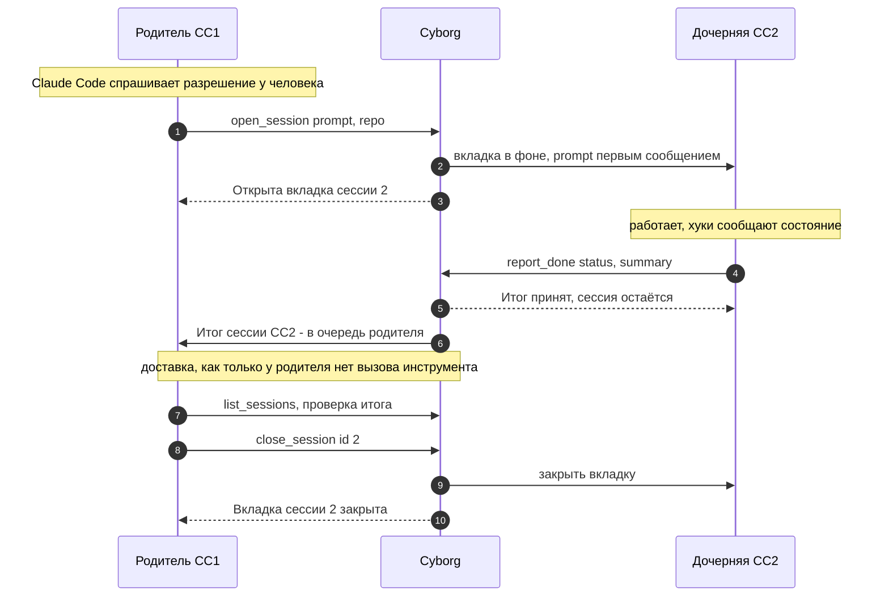
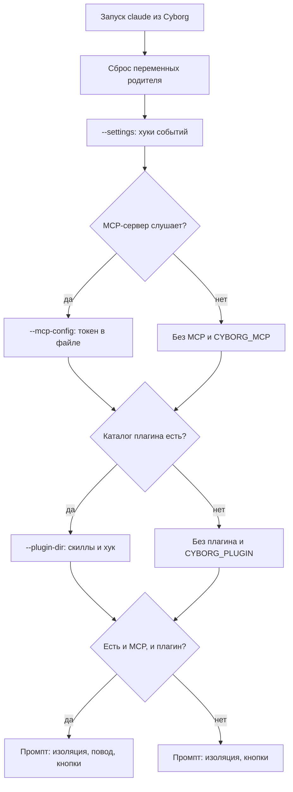
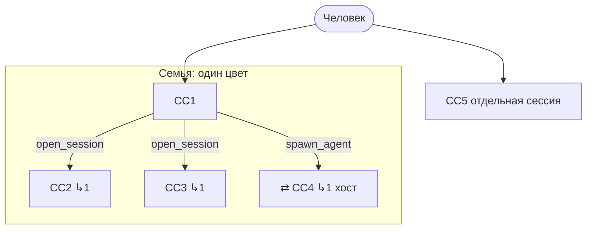

Когда задача распадается на независимые части, одна сессия может стать ведущей: открыть для частей соседние вкладки, дать каждой задание, дождаться итога и закрыть отработавших. Человек не переносит текст между вкладками. Открытая вкладка - дочерняя сессия, открывшая её - родитель.

Для этого Cyborg поднимает свой MCP-сервер и подключает его к каждой сессии, которую запускает. Модель видит несколько инструментов (таблица ниже), а порядок работы с ними ей подсказывает скилл `cyborg:parallel-sessions` из плагина Cyborg.

## Что где

| Часть | Что это | Где подробнее |
|---|---|---|
| Инструменты сессий | `open_session`, `list_sessions`, `send_to_session`, `close_session`, `report_done`, а для хостов SSH ещё `spawn_agent` и `close_agent` | [ниже](#инструменты) |
| Вкладка дочерней | Метка родителя `↳N`, цвет «семьи», пометка в «Истории» | [ниже](#как-это-видно-в-интерфейсе) |
| Плагин Cyborg | Скилл `parallel-sessions` и хук `lsp-reap`; подключается к локальным сессиям ключом `--plugin-dir` | [ниже](#плагин-cyborg-и-скилл) |
| Удалённые агенты | Сессии на серверах по SSH: те же инструменты поручения, но своя работа с клонами | [удалённые сессии](/features/remote/) |
| Изоляция | Каждая сессия правит в своём worktree | [изоляция](/features/isolation/) |

## Как это работает

Делегирование идёт по решению модели и с вашего подтверждения: каждый вызов инструмента сессий подтверждается обычным запросом разрешения Claude Code в вызывающей сессии. Своего окна подтверждения Cyborg не добавляет.

Инструменты действуют только над сессиями того же проекта воркспейса. Дочерняя сессия всегда в проекте открывшей, и правка списка репозиториев проекта их не разделяет. Чужие проекты и сессии, запущенные не из Cyborg, инструменты не видят.

### Жизненный цикл дочерней сессии

Что происходит на каждом шаге:

1. **Поручение.** `open_session` принимает задание `prompt` и рабочий каталог `repo` - один из каталогов проекта (перечень модель видит в схеме инструмента). Окно Cyborg открывает вкладку в том же проекте в фоне: текущая вкладка остаётся активной. Остальные каталоги проекта подключаются к новой сессии как `--add-dir`. Задание попадает в `claude` первым сообщением. Новая сессия диалога родителя не видит, поэтому задание должно быть самодостаточным: цель, пути, ветки, критерий готовности. Начинаться оно может слэш-командой.
2. **Работа.** Cyborg знает состояние каждой сессии по событиям хуков ([хуки](/concepts/hooks/)): `starting` - запускается или стоит на доверии к каталогу, `working` - работает (в том числе ждёт своих фоновых задач: такой сессии сообщение уходит сразу), `waiting` - ход закончен, ждёт сообщения, `asking` - стоит на вопросе, разрешении или лимите и ждёт человека. Родитель читает их в `list_sessions`; опрашивать в цикле не нужно: скилл советует закончить ход, итог придёт новой репликой.
3. **Итог.** Закончив, дочерняя вызывает `report_done`: статус `ok`, `failed` или `blocked`, `summary` и, если есть, `branch` и `pr`. Cyborg ставит в очередь родителя текст «Итог сессии CC2: ok»: строки `ветка: …` и `PR: …`, если заданы, пустая строка и `summary`. Итог уходит один раз за круг работы; новый круг начинается со следующего сообщения дочерней - от родителя через `send_to_session` или от человека. Сессия итогом не закрывается. Если родителя уже нет, итог показывается уведомлением рабочего стола: заголовок - `CC2` и проект, текст - «статус: первые 200 знаков итога».
4. **Приёмка и закрытие.** Итог дочерней - утверждение, а не факт: родитель сам проверяет дифф, ветку или PR, затем закрывает отработавшую `close_session`. Диалог закрытой вкладки остаётся в «Истории».

Если процесс дочерней завершился раньше (`/exit`, сбой), её вкладка остаётся открытой, а родителю приходит сообщение «Сессия CC2 завершилась (код N): её вкладка открыта, закрыть - close_session.». Закрыл вкладку дочерней человек, другая сессия или она сама - сообщение называет, кто: «Вкладку сессии CC2 закрыл человек.», «Сессия CC2 закрыла свою вкладку.». Своё закрытие родителю не сообщается, как и завершение всех сессий при смене воркспейса и выходе из Cyborg.

### Что получает сессия при запуске

## Инструменты

Состав инструментов зависит от сессии: сервер отдаёт каждой свой список.

| Инструмент | Что делает | Кто может вызвать | Ограничения |
|---|---|---|---|
| `open_session` `prompt`, `repo` | Открывает вкладку сессии в том же проекте, `prompt` - её первое сообщение. Ответ: «Открыта вкладка сессии N в repo.» | Локальная сессия | `prompt` непустой, не начинается с «-» и «!», до 100 000 байт UTF-8; `repo` - из каталогов запуска вызывающей. Если окно не открыло вкладку за 20 с, вызов вернёт ошибку |
| `list_sessions` | Перечень вкладок проекта, включая вызывающую (`self: true`) | Любая, локальная и удалённая | Хвост ответа `last_answer` - последние 1500 знаков |
| `send_to_session` `id`, `message` | Пишет в другую вкладку, как если бы человек набрал текст и нажал Enter | Любая, локальная и удалённая | Не себе; не начинается с «/», «!» и «#»; до 100 000 байт; в `starting`, `asking` и `exited` не отправляется; подробности ниже |
| `close_session` `id`, `force` | Закрывает вкладку, как крестик, но без окна подтверждения | Локальная сессия | Правила закрытия - ниже; `force` логический, по умолчанию `false` |
| `report_done` `status`, `summary`, `branch`, `pr` | Сдаёт итог открывшей сессии | Локальная дочерняя (открытая через `open_session`) и удалённый агент | `status` - `ok`, `failed` или `blocked`; `pr` - ссылка https до 2000 знаков; один итог за круг работы |
| `spawn_agent` `host`, `repo`, `branch`, `prompt`, `limits`, `keep` | Запускает агента на сервере по SSH | Локальная сессия, если у проекта заданы хосты | Подробности - [удалённые сессии](/features/remote/) |
| `close_agent` `id`, `keep` | Завершает удалённого агента и убирает его клоны | Локальная сессия, если у проекта заданы хосты | Только для удалённых сессий; локальную закрывает `close_session` |

Сессия, открытая человеком, `report_done` не видит: в списке инструментов его нет, и вызов отвергается как неизвестный инструмент. Удалённый агент видит только `list_sessions`, `send_to_session` и `report_done`: открывать и закрывать сессии он не может.

### Что показывает list_sessions

Ответ - JSON-массив, по записи на вкладку:

| Поле | Значение |
|---|---|
| `id`, `tab` | Номер сессии и подпись вкладки `CC<id>` |
| `self` | `true` у вызывающей |
| `host` | Хост - только у удалённой сессии |
| `parent` | Номер сессии, открывшей эту инструментом; у открытых человеком нет |
| `child` | `true` у дочерней вызывающей |
| `repo`, `cwd` | Каталог запуска и текущий каталог; у удалённой `cwd` - путь на хосте |
| `state` | `starting`, `working`, `waiting`, `asking` или `exited` - процесс локальной сессии завершился, вкладка открыта |
| `exit_code` | Код выхода, только у `exited` |
| `reason` | Причина ожидания человека, только у `asking` |
| `queued` | Сколько сообщений ждёт в очереди Cyborg, только если очередь не пуста |
| `last_answer` | Хвост последнего ответа без комментария с кнопками; если ответ длиннее 1500 знаков, перед хвостом стоит «…» |

Поле `child` нужно потому, что после сжатия контекста модель может забыть номера своих дочерних, а закрывать их должна она.

### Как send_to_session доставляет сообщение

Сообщение, введённое во время хода, Claude Code ставит в свою очередь и передаёт модели после текущего вызова инструмента, не дожидаясь конца хода. Но Enter в сессии, стоящей на запросе разрешения, ответил бы на этот запрос, а такой запрос появляется только внутри вызова инструмента. Поэтому Cyborg следит по хукам `PreToolUse` и `PostToolUse` за вызовами в полёте и пишет локальной сессии, только когда ни один вызов не идёт. Перед вставкой и перед Enter он перепроверяет это правило.

| Состояние получателя | Что происходит |
|---|---|
| `waiting` либо `working` без вызова инструмента, очередь пуста | Текст вставляется целиком, через 150 мс уходит Enter. Ответ: «Сообщение отправлено сессии N.», работающей - «Сообщение отправлено сессии N: она работает, Claude Code передаст его после текущего вызова инструмента.» |
| `working`, идёт вызов инструмента, либо очередь не пуста | Сообщение встаёт в очередь: ответ «Сообщение сессии N в очереди Cyborg: уйдёт, как только она примет ввод.» Из очереди оно уходит по одному, как только вызов закончится |
| `starting` | Отказ: «ещё запускается» |
| `asking` | Отказ: «ждёт человека» и причина |
| `exited` | Отказ: «завершилась: её вкладку закрывает close_session» |

Долгие вызовы `REPL`, `Poll` и `Agent` сообщение не держат: вызовы внутри них сообщают о себе сами. Вызов субагента держит так же, как вызов главной модели: его запрос разрешения появляется в том же окне.

Удалённой сессии события идут по ssh с задержкой, поэтому ей Cyborg пишет только после конца хода: в `waiting` либо в `working`, который лишь ждёт своих фоновых задач или пробуждения, и только когда последнее событие, в том числе фонового субагента, старше 2 с. Иначе сообщение ждёт в очереди с ответом «Сессия N работает: сообщение в очереди Cyborg и уйдёт, когда она закончит ход.»

Другие подробности:

- Из текста вычищаются управляющие символы, кроме перевода строки и табуляции.
- Получатель не знает отправителя. Если нужен ответ, свой номер из `list_sessions` называют в самом сообщении.
- Если человек в этот момент набирает текст в той вкладке, сообщение допишется к его вводу.
- Если локальная сессия начала вызов инструмента между вставкой и Enter, Enter уходит, когда вызов закончится; до того сообщение считается в `queued`. У удалённой Enter не отправляется, а вызов возвращает ошибку: текст остаётся в её поле ввода.
- Очередь хранится только в памяти Cyborg: она пропадает с закрытием вкладки и выходом из программы. Сообщение, которое не удалось доставить из очереди, снимается без уведомления.

### Как закрывается вкладка

| Кого закрывают | Условие |
|---|---|
| Свою дочернюю (`child: true`) | В любом состоянии, `force` не нужен |
| Чужую вкладку в `waiting` или `exited` | Без `force` |
| Чужую вкладку в `working`, `asking` или `starting` | Только с `force: true`; без него отказ «закрытие оборвёт её, закрыть всё же - force: true» |
| Себя | В любом состоянии; вкладка закроется через секунду после ответа, чтобы результат вызова успел попасть в диалог |

Закрытие убирает вкладку и завершает процесс, очередь её сообщений пропадает; диалог остаётся в журнале Claude Code, и его можно продолжить из [«Истории»](/features/sessions/#история). Прежде чем закрыть соседку, прочитайте её итог в `list_sessions`. Дочерней считается только прямая: вкладку внучки родитель закрывает как чужую.

## Как это видно в интерфейсе

Дочернюю сессию можно отличить от самостоятельной, не заглядывая в `list_sessions`.

| Где | Что видно |
|---|---|
| Подпись вкладки | `CC2 ↳1 · repo`: после номера стрелка и номер сессии-родителя. У удалённой - значок `⇄`, номер, `↳` с номером родителя и плашка хоста |
| Цвет | Дочерняя берёт цвет родителя: вся «семья» одного цвета, а следующая самостоятельная сессия получает новый цвет палитры |
| Подсказка вкладки | Строка «Открыта сессией» с подписью вкладки родителя; после его закрытия - «Открыта сессией CC1 (закрыта)» |
| «История» | Строка дочерней помечена «· дочерняя» |

Подробности:

- Журнал Claude Code не знает, кто открыл сессию, поэтому Cyborg хранит номера разговоров дочерних сам: файл `child-sessions.json` в [каталоге данных](/concepts/data/), последние 2000. Локальная дочерняя записывает номер разговора по первому событию хука (и новый, если в ней выполнили `/clear`); удалённая - при создании.
- Дочерние, открытые до появления этой метки, в «Истории» не помечены.
- Дочерняя, продолженная из «Истории», открывается самостоятельной вкладкой: родителя у неё нет.
- Когда родитель закрыт, дочерняя остаётся открытой. Её итог показывается уведомлением рабочего стола.

## Плагин Cyborg и скилл

Cyborg поставляет собственный плагин Claude Code: каталог `plugin/` репозитория, который сборка кладёт в `dist/plugin`. Каждой локальной сессии он подаётся ключом `--plugin-dir "$CYBORG_PLUGIN"` только на время сессии: в настройки Claude Code ничего не записывается, ваши плагины и скиллы остаются как были. Если каталога плагина нет, сессия запускается без него. Удалённые сессии плагин не получают.

| Состав плагина | Что делает |
|---|---|
| Скилл `parallel-sessions` | Порядок делегирования: когда делить задачу, как ставить задание, как ждать итог и закрывать отработавших |
| Хук `lsp-reap` | Перезапускает языковой сервер сессии после смены или снятия worktree ([ниже](#хук-lsp-reap)) |

### Как сессия узнаёт о скилле

Описание скилла в длинном списке скиллов сессии обрезается, и по нему он мог бы не сработать. Поэтому к системному промпту сессии, у которой есть и MCP Cyborg, и плагин, Cyborg дописывает короткий повод: задачу, распадающуюся на независимые части, можно делегировать другим сессиям, в первый раз надо спросить человека и запомнить его решение, а как именно - в скилле `cyborg:parallel-sessions`. Сессия без MCP или без плагина этого повода не получает.

### Что написано в скилле

- **Цель.** Делегировать только если так дешевле или быстрее, чем сделать самой. Учитываются время, токены всех сессий, прогоны сборки и тестов, место на площадках. Часть, которая ничего не правит и нужна только выводом, дешевле отдать субагенту, чем вкладке.
- **Решение человека.** Сначала прочитать память: если записано «согласен» - делегировать без вопроса и назвать раскладку; «отказался» - вести задачу самой; записи нет - предложить, какие части независимы и куда уйдут, и сохранить ответ.
- **Что нельзя.** Раздавать зависимые части одновременно, слать сообщения без пользы (подтверждение, промежуточный отчёт), гонять один прогон в нескольких сессиях, держать дочернюю, которая не сходится. Дочерней нельзя открывать свои сессии, если задание этого не разрешило.
- **Нагрузка.** Перед раздачей вызвать `list_sessions`, посчитать занятость площадок (эта машина и каждый хост), отдавать часть наименее занятой, не поднимать `limits` без слова человека. Незапушенная работа - только локальной сессии, долгий прогон - на хост, короткая часть - локальной.
- **Задание.** Цель и критерий «готово», выясненные пути и ветки, ветка, от которой дочерняя начнёт worktree, если ей нужна незапушенная работа родителя, граница работы и что сдавать: «закоммить в ветку X» либо «запушь ветку X и открой PR», затем `report_done`.
- **Ожидание.** Не опрашивать `list_sessions` в цикле, завершить ход, дождаться итога. Итог проверить самой, прежде чем сливать или пересказывать.
- **Закрытие.** Закрыть дочернюю после приёмки, чужую вкладку - только по просьбе человека. К концу задачи после родителя не остаётся открытых дочерних, их worktree и веток со слитой работой; что оставлено намеренно, надо назвать.

Модель решает сама, когда подключать скилл. Обращаться к нему можно и явно, просьбой вроде «сделай параллельно» или «разнеси по сессиям».

### Хук lsp-reap

Языковой сервер (LSP) Claude Code один на сессию и остаётся в том каталоге, где поднялся. После `EnterWorktree` и `ExitWorktree` он отвечал бы из прежнего корня, а после снятия worktree держал бы сотни мегабайт памяти в уже удалённом каталоге.

Хук подключён к `PostToolUse` для инструментов `EnterWorktree`, `ExitWorktree` и `Bash` (таймаут 10 с). Что он делает:

1. Находит процесс `claude` своей сессии и среди его потомков - языковые серверы. Сервер опознаётся по имени программы, а не по тексту команды: `gopls`, `rust-analyzer`, `clangd`, `jdtls`, `pylsp`, `tsserver`, `OmniSharp`, а также программа, в имени которой есть `language-server`, `languageserver` или `langserver` либо которое оканчивается на `-ls`.
2. Останавливает сервер, чей рабочий каталог удалён. После `EnterWorktree` и `ExitWorktree` останавливает и сервер, чей каталог отличается от нового.
3. Выводит сообщение «LSP перезапустится в текущем каталоге, остановлен прежний: …». Claude Code поднимает сервер заново при следующем обращении к LSP.

Хук работает только там, где есть `/proc`: на Linux. На macOS он ничего не делает. Субагенты с `isolation: worktree` идут через общий сервер сессии, его каталог не меняется, и хук их не касается.

## Окружение: что не наследуется

Cyborg можно запустить из сессии Cyborg. Тогда в его окружении окажутся переменные родительской сессии: путь к её MCP-конфигу с токеном и путь к её плагину. Перед запуском каждой сессии Cyborg удаляет из окружения `CYBORG_MCP`, `CYBORG_PLUGIN` и `CYBORG_CWD`, а также маркеры родительской сессии Claude Code. Свои значения ставятся только если у сессии есть свой MCP-конфиг и свой плагин. Так сессия без MCP (сервер не поднялся) не получает чужой токен, а сессия без плагина - чужой каталог плагина.

## Безопасность сервера

- Сервер слушает только `127.0.0.1`, порт выдаёт система.
- Каждая сессия получает свой токен: конфиг лежит файлом с правами `0600` рядом с файлом событий, путь к нему - переменная `CYBORG_MCP`. В командную строку токен не попадает. При выходе сессии файл удаляется, токен отзывается; файлы убитого экземпляра убираются при следующем запуске.
- Запрос с заголовком `Origin` (страница в браузере) получает 403, без токена или с чужим - 401.
- Задание новой сессии идёт мимо окна: окно получает одноразовый ключ, а текст берёт из главного процесса, он же проверяет, что каталог совпадает с выбранным моделью.

## Удалённые сессии

Тот же механизм ведёт агентов на серверах по SSH: `spawn_agent` открывает вкладку-агента, `report_done` сдаёт итог, `close_agent` завершает и убирает клоны. Отличия от локальных:

| | Локальная | Удалённая |
|---|---|---|
| Открывается | `open_session` | `spawn_agent`, нужны хосты в проекте |
| Закрывается | `close_session` | `close_agent` (и `close_session` для своего агента, без `keep`) |
| Итог | Коммит в своей ветке и `report_done` | Ветка в origin, PR и `report_done`; в тексте итога стоит хост |
| Инструменты сессий | Все, что есть у локальной | Только `list_sessions`, `send_to_session`, `report_done` |
| Плагин Cyborg | Есть | Нет |
| Пределы | Нет своих | По умолчанию 4 агента на хост, 4 ч на круг работы, 30 мин простоя в работе; превышение закрывает агента с итогом `failed`. Агент, 2 ч ждущий ввода, засыпает |

Клоны, запуск, туннель и сон агента - на странице [«Удалённые сессии»](/features/remote/).

## Ограничения

- Инструменты работают только в сессиях, запущенных из Cyborg после того, как сервер начал слушать. Если сервер не поднялся, сессия стартует без инструментов и без `CYBORG_MCP`.
- Цель `send_to_session` - сессия того же проекта в состоянии `waiting` (через очередь - `working`). Ответить за человека на вопрос, разрешение или лимит другой сессии нельзя.
- Слэш-команды, команды оболочки (`!`) и запись в память (`#`) в чужую сессию не уходят: такие сообщения отвергаются. Слэш-команду можно поставить только в начало `prompt` при открытии новой сессии.
- Очередь сообщений не хранится на диске.
- Закрытие чужой работающей вкладки возможно только с `force: true`; родитель закрывает без `force` только прямую дочернюю.
- Итог дочерней `report_done` - один за круг работы.
- Состояние сессии известно только по хукам. Запрос разрешения может появиться раньше своего события: в этом промежутке сообщение будет доставлено, как сессии в `waiting`. Этот риск принят.

## Если не работает

| Симптом | Причина и что делать |
|---|---|
| У сессии нет инструментов Cyborg | Сессия запущена до того, как сервер начал слушать, либо сервер не поднялся. Откройте новую сессию |
| «интерфейс Cyborg не открыл вкладку за 20 с» | Окно не успело открыть вкладку. Повторите вызов |
| «окно Cyborg закрыто» | Окна нет, открывать вкладку некому |
| «вкладка передавшей сессии не найдена» | Родитель закрыт во время открытия |
| «каталог … больше не входит в проект …» | Состав репозиториев проекта изменился после запуска родителя |
| «сессия N ещё запускается» | Дождитесь, пока она загрузится или вы подтвердите доверие к каталогу |
| «сессия N ждёт человека (…)» | Нужен ответ человека в той вкладке. Cyborg в неё не пишет |
| «закрытие оборвёт её, закрыть всё же - force: true» | Вкладка занята или ждёт человека. Дождитесь итога или передайте `force` по просьбе человека |
| «итог этого круга работы уже отправлен …» | Итог уже сдан. Новый круг начнётся со следующего сообщения сессии |
| `report_done` не найден | Сессия открыта человеком: инструмент есть только у открытых другой сессией |
| Сообщение не дошло до сессии | Оно в очереди, пока получатель работает. Если вкладку закрыли или Cyborg перезапустили, очередь потеряна |

Решения и обоснование - ADR-0019 в репозитории.
