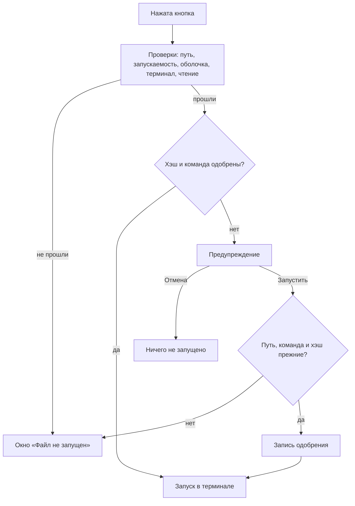
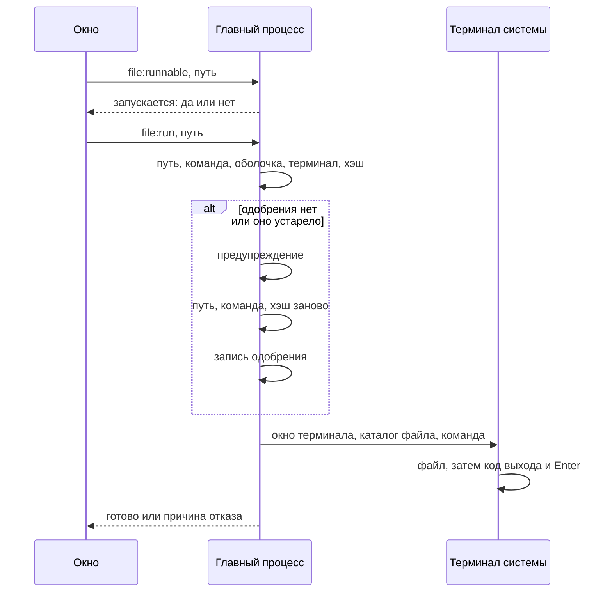

Скрипт или собранную программу из дерева можно запустить, не уходя в свой терминал и не набирая путь: открываете файл в просмотре и нажимаете «▶ Запустить в терминале». Файл выполнится в окне терминала вашей системы, в каталоге файла. Перед первым запуском каждого содержимого Cyborg показывает предупреждение и запоминает ваше согласие; если файл изменился (его мог переписать сессия Claude Code или чужой коммит), спросит снова.

## Что где

| Что | Где |
|---|---|
| Кнопка «▶ Запустить в терминале» | В шапке просмотра файла, левее «Открыть в системе». Подсказка: «Запустить файл в системном терминале». |
| Предупреждение «Запустить файл в терминале?» | Окно сообщений поверх Cyborg, кнопки «Отмена» и «Запустить» |
| Окно запуска | Окно терминала системы: Terminal.app на macOS, эмулятор из списка на Linux |
| Отказ | Окно «Файл не запущен» с причиной |
| Хранилище одобрений | `run-approvals.json` в [каталоге данных](/concepts/data/) |

## Как запустить

1. Откройте файл кликом по строке дерева. Клик только открывает просмотр: вопроса о запуске на сам клик нет.
2. Если файл запускается, в шапке просмотра появится кнопка «▶ Запустить в терминале». Нажмите её.
3. Если содержимое или команда запуска новые, откроется предупреждение. Прочтите путь и команду, нажмите «Запустить» или «Отмена». «Отмена» выбрана по умолчанию и срабатывает по `Esc`.
4. Откроется окно терминала. Файл выполняется в его каталоге. Когда он завершится, окно не закроется: в нём появятся пустая строка и «[Код выхода N] Нажмите Enter, чтобы закрыть окно».
5. `Ctrl+C` в этом окне прерывает файл, но не окно: вы увидите код выхода (130) и сможете прочесть вывод.

Если одобрение этого содержимого и этой команды уже есть, предупреждения нет: окно терминала открывается сразу.

### Когда кнопки нет

Кнопка появляется только у файла, который главный процесс признал запускаемым. Просмотр при этом не нужен: кнопка есть и у двоичного файла, который просмотр показать не может, и у файла больше 5 МБ.

Запускаемость определяется по порядку, берётся первое подходящее:

| Признак | Что запускается |
|---|---|
| У файла есть бит исполнения для вашего пользователя | Сам файл |
| Первая строка - `#!` | Интерпретатор из неё и файл |
| Расширение из таблицы ниже | Интерпретатор по расширению и файл |
| Ничего из этого, а также каталог | Не запускается, кнопки нет |

Расширения:

| Расширение | Интерпретатор |
|---|---|
| `.sh` | `bash` |
| `.py` | `python3` |
| `.js`, `.mjs`, `.cjs` | `node` |

Кнопки нет и в этих случаях:

- сессия удалённая ([запуск там не поддерживается](#удалённые-сессии));
- у файла негодный `#!` (интерпретатор не абсолютный путь, управляющие символы в строке, не UTF-8, нет конца строки в первых 256 байтах): по расширению такой файл тоже не запускается, чтобы явный `#!` не подменялся молча;
- в пути файла есть управляющие символы;
- система не macOS и не Linux.

Ссылка на файл судится по цели: цель вне репозиториев проекта и каталогов сессий - отказ, бит и содержимое берутся у файла, на который она указывает. «Открыть в системе» исполняемый файл (с битом исполнения, а также `.sh`, `.js` и ряд других расширений) не откроет, так же как путь из вывода сессии: для запуска есть эта кнопка.

## Предупреждение и одобрение

Окно показывает три строки и текст риска:

```text
Запустить файл в терминале?

Файл: /path/to/repo/scripts/build.sh
Каталог: /path/to/repo/scripts
Команда: bash /path/to/repo/scripts/build.sh

Файл выполнится с правами вашего пользователя и может изменить или удалить ваши данные. Запускайте только файл, которому доверяете.
```

Команда показана так, как её исполнит терминал (слова с пробелами и спецсимволами в кавычках для `sh`). Если у пути уже было одобрение, а содержимое или команда теперь другие, сверху добавлена строка «Файл изменён с прошлого одобрения: содержимое либо команда запуска уже не те.».

«Одобрение привязано к хэшу содержимого» значит следующее.

| Вопрос | Ответ |
|---|---|
| Что запоминается | Физический путь файла, SHA-256 его содержимого и команда запуска |
| Когда спросят снова | Содержимое изменилось; изменилась команда (например, сняли бит исполнения или появился другой `#!`); одобрено другое содержимое этого пути, а вы вернули прежнее |
| Когда не спросят | Путь, содержимое и команда те же: даже после перезапуска Cyborg или смены ветки, если файл по этому пути вернулся к одобренному содержимому. Переименованный файл - другой путь, одобрение для него новое |
| Срок | По времени одобрение не истекает. Хранится до 1000 одобрений, при переполнении вытесняется самое давнее |
| Где лежит | `run-approvals.json` в каталоге данных приложения, один файл на все воркспейсы: `~/Library/Application Support/cyborg` на macOS, `~/.config/cyborg` на Linux |
| Две ссылки на один файл | Делят одно одобрение: ключ - физический путь цели |
| Отозвать | Списка одобрений с отзывом в интерфейсе нет. Удалённый или повреждённый файл читается как пустой, и Cyborg спросит заново |

Если записать одобрение не удалось, файл всё равно запустится, а в следующий раз спросят снова.

## Как это устроено



Проверки идут в таком порядке: путь, платформа, «файл больше не запускается», оболочка, на macOS - обратная косая черта, на Linux - эмулятор, чтение файла. Все они срабатывают до предупреждения: одобрять запуск, который не выйдет, бессмысленно. Повторное нажатие, пока идёт запуск того же файла, ничего не делает.

Интерфейс получает от главного процесса только ответ «запускается или нет» и путь. Команду, хэш и одобрение ведёт главный процесс, и считает их по файлу на диске в момент нажатия. Поэтому то, что вы видите в предупреждении, и то, что запустится, определено одним процессом.



## Чем запускается

### macOS

Окно открывает Terminal.app командой `osascript` с постоянным сценарием: каталог и слова команды передаются ему отдельными аргументами, а не склеиваются в строку. Cyborg ждёт, пока `osascript` отработает (не дольше 120 секунд), и показывает его ошибку, если она есть: например, отказ в разрешении управлять Terminal.

Кавычение Terminal.app рассчитано на `sh`, поэтому каталог или слово команды с обратной косой чертой на macOS не запускаются.

### Linux

Эмулятор - первый найденный исполняемый файл по порядку: значение переменной `TERMINAL`, затем `x-terminal-emulator`, `gnome-terminal`, `konsole`, `xfce4-terminal`, `kitty`, `alacritty`, `wezterm`, `foot`, `xterm`.

- Имя без `/` ищется по абсолютным каталогам `PATH` самого Cyborg по порядку; значение `TERMINAL` с `/` принимается только абсолютным путём; ненайденное пропускается.
- `PATH` и `TERMINAL` берутся из окружения Cyborg с учётом окна «Окружение» (`Ctrl+Shift+E`), а не из логин-оболочки: если `TERMINAL` задан только в `~/.bashrc`, а Cyborg запущен из меню приложений, он его не увидит. Выберите `TERMINAL` в окне «Окружение», запускайте `./cyborg` из терминала или задайте переменную там, где её видит запускающий процесс.
- `x-terminal-emulator` обычно ссылка: форму передачи команды выбирают по имени программы, на которую она указывает.
- Команда передаётся эмулятору по элементам, а не одной строкой:

| Эмулятор | Как получает команду |
|---|---|
| `gnome-terminal` | после `--` |
| `xfce4-terminal` | после `-x` |
| `kitty`, `foot` | сразу, без ключа |
| `wezterm` | после `start --` |
| прочие | после `-e` |

Эмулятор запускается отдельным процессом, не зависящим от Cyborg.

### Общее для обеих систем

- Скрипт, который читает окно, написан на POSIX `sh`; на Linux его исполняет логин-оболочка пользователя (`$SHELL -lc`, а без `SHELL` - `/bin/bash`), на macOS - `/bin/sh` внутри окна Terminal.app.
- Рабочий каталог - каталог файла. Если к этому моменту он недоступен, в окне будет «Каталог недоступен: <путь>» и ожидание Enter.
- Из окружения убраны маркеры сессии Claude Code и переменные Cyborg, которые достались бы от сессии, запустившей Cyborg: файл не ведёт себя как её потомок.
- Переменные окружения запуска - те, что выбраны и сняты в окне «Окружение»: они доходят и до терминала с общим сервером (gnome-terminal, konsole, Terminal.app) через временный файл `env.sh`, а не через аргументы процесса. Файл лежит в `run-env/<pid>-<случайно>/` каталога данных приложения (каталог `0700`, файл `0600`), читающий скрипт удаляет его сразу, остаток стирают таймер на минуту, выход Cyborg и следующий запуск. Аргументов для запуска задать нельзя.

Подробности по платформам - в [macOS и Linux](/reference/platforms/).

## Что может не запуститься

| Ситуация | Что увидите | Причина |
|---|---|---|
| Файл без бита, `#!` и известного расширения, каталог | Кнопки нет | Файл не признан запускаемым |
| Удалённая сессия | Кнопки нет | Файл лежит на другой машине |
| Файл удалили после открытия просмотра | «Файл не запущен»: «Файл не найден» | Путь проверяется до всего остального |
| Ссылка ведёт за пределы репозиториев и каталогов сессий | «Файл не запущен»: «Путь вне репозиториев проектов и каталогов сессий» | Ссылка судится по цели |
| С файла сняли бит или переписали `#!`, пока просмотр был открыт | «Файл не запущен»: «Файл больше не запускается: <путь>» | Запускаемость определяется заново при нажатии |
| `$SHELL` - `fish`, `tcsh`, `csh`, `nu`, `xonsh`, `elvish` или `pwsh` | «Файл не запущен»: «Логин-оболочка <имя> не разбирает скрипт запуска (нужна оболочка семейства sh: bash, zsh, dash, ksh). Запустите файл из своего терминала.» | Скрипт запуска на `sh`; такая оболочка закрыла бы окно, ничего не исполнив. Проверка идёт до предупреждения, на обеих системах |
| macOS, обратная косая черта в каталоге или команде | «Файл не запущен»: «Путь или команда с обратной косой чертой на macOS не запускаются» | Кавычение Terminal.app рассчитано на `sh`; иная оболочка разобрала бы путь иначе |
| Linux, ни одного эмулятора | «Файл не запущен»: «Не найден эмулятор терминала. Искали в PATH: $TERMINAL, x-terminal-emulator, …, xterm. Задайте переменную окружения TERMINAL с именем или путём вашего терминала и перезапустите Cyborg.» | Нет ни `TERMINAL`, ни одного эмулятора из перечня в `PATH` Cyborg. Если `TERMINAL` задан, в скобках указано его значение |
| У файла нет права на чтение при выставленном бите | «Файл не запущен»: «Файл не прочитан: <код ошибки>» | Хэш посчитать нельзя, а без хэша одобрять нечего |
| Файл изменили, пока открыто предупреждение | «Файл не запущен»: «Файл изменился, пока вы решали: запуск отменён» | После согласия путь, команда и хэш считаются заново; одобрение не сохраняется |
| Эмулятор не стартовал либо `osascript` вернул ошибку | «Файл не запущен» с текстом ошибки | Запуск после согласия не удался |

Отмена предупреждения и успешный запуск окна не дают.

## Безопасность

| Cyborg проверяет | Как |
|---|---|
| Путь | Файл лежит внутри репозиториев проекта или каталогов сессий; символьная ссылка судится по цели; пути с `..` отвергаются |
| Содержимое | SHA-256 считается по файлу на диске и до предупреждения, и заново после согласия; расхождение - отказ |
| Команду | Показывается в предупреждении, входит в одобрение; смена бита или `#!` требует нового согласия |
| Оболочку | Только семейство `sh`: иначе отказ с названием оболочки |
| Подстановку в имени | Путь и слова команды доходят до оболочки аргументами постоянного скрипта, а не вписываются в текст команды: файл с пробелом, кавычкой, `$` или `;` в имени запускает именно этот файл |

Чего Cyborg не делает:

- не изолирует файл: он выполняется с правами вашего пользователя и может изменить или удалить ваши данные;
- не разбирает, что делает файл: одобрение значит «вы видели путь и команду», а не «файл безопасен»;
- не защищает от смены файла в окне между последней сверкой хэша и началом исполнения в терминале: оно короткое, и закрыть его без смены того, что видит запущенный файл, нельзя.

Одобряйте только то, чему доверяете: файлы репозитория меняют сессии Claude Code и чужие коммиты.

## Удалённые сессии

Во вкладке удалённой сессии кнопки нет: файл лежит на другом хосте, а запуск идёт в терминале вашей машины. Даже если вызвать запуск для такого пути, главный процесс его отвергнет: путь проверяется среди локальных репозиториев и каталогов сессий. О самих удалённых сессиях - [удалённые сессии](/features/remote/).

## Ограничения

- macOS и Linux. Windows не поддерживается.
- Таблица «расширение - интерпретатор» зашита в код; выбрать интерпретатор вручную нельзя.
- Нельзя передать файлу аргументы, выбрать терминал в интерфейсе или посмотреть и отозвать одобрения. Переменные окружения задаёт только окно «Окружение», на все запуски сразу.
- Запуска по ссылке-пути из вывода сессии нет.
- Терминал и вывод сессии Claude Code не затрагиваются: файл открывается в отдельном окне, своего терминала внутри Cyborg для него нет.
- Работа через настоящий Terminal.app автотестами не проверяется: тесты сверяют состав аргументов `osascript`.

## Если не работает

| Что видите | Что делать |
|---|---|
| Кнопки нет | Проверьте, что файл запускается: у него есть бит исполнения, `#!` с абсолютным путём интерпретатора или расширение из таблицы; сессия локальная |
| Отказ про оболочку | Cyborg читает `SHELL` из своего окружения. Запустите файл из своего терминала либо запускайте Cyborg из оболочки семейства `sh` |
| Не найден эмулятор на Linux | Задайте `TERMINAL` с именем или абсолютным путём вашего терминала в окружении, из которого запускаете Cyborg, и перезапустите его |
| На macOS окно не открылось и сообщение про разрешение | Разрешите Cyborg управлять Terminal в настройках системы и нажмите кнопку снова. Текст ошибки `osascript` показан в окне «Файл не запущен» |
| Спрашивает каждый раз | Содержимое или команда меняются между запусками (файл пишет сам себя, переключается ветка, меняется бит исполнения), либо `run-approvals.json` недоступен для записи |
| «Файл не прочитан» | Выдайте права на чтение файла: без него Cyborg не может посчитать хэш |

Решения и обоснование - ADR-0021 в репозитории.
